# 01 – Kommissionierung

Stand: Version 1.99.89 (IDEAL: Maske „Liste“ und summierter Auftragsdruck, Text; Fotos folgen), 1.99.79 (Hinweis „Altbestand geprüft“), 1.99.70 (Abschnitt „Weitere Knöpfe“, Hinweise) bzw. 1.99.58 · Standorte AKE und IDEAL · Bilder aus dem AKE-Testsystem (IDEAL-Bild extra gekennzeichnet)

## Zweck

Die Kommissionierung stellt die Bauteile eines Fertigungsauftrags (FA) bereit. Der **Leitstand** gibt einen FA frei; das WMS legt
dabei automatisch einen oder mehrere **Kommissionieraufträge** an (Nummer `KO-JJJJ-NNNNN`, je Kommissionierbereich einer: Lager, Glas,
Vorkommissionierung). Der Kommissionierer arbeitet seine Aufträge ab, bucht die Teile auf einen **Kommissionierwagen** um und schließt
den Auftrag ab – vollständig oder teilweise mit Folgeauftrag.

Sind alle Kommissionieraufträge eines FA abgeschlossen, gilt der FA als kommissioniert. Kommissionier-Umbuchungen gehen **nicht** an Sage.

## Wer darf

| Aufgabe | Rolle (wie unter *Stammdaten → Rollen*) |
|---|---|
| FA freigeben, Priorität vergeben, Kommissionierer zuweisen, Freigabe zurücknehmen | **Leitstand** |
| Kommissionieraufträge öffnen, Zeilen umbuchen, Auftrag abschließen, drucken | **Kommissionierer** |
| Bedarfsmeldung aus dem Auftrag („Bestellen“) | **Kommissionierer**, zusätzlich muss die Einstellung „Bedarfsmeldungen aus der Stückliste“ an sein |
| alles | **Administrator** |

Wer nur **Leitstand** hat (ohne Kommissionierer), sieht im Leitstand die Auftragsnummern als Links, kann sie aber **nicht** öffnen
(„Zugriff verweigert“). Wer beides braucht, bekommt beide Rollen.

**Einstellungen** (*Stammdaten → Einstellungen*, pflegt die WMS-Betreuung):

- **Leitstand** – an: Freigabe und Priorität über den Leitstand, die Freigabe legt die Kommissionieraufträge an. Aus: Der Kommissionierer
  wählt den FA aus einer Auswahlliste, beim Öffnen entstehen die Aufträge.
- **Kommissionierung mit Anwenderzuweisung** – an: Bei der Freigabe muss ein Kommissionierer gewählt werden; jeder sieht in der Liste
  zuerst nur seine eigenen Aufträge.
- **Kommissionier-Vorlauf** und **Vorkommissionier-Vorlauf** – wie viele Arbeitstage vor dem Termin ein Auftrag fällig wird.
- Als Kommissionierer wählbar sind nur Benutzer, bei denen in der Benutzerverwaltung **„Kommissionierer“** angehakt ist.

## Schritt für Schritt

### 1. Leitstand: FA freigeben (einzeln)

Menü **Leitstand → Kommissionierung**. Die Liste zeigt die offenen FAs mit Kommissionier-Termin („Komm.“), Status und ganz rechts die
Spalten **Freigabe** und **Kommissionierer**. Die Tabelle ist breit – ggf. nach rechts scrollen oder über das Zahnrad Spalten ausblenden.

1. Beim gewünschten FA auf **Freigeben** klicken.
2. Im Fenster **Kommissionier-Freigabe** den Kommissionierer wählen.
3. **Freigeben** klicken.

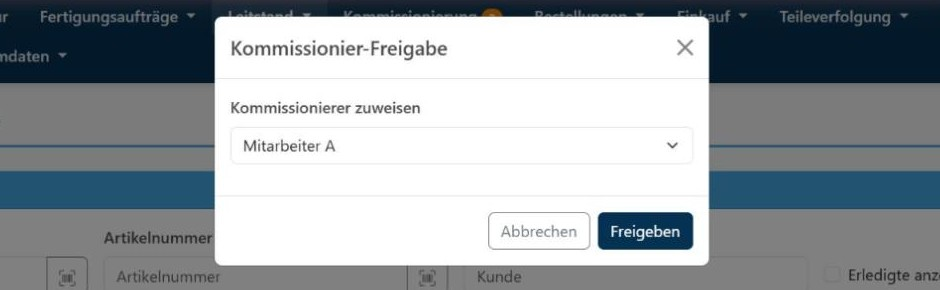

Oben erscheint eine grüne Meldung mit den angelegten Kommissionieraufträgen, z. B.:

Nach der Freigabe zeigt die Zeile:

- in **Status** die Aufträge des FA mit Bereich-Kürzel (L = Lager, G = Glas, VK = Vorkommissionierung) und Status,
- in **Freigabe** einen **grünen Haken** und daneben das Feld **Priorität** (1 = höchste),
- in **Kommissionierer** den zugewiesenen Namen (anklickbar zum Ändern).

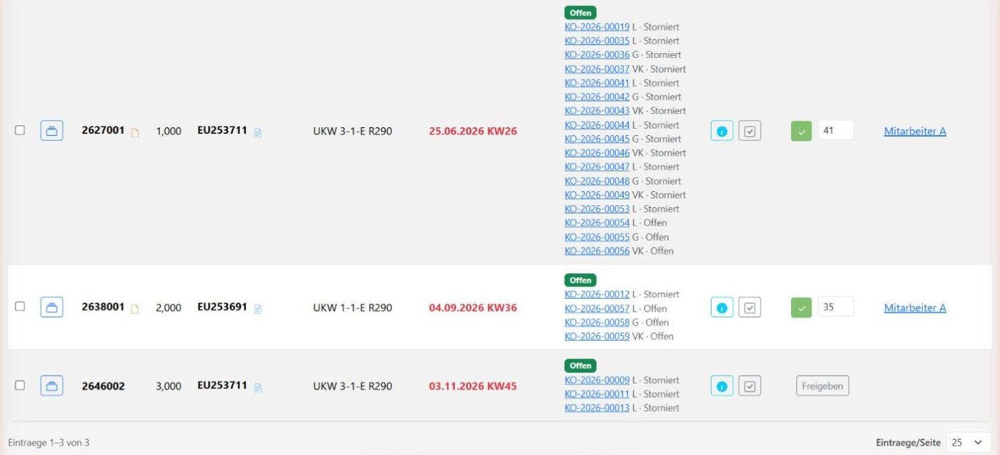

> **Achtung: Der grüne Haken ist ein Umschalter.** Ein Klick darauf nimmt die Freigabe **zurück** und storniert die Aufträge ohne
> Fortschritt. Siehe „Hinweise und Stolperfallen“.
>
> Seit Version 1.99.23 kann eine **veraltete** Leitstand-Seite (lange offen, ein Kollege hat inzwischen freigegeben oder zurückgenommen)
> nichts mehr ungewollt umschalten: Es erscheint „FA … ist bereits freigegeben – nichts geändert.“ bzw. „FA … ist nicht (mehr) freigegeben –
> nichts geändert.“ Eine Seite von vor dem Update meldet „Die Seite ist veraltet – bitte neu laden. Es wurde nichts geändert.“ Dann F5.

**Priorität:** Bei der Freigabe vergibt das WMS automatisch die nächste freie Nummer (höher als jede andere offene, auch als die von
zurückgenommenen Freigaben – deshalb kann die Zahl höher sein als alle sichtbaren). Ändern: Zahl ins Feld tippen, **Enter** oder
Feld verlassen. Zwei FAs dürfen bewusst dieselbe Priorität haben. Priorität und Kommissionierer am FA gelten auch für seine offenen
Kommissionieraufträge.

**Kein Kommissionierer vorhanden?** Ist in der Benutzerverwaltung niemand als Kommissionierer gekennzeichnet, zeigt das Fenster einen
gelben Hinweis „Kein Benutzer als Kommissionierer gekennzeichnet …“ und **Freigeben** bleibt gesperrt. Dann die WMS-Betreuung bitten,
den Haken „Kommissionierer“ beim Benutzer zu setzen.

### 2. Leitstand: Sammelfreigabe

1. In der ersten Spalte die Häkchen bei den gewünschten FAs setzen. Oben erscheint die Leiste **„n markiert“**.
2. **Markierte freigeben** klicken.

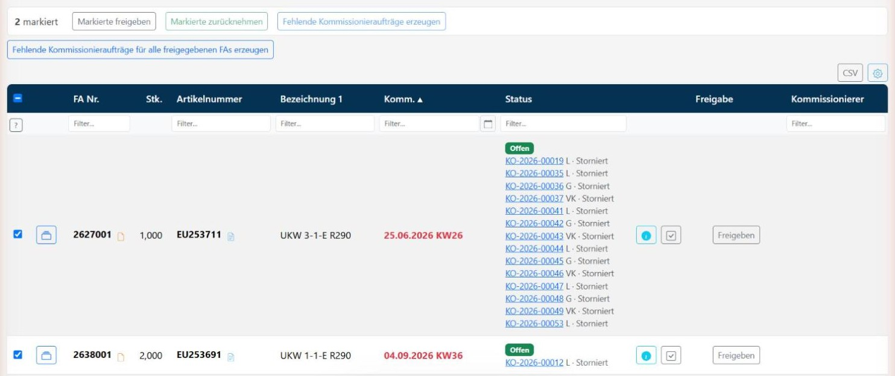

3. Im Fenster **Sammel-Freigabe** den Kommissionierer wählen und **Freigeben** klicken.

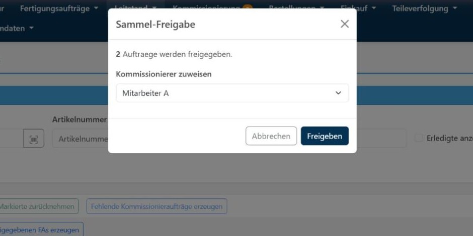

Jeder FA bekommt eine eigene Priorität (fortlaufend). Die Meldung nennt alle neuen Auftragsnummern. FAs ohne Stückliste werden gemeldet
(„… ohne Stückliste – kein Kommissionierauftrag“), FAs ohne Artikelnummer werden übersprungen.

Weitere Knöpfe in der Leiste:

- **Markierte zurücknehmen** – nimmt die Freigabe der markierten FAs zurück (wie Schritt 9).
- **Stücklisten-Nachträge legt der Dienst nachts an** (seit Version 1.99.70): Kommen nach der Freigabe Stücklistenpositionen dazu oder
  steigt eine Menge, entstehen die fehlenden Kommissionieraufträge einmal pro Nacht automatisch (Standard: ab 2 Uhr). Doppelte entstehen
  dabei nicht.
- **Fehlende Kommissionieraufträge erzeugen** und **„Fehlende Kommissionieraufträge für alle freigegebenen FAs erzeugen“** sehen seit
  Version 1.99.70 **nur noch Administratoren**. Sie machen sofort, was der nächtliche Lauf macht – nur für Notfälle.
- **Altbestand geprüft** (Knopf in der FA-Zeile bei „Altbestand prüfen“) legt die fehlenden Aufträge des FA sofort an, wenn der FA
  freigegeben ist. Klappt das Anlegen nicht, ist „Altbestand geprüft“ trotzdem gespeichert und ein gelber Hinweis erscheint – der
  nächtliche Lauf holt die Aufträge nach (seit 1.99.79).
- **⚠ Stückliste kleiner** (gelbes Badge in der FA-Zeile): Die Stückliste ist nach der Freigabe kleiner geworden als die offenen
  Kommissionierzeilen (Position entfallen oder Menge gesenkt). Der Tooltip nennt Artikel, Position, Stücklisten- und beauftragte Menge.
  Offene Zeilen werden **nicht** automatisch gekürzt – der Leitstand entscheidet (z. B. Auftrag zurücknehmen oder beim Abschluss
  „Vollständig“). Dieselbe Liste steht oben in der Stückliste des FA. Das Badge verschwindet nach dem nächsten Nachtlauf, wenn nichts
  mehr übersteht.

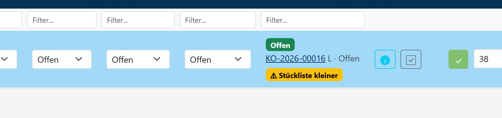

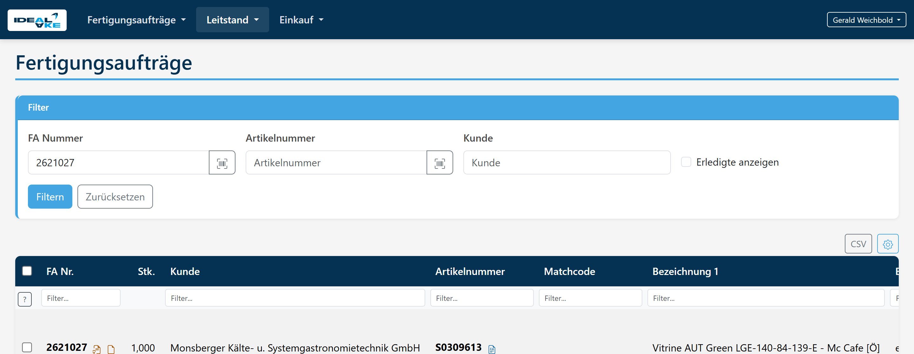

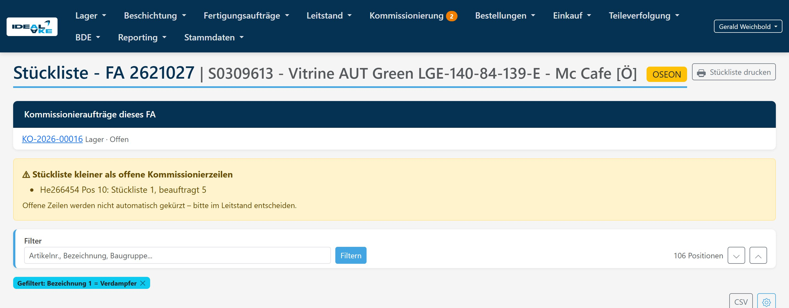

### 3. Kommissionierer: Auftragsliste

Menü **Kommissionierung**. Jede Zeile ist **ein** Kommissionierauftrag – ein FA kann also
mehrfach vorkommen (je Bereich einmal).

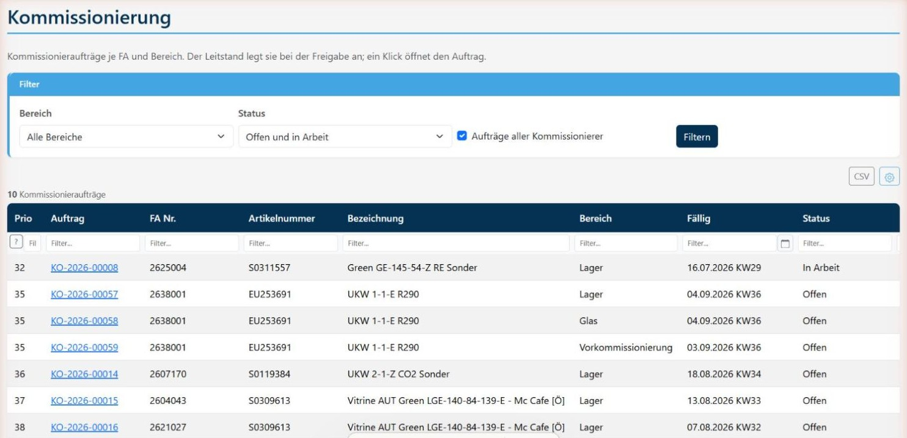

- **Filter Bereich:** nur Lager, nur Glas, nur Vorkommissionierung.
- **Filter Status:** „Offen und in Arbeit“ (Standard) oder „Alle (auch abgeschlossen, storniert)“.
- **Aufträge aller Kommissionierer:** ohne Haken sieht man nur die eigenen Aufträge (bei Anwenderzuweisung).
- **Spaltenfilter** unter den Spaltenköpfen, z. B. Auftrag, FA, Werkbank, Fällig (`kw36` = Kalenderwoche 36). Das **?** erklärt die Suchsyntax.
- **Fällig** ist der Kommissionier-Termin; Aufträge im Bereich *Vorkommissionierung* sind um den Vorkommissionier-Vorlauf früher fällig.
- Sortiert nach **Prio** (Aufträge ohne Prio am Ende).
- Mit dem Handscanner kann der Barcode eines ausgedruckten Auftrags in den Spaltenfilter **Auftrag** gescannt werden.

Klick auf die **KO-Nummer** öffnet den Auftrag.

### 4. Kommissionierauftrag öffnen

Oben stehen FA, Artikel und der Kasten **Kommissionierauftrag KO-… · Bereich · Status**. Darunter die Zeilen des Auftrags als Stückliste.

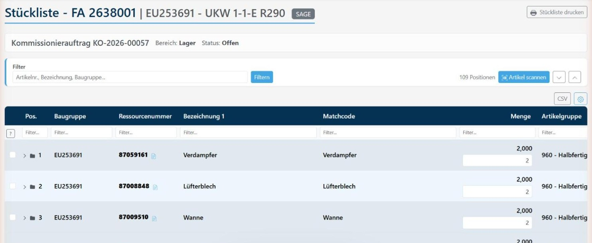

- **Baugruppen** (Ordner-Symbol) lassen sich mit **›** aufklappen, die Pfeile rechts oben klappen alle auf bzw. zu.
- „**n Positionen**“ zeigt, wie viele Zeilen der Auftrag hat.
- **Artikel scannen:** Barcode eines Bauteils scannen – die passende Zeile wird angehakt. Ist der Artikel nicht im Auftrag, erscheint
  „Artikel nicht gefunden“ mit der Möglichkeit, gleich den nächsten zu scannen.
- Steht oben ein blaues Kästchen **„Gefiltert: …“**, wirkt ein persönlicher Standardfilter (aus dem Profil). Mit dem **×** im Kästchen
  wird er für diese Seite aufgehoben.

#### IDEAL: Maske „Liste“ (summiert je Artikel)

Sind die Kommissionierlisten eingeschaltet, öffnet der Auftrag bei IDEAL in der Maske **Liste**. Oben im Auftrag wechselt
**Stückliste | Liste** zwischen beiden Masken (die aktive trägt einen Haken; beim nächsten Öffnen kommt wieder die Liste).

- Eine Zeile je **Artikel und Kommissionierziel**; Baugruppen stehen getrennt (Kennzeichen **BG**). **Menge Soll** ist die Summe aller
  Positionen, die Spalte **Pos.** nennt sie alle (z. B. „9, 10“).
- Sortiert nach Kommissionierziel, Hauptlagerplatz und Position – so geht man die Ziele und Lagerplätze der Reihe nach ab.
- **bereits gebucht x** zeigt, was schon umgebucht ist. Der Hinweis **„⚠ Rest … aus Pos. … geht beim Abschluss in den Folgeauftrag“** nennt
  Reste teilgebuchter Positionen. Ganz umgebuchte Zeilen sind grau mit „✓ gepickt“.
- Zeilen mit **„ohne Stückliste“** gehören zum Auftrag, ihre Position fehlt aber in der aktuellen Stückliste (oben gelb gemeldet).
- **Umbuchen direkt in der Liste:** Haken setzen (oder Artikel scannen), **Ist-Menge** prüfen – vorbelegt ist das noch offene Soll aller
  Positionen der Zeile –, **Quell-Lagerplatz** wählen, unten den Ziel-Lagerplatz (Wagen) wählen und **„Gepickte Artikel umbuchen“**.
  Die Ist-Menge wird in Positionsreihenfolge verteilt, jede Position bis zu ihrem Soll. Beispiel Pos. 10 Soll 3 und Pos. 20 Soll 2:
  Ist 5 → 3 und 2; Ist 4 → 3 und 1 (Pos. 20 teilgeliefert, der Rest geht beim Abschluss in den Folgeauftrag); Ist 2 → nur Pos. 10 mit 2,
  Pos. 20 bleibt offen. Mehr als das offene Soll wird abgelehnt („größer als offenes Soll“).
- Gebucht wird **alles oder nichts**: Fehlt an einer Position Bestand, wird gar nichts gebucht. Hat inzwischen jemand anderes umgebucht,
  kommt „… bitte Seite neu laden“ – Seite neu laden und nochmals buchen.
- Bestellen und Lagerbestellung gibt es nur in der Maske „Stückliste“.
- Wer Haken gesetzt oder Ist-Mengen geändert hat und umschaltet, wird vorher gefragt – ungespeicherte Eingaben gehen sonst verloren.
- Die Liste hat eine eigene Spaltenauswahl (Zahnrad), unabhängig von der Stückliste.

### 5. Zeilen anhaken, Ist-Menge und Quell-Lagerplatz prüfen

1. Bei jedem geholten Teil das Häkchen setzen (oder Artikel scannen). Die Zeile wird grün; noch ist **nichts** gebucht.
2. **Ist-Menge** prüfen (Spalte **„Menge IST“** rechts neben „Menge“, seit 1.99.58). Vorbelegt ist die Soll-Menge. Wurde weniger geholt, die tatsächliche Menge
   eintragen (größer 0, höchstens Soll).
3. **Quell-Lagerplatz** prüfen (Spalte ganz rechts). Vorgeschlagen wird der Hauptlagerplatz, sonst der buchbare Platz mit der
   größten Menge, sonst `NAN` (Platz für Negativbuchungen, wenn kein Bestand gebucht ist).

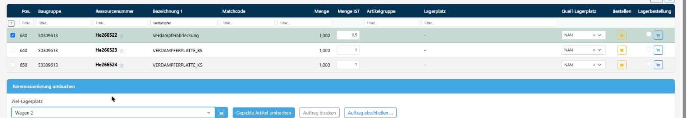

### 6. Auf den Kommissionierwagen umbuchen

Unten im Kasten **Kommissionierung umbuchen**:

1. **Ziel-Lagerplatz** = Kommissionierwagen wählen (oder den Barcode des Wagens mit dem Scan-Knopf daneben scannen).
2. **Gepickte Artikel umbuchen** klicken – **einmal**.

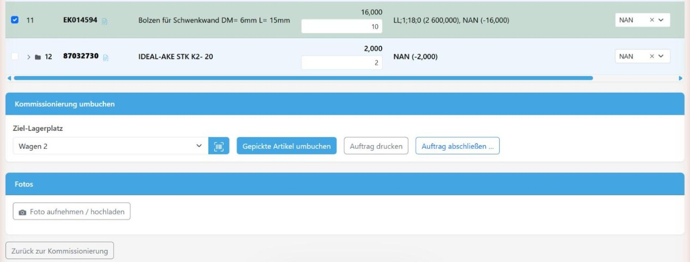

Liegen auf dem Wagen schon Teile eines **anderen** FA, fragt das WMS nach:

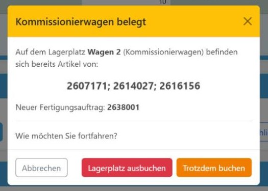

- **Abbrechen** – nichts wird gebucht, anderen Wagen wählen.
- **Lagerplatz ausbuchen** – öffnet die Ausbuchung des Wagens (für einen Wagen, der eigentlich leer sein sollte; nur für
  Lager-Keyuser und Administratoren). Ausgebucht werden nur die Artikel der vorbelegten FA; Artikel ohne FA bleiben am Wagen.
  Feld leeren = alles ausbuchen (siehe [Anleitung 09, Abschnitt 5](09-einbuchen-ausbuchen-umbuchen.md)).
- **Trotzdem buchen** – bucht zusätzlich auf den Wagen; die FA-Nummern am Wagen werden zusammengeführt.

### 7. Auftrag abschließen: Vollständig, Teilweise oder weiter

Nach dem Umbuchen erscheint **Kommissionierung Status** (jederzeit auch über **Auftrag abschließen …** erreichbar):

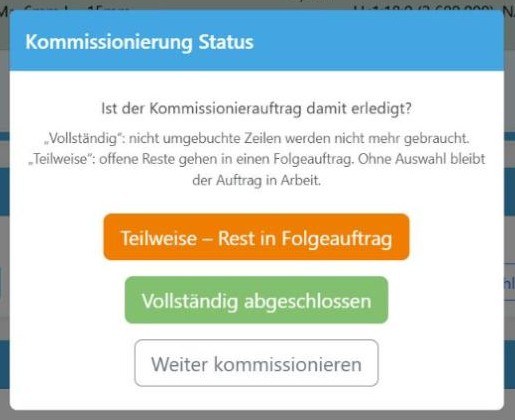

- **Teilweise – Rest in Folgeauftrag:** Was noch fehlt (nicht umgebuchte Zeilen und Restmengen), kommt in einen **neuen** Auftrag mit
  eigener Nummer („Rest aus KO-…“). Beispiel: Soll 16, Ist 10 → Folgeauftrag mit Soll 6.
- **Vollständig abgeschlossen:** Der Auftrag ist fertig. **Nicht umgebuchte Zeilen gelten als „nicht gebraucht“** und werden nicht
  mehr kommissioniert.
- **Weiter kommissionieren:** Der Auftrag bleibt „In Arbeit“, die Seite lädt neu.

Nach dem Klick ist der Knopf kurz gesperrt („wird gesendet …“, höchstens 10 Sekunden). Ein zweiter Abschluss desselben Auftrags (Doppelklick,
zweites Gerät) ändert nichts und meldet „Auftrag … ist bereits … – nichts geändert.“ (seit Version 1.99.23).

Nach „Teilweise“ meldet die Liste die neue Nummer:

Im Leitstand steht der FA dann auf **Teilkomm.** (teilkommissioniert), bis alle seine Aufträge abgeschlossen sind:

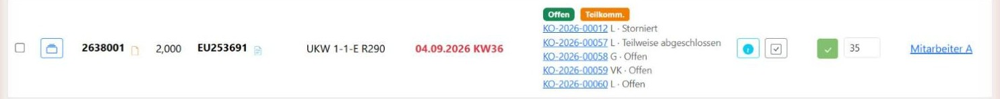

Ein FA gilt erst als kommissioniert, wenn **alle** seine Aufträge (Lager, Glas, Vorkommissionierung, Folgeaufträge) abgeschlossen sind.

### 8. Auftrag drucken

Auf der Auftragsseite **Auftrag drucken** öffnet eine Druckansicht in einem neuen Fenster (oben **Drucken** und **Schließen**).

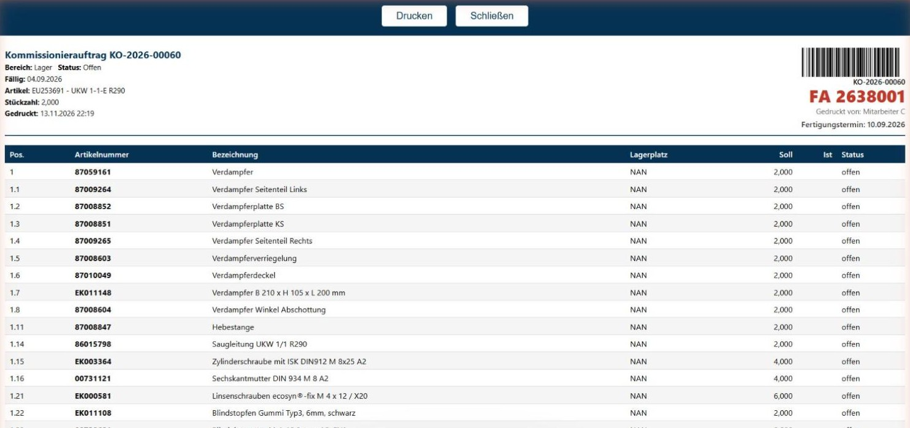

- Kopf: Auftragsnummer, Bereich, Status, Fällig, Artikel, Stückzahl, Barcode der Auftragsnummer, FA, Fertigungstermin.
- Zeilen: Position, Artikelnummer, Bezeichnung, **Lagerplatz** (umgebuchte Zeilen: tatsächlicher Quell-Platz; offene: Vorschlag),
  Soll, Ist, Status (z. B. „offen“, „gepickt“, „in Folgeauftrag“).
- Gedruckt werden **immer alle Zeilen** des Auftrags, auch wenn auf der Seite ein Filter aktiv ist. Ist die Seite nach einer Spalte
  sortiert, druckt er in dieser Reihenfolge.
- **IDEAL, Maske „Liste“:** „Auftrag drucken“ druckt **summiert** („Kommissionierauftrag … (summiert)“, Banner „Summierte Ansicht“) –
  eine Zeile je Artikel und Kommissionierziel, genau mit den in der Liste eingeblendeten Spalten, in der Reihenfolge der Liste.
  Daneben lädt **PDF** dasselbe Dokument als PDF-Datei (nur sichtbar, wenn die PDF-Erzeugung eingerichtet ist).

### 9. Fehlteile: Bedarfsmeldung aus dem Auftrag

Fehlt ein Teil, kann direkt aus dem Auftrag eine **Bedarfsmeldung** erstellt werden (nur wenn die Einstellung „Bedarfsmeldungen aus der
Stückliste“ an ist):

1. In der Zeile auf den orangen **Einkaufswagen** (Spalte „Bestellen“) klicken – oder mehrere Zeilen anhaken und oben
   **Ausgewählte bestellen** wählen.
2. Menge, Priorität (Normal, Dringend, Eilt) und optional eine Bemerkung eingeben.
3. **Bestellen** klicken.

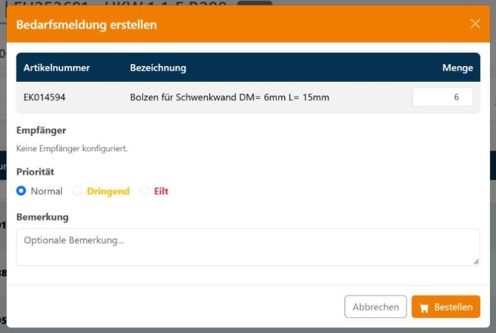

Die Meldung erscheint unter **Bestellungen → Bedarfsmeldungen** und wird an die Empfängergruppe der Artikelgruppe gemeldet. Eine schon
bestellte Zeile trägt ein oranges Symbol (Maus darüber: wann und von wem). Mehr dazu in [Anleitung 04](04-bedarfsmeldung.md).

### 10. Freigabe zurücknehmen

Im Leitstand beim FA auf den **grünen Haken** klicken (oder mehrere markieren und **Markierte zurücknehmen**).

- Aufträge **ohne** gepickte oder umgebuchte Zeile werden **storniert**.
- Aufträge **mit** Fortschritt bleiben bestehen; die Meldung nennt sie („… bleiben bestehen – bitte klären“). Sie stehen weiter in der
  Liste Kommissionierung. Bereits umgebuchte Teile bleiben auf dem Wagen.
- Der FA behält seine Priorität. Wird er wieder freigegeben, steht er wieder an seinem Platz.

## Unterschiede AKE und IDEAL

| | AKE | IDEAL |
|---|---|---|
| Aufbau | Jeder FA ist für sich (flach). | FAs sind hierarchisch: ein **HauptFA** mit vielen Sub-FAs. |
| Freigabe, Priorität, Sammelauswahl | an jedem FA | **nur am HauptFA**; Sub-FA-Zeilen haben keine Knöpfe. Ein Sub-FA in der Sammelauswahl wird übersprungen und gemeldet („Übersprungen (Sub-FA …)“). |
| Kommissionierauftrag | enthält die Stückliste des FA | enthält die **komplette Struktur** des HauptFA |
| Kommissionierlisten | – | zusätzlich Menü **Kommissionierung → Kommissionierlisten** (summiert nach Kommissionier-Ziel, mit Abteilung und Lagerplätzen). Seit Version 1.99.43 stehen dort **nur im Leitstand freigegebene** HauptFAs – wer dort etwas vermisst, prüft zuerst die Freigabe (Schritt 1). Anleitung: [Kapitel 16](16-ideal-kommissionierliste.md) |

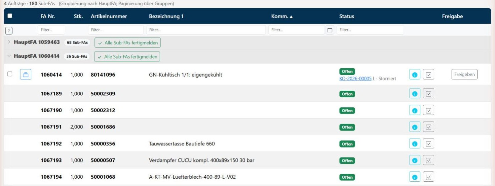

## Hinweise und Stolperfallen

**Bekannte Fehler (Stand 16.11.2026, Version 1.99.29):**

- ~~Knöpfe nur einmal drücken~~ – **behoben seit Version 1.99.23.** Doppelklick oder zwei Personen gleichzeitig auf **Freigeben**,
  **Teilweise** oder **Vollständig** ergeben genau ein Ergebnis; der zweite Versuch meldet „… bereits … – nichts geändert.“ statt einer Fehlerseite.
- ~~Grüner Haken = Zurücknehmen auf veralteter Seite~~ – **behoben seit Version 1.99.23** (siehe Kasten in Schritt 2). Auf einer aktuellen Seite
  nimmt ein Klick auf den grünen Haken die Freigabe weiterhin bewusst zurück.
- ~~Unterpositionen nicht sichtbar~~ – **behoben seit Version 1.99.23:** Zeilen, deren Baugruppe in einem anderen Auftrag liegt, stehen jetzt auf
  der Auftragsseite. **Offen bleibt:** Eine Auftragszeile, die in der **aktuellen** Stückliste nicht mehr vorkommt (Stückliste nach der Freigabe
  geändert), fehlt weiter still auf der Auftragsseite. Nennt „n Positionen“ mehr Zeilen, als zu sehen sind: **„Auftrag drucken“** (der Druck
  enthält alle Zeilen), **nicht „Vollständig“** drücken und den Leitstand informieren.
- **„Vollständig“ fragt nicht nach.** Ein Klick auf „Vollständig abgeschlossen“ ohne eine einzige Umbuchung setzt alle Zeilen auf
  „nicht gebraucht“ und kann den FA als kommissioniert melden. Es gibt keinen Rückweg in der Oberfläche.
- **Haken „Als erledigt markieren“ im Leitstand** (Kästchen-Symbol neben dem **i**): Er setzt den FA auf „Komm. erledigt“, **ohne** die
  offenen Kommissionieraufträge abzuschließen – sie verschwinden still aus der Liste. Nicht verwenden, solange Aufträge offen sind.
- **Sammelfreigabe ändert den Kommissionierer bestehender Aufträge nicht.** Wird ein schon freigegebener FA erneut über die Sammelfreigabe
  mit einem anderen Kommissionierer freigegeben, behalten seine Aufträge den alten. Kommissionierer stattdessen über den Namen in der
  Spalte **Kommissionierer** ändern.
- **Fälligkeit im Druck (Vorkommissionierung):** Hat eine Werkbank eigene Vorkommissioniertage, kann das Datum „Fällig“ auf dem
  Ausdruck von der Liste abweichen. Maßgeblich ist die Liste.

**Allgemein:**

- **IDEAL – Freigabe auch für die Kommissionierliste:** Seit Version 1.99.43 erscheint ein HauptFA in den **Kommissionierlisten** erst nach der
  Freigabe im Leitstand. Wird die Freigabe zurückgenommen, verschwindet er dort wieder (siehe [Kapitel 16](16-ideal-kommissionierliste.md)).
- Erst **„Gepickte Artikel umbuchen“** bucht. Häkchen und Ist-Mengen allein speichern nichts – vor dem Verlassen der Seite umbuchen.
- Kommissionierwagen erscheinen nicht in der Bestandsspalte der Stückliste und nicht als Quell-Lagerplatz.
- Ein Wagen, der wieder leer sein soll, wird über **Lager → Lagerplatz umbuchen** (z. B. Wagen → Lager) oder **Lager → Lagerplatz
  ausbuchen** geleert (beides nur für Lager-Keyuser und Administratoren).
- Wird nach der Freigabe die Stückliste in Sage ergänzt, entstehen die zusätzlichen Zeilen seit Version 1.99.70 **in der folgenden
  Nacht** (Dienst-Lauf „Kommissionier-Nachtrag“) – nicht sofort. Eilt es, kann ein Administrator im Leitstand „Fehlende
  Kommissionieraufträge erzeugen“ klicken.
- Ein FA mit dem Häkchen **Glas** im Leitstand bekommt nur dann einen Glas-Auftrag, wenn für die Glasteile eine Zuordnungsregel gepflegt
  ist (siehe Anleitung 02).
- Zeigt das Bedarfsmeldungs-Fenster „**Keine Empfänger konfiguriert**“, wird die Meldung zwar gespeichert, aber für diese Artikelgruppe ist
  keine Empfängergruppe hinterlegt. Bitte Einkauf bzw. Leitstand direkt informieren.

## Häufige Fragen

**Warum hat mein FA drei Kommissionieraufträge?**
Weil seine Stücklistenzeilen in drei Bereiche fallen (Lager, Glas, Vorkommissionierung). Jeder Bereich hat seinen eigenen Auftrag, damit
er von der zuständigen Stelle und zum richtigen Termin kommissioniert wird.

**Ich sehe meine Aufträge nicht.**
Haken **„Aufträge aller Kommissionierer“** setzen und **Filtern**. Prüfen, ob der Status-Filter auf „Offen und in Arbeit“ steht und kein
Spaltenfilter gesetzt ist. Ist der FA im Leitstand nicht freigegeben, gibt es keinen offenen Auftrag.

**Wo finde ich einen abgeschlossenen oder stornierten Auftrag?**
Liste Kommissionierung, Status **„Alle (auch abgeschlossen, storniert)“**. Im Leitstand stehen alle Aufträge eines FA in der Spalte Status.

**Ich habe zu viel umgebucht.**
Eine Umbuchung lässt sich in der Kommissionierung nicht rückgängig machen. Die Teile per **Lager → Umbuchung** vom Wagen zurück auf den
Lagerplatz buchen.

**Was bedeutet `NAN` als Lagerplatz?**
Für dieses Teil ist im WMS kein buchbarer Bestand gebucht. Die Umbuchung erfolgt dann vom Platz NAN (negativer Bestand). Wenn das Teil
tatsächlich im Lager liegt, besser den richtigen Quell-Lagerplatz auswählen; sonst bitte dem Lager melden.

**Darf ich die Priorität doppelt vergeben?**
Ja. Zwei FAs mit gleicher Zahl sind gleich dringend.

**Ein Kollege hat einen Auftrag teilweise abgeschlossen – wo ist der Rest?**
Im Folgeauftrag mit neuer KO-Nummer (Bemerkung „Rest aus KO-…“). Er steht in der Liste Kommissionierung und im Leitstand beim FA.

**Was passiert, wenn Sage den FA als verpackt oder abgeholt meldet?**
Der FA wird automatisch als „Komm. erledigt“ markiert und verschwindet aus Leitstand und Liste. Ob dabei noch offene Aufträge bestehen,
bitte beim Leitstand nachfragen.
