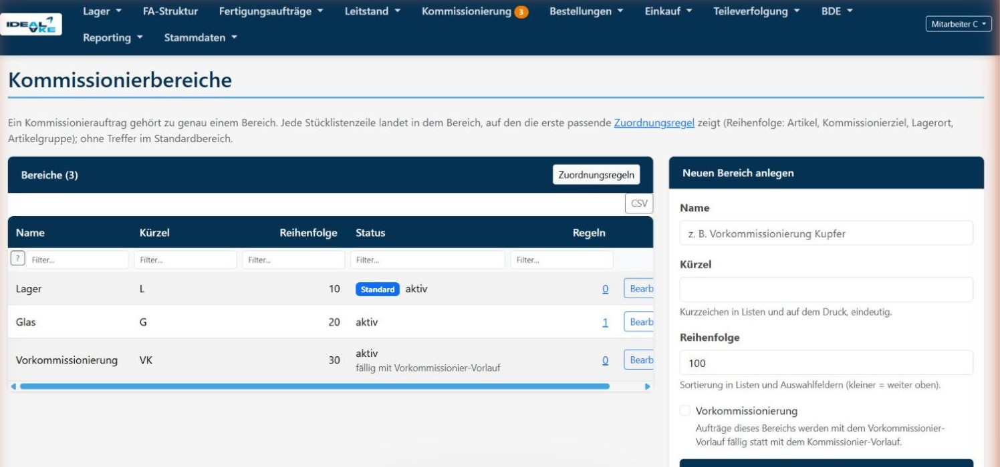
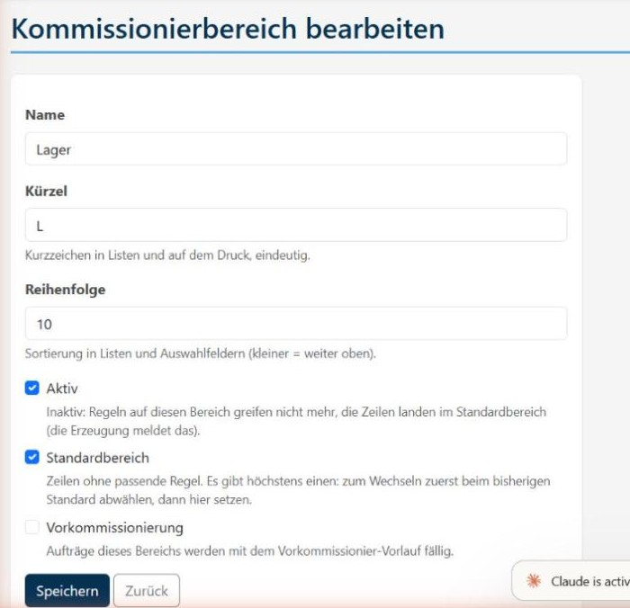
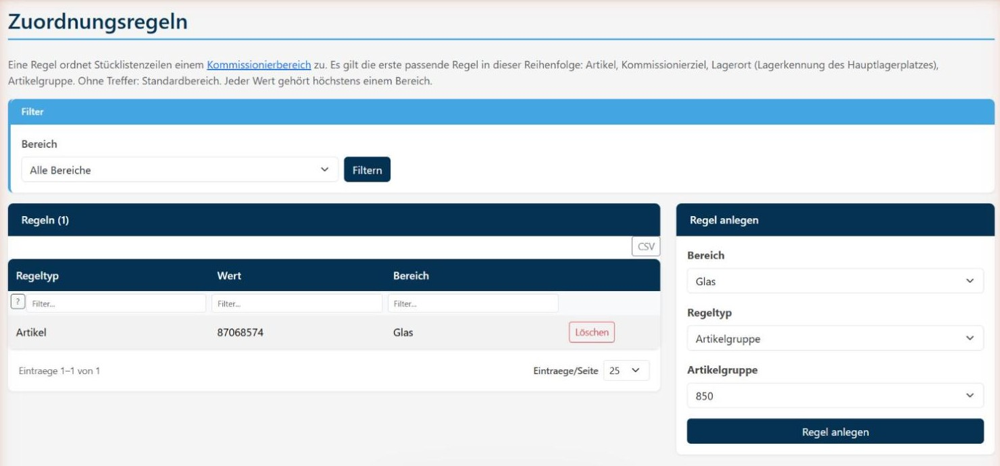

# 02 – Kommissionierbereiche

Stand: Version 1.99.22 · Standorte AKE und IDEAL · Bilder aus dem AKE-Testsystem

## Zweck

Ein **Kommissionierbereich** legt fest, *wer* und *wann* Teile kommissioniert: z. B. **Lager**, **Glas** und **Vorkommissionierung**.
Bei der Freigabe eines FA verteilt das WMS jede Stücklistenzeile auf einen Bereich und legt **je Bereich einen Kommissionierauftrag**
an (siehe [Anleitung 01](01-kommissionierung.md)). Welche Zeile in welchen Bereich kommt, bestimmen die **Zuordnungsregeln**. Zeilen
ohne passende Regel landen im **Standardbereich** (normalerweise „Lager“).

## Wer darf

| Aufgabe | Rolle (wie unter *Stammdaten → Rollen*) |
|---|---|
| Bereiche und Regeln ansehen | **Stammdaten ansehen** |
| Bereiche anlegen und ändern, Regeln anlegen und löschen | **Stammdaten** |
| alles | **Administrator** |

Mit „Stammdaten ansehen“ sind die Listen sichtbar, die Knöpfe zum Ändern fehlen.

Die Fälligkeit hängt an zwei Einstellungen (*Stammdaten → Einstellungen*): **Kommissionier-Vorlauf** (Arbeitstage vor dem FA-Termin)
und **Vorkommissionier-Vorlauf** (zusätzliche Arbeitstage für Bereiche mit Haken „Vorkommissionierung“; je Werkbank abweichend
einstellbar).

## Schritt für Schritt

### 1. Bereiche ansehen

Menü **Stammdaten → Kommissionierbereiche**.

- **Kürzel** erscheint in Listen und auf dem Druck (z. B. im Leitstand „KO-2026-00057 L · Offen“).
- **Status:** „Standard“ (blaues Kennzeichen), „aktiv“/„inaktiv“, bei Vorkommissionierung „fällig mit Vorkommissionier-Vorlauf“.
- **Regeln:** Anzahl der Zuordnungsregeln; ein Klick auf die Zahl öffnet die Regeln dieses Bereichs.

### 2. Neuen Bereich anlegen

Rechts im Kasten **Neuen Bereich anlegen**:

1. **Name** (eindeutig) und **Kürzel** (kurz, eindeutig) eintragen.
2. **Reihenfolge**: kleinere Zahl = weiter oben in Listen und Auswahlfeldern.
3. **Vorkommissionierung** anhaken, wenn die Aufträge dieses Bereichs um den Vorkommissionier-Vorlauf **früher** fällig sein sollen.
4. **Bereich anlegen**.

Neue Bereiche sind aktiv und **nicht** Standard. Ohne Zuordnungsregel bekommt ein neuer Bereich keine Zeilen.

### 3. Bereich bearbeiten

In der Liste auf **Bearbeiten** klicken (Tabelle ggf. nach rechts scrollen).

- **Aktiv** abwählen: Regeln auf diesen Bereich greifen nicht mehr; die Zeilen landen im Standardbereich (die Erzeugung meldet das).
  Bereits angelegte Aufträge bleiben in diesem Bereich.
- **Standardbereich**: siehe nächster Schritt.
- **Speichern**.

### 4. Standardbereich wechseln

Es gibt **höchstens einen** Standardbereich, und er muss aktiv sein. Wer einen zweiten als Standard speichert, bekommt
„Es gibt bereits einen Standardbereich („…“). Zuerst dort abwählen.“ – es wird nichts gespeichert.

Wechsel in zwei Schritten, **möglichst ohne Pause dazwischen**:

1. Beim bisherigen Standard **Bearbeiten**, Haken **Standardbereich** entfernen, **Speichern**. Es erscheint die Warnung
   „Es gibt jetzt keinen aktiven Standardbereich …“.
2. Sofort beim neuen Bereich **Bearbeiten**, Haken **Standardbereich** setzen, **Speichern**.

Siehe Stolperfalle „Zeit ohne Standardbereich“ unten.

### 5. Zuordnungsregeln pflegen

Über **Zuordnungsregeln** (Knopf in der Bereichsliste) oder die Regel-Zahl eines Bereichs.

Regel anlegen:

1. **Bereich** wählen.
2. **Regeltyp** wählen:
   - **Artikel** – ein bestimmter Artikel (über „Artikel suchen“).
   - **Kommissionierziel** – alle Zeilen mit diesem Kommissionierziel aus der Stückliste (IDEAL; an AKE trägt die Stückliste kein
     Kommissionierziel).
   - **Lagerort** – alle Artikel, deren Hauptlagerplatz diese Lagerkennung hat. Greift nur, wenn beim Hauptlagerplatz eine Lagerkennung
     gepflegt ist.
   - **Artikelgruppe** – alle Artikel einer Artikelgruppe.
3. Wert aus der Auswahl wählen (nur vorhandene Werte sind möglich).
4. **Regel anlegen**. Meldung z. B. „Regel Artikelgruppe „850“ angelegt.“

**Welche Regel gewinnt?** Die erste passende in der Reihenfolge **Artikel → Kommissionierziel → Lagerort → Artikelgruppe**. Eine
Artikel-Regel schlägt also eine Artikelgruppen-Regel. Passt keine Regel: Standardbereich.

**Jeder Wert gehört höchstens einem Bereich.** Dieselbe Artikelgruppe einem zweiten Bereich zuordnen ergibt
„… ist schon dem Bereich … zugeordnet.“

Regel entfernen: in der Liste **Löschen**.

Regeln wirken auf **neu angelegte** Kommissionieraufträge (Freigabe, „Fehlende Kommissionieraufträge erzeugen“). Bestehende Aufträge
werden nicht umsortiert; ein Folgeauftrag („Teilweise“) bleibt im Bereich seines Ursprungsauftrags.

## Unterschiede AKE und IDEAL

- Beide Standorte haben dieselbe Maske und dieselben drei Startbereiche (Lager als Standard, Glas, Vorkommissionierung).
- Der Regeltyp **Kommissionierziel** ist nur an IDEAL sinnvoll (FA-Struktur mit Kommissionierziel).
- **AKE, Glas:** Das Häkchen **Glas** am FA im Leitstand erzeugt **keinen** Glas-Auftrag. Glasteile kommen nur dann in den Bereich Glas,
  wenn für sie eine Regel gepflegt ist (Artikel, Artikelgruppe oder Lagerort). Welche Regeln je Standort gelten sollen, bitte mit dem
  Leitstand abstimmen.

## Hinweise und Stolperfallen

**Bekannte Fehler (Stand 14.11.2026, Behebung geplant):**

- **Zeit ohne Standardbereich.** Zwischen „Standard abwählen“ und „neuen Standard setzen“ gibt es keinen Standardbereich. Gibt der
  Leitstand genau in dieser Zeit einen FA frei, wird der FA zwar freigegeben, bekommt aber **keinen** Kommissionierauftrag (nur der
  Freigebende sieht die Meldung „Kein aktiver Standardbereich …“). Deshalb: Standard nur in einer ruhigen Zeit wechseln, vorher dem
  Leitstand Bescheid geben, beide Schritte direkt nacheinander. Danach im Leitstand **„Fehlende Kommissionieraufträge für alle
  freigegebenen FAs erzeugen“** klicken.
- **Löschen fragt nicht nach.** Ein Klick auf **Löschen** entfernt die Regel sofort und endgültig. Vorher genau prüfen.
- **Deaktivieren warnt nicht.** Ein Bereich mit offenen Aufträgen lässt sich ohne Hinweis deaktivieren. Die offenen Aufträge bleiben
  bestehen; neue Zeilen gehen in den Standardbereich.
- **Druck-Fälligkeit Vorkommissionierung:** Hat eine Werkbank eigene Vorkommissioniertage, kann das Fälligkeitsdatum auf dem Ausdruck
  von der Liste Kommissionierung abweichen. Maßgeblich ist die Liste.

**Allgemein:**

- Name und Kürzel müssen eindeutig sein („Bereich nicht angelegt: Name „Lager“ ist schon vergeben.“).
- Der Standardbereich kann nicht deaktiviert werden („Der Standardbereich muss aktiv sein.“).
- Eine Regel auf einen **inaktiven** Bereich wird übergangen; die Zeile landet im Standardbereich, und die Erzeugung meldet das.

## Häufige Fragen

**Ich habe eine Regel angelegt, aber der Auftrag ist noch im Lager.**
Regeln gelten nur für neu angelegte Aufträge. Für einen schon freigegebenen FA bitte beim Leitstand nachfragen (Freigabe zurücknehmen und
neu freigeben storniert nur Aufträge ohne Fortschritt).

**Warum fällt ein Teil nicht in den Bereich seiner Artikelgruppe?**
Wahrscheinlich gibt es eine Regel mit höherem Vorrang (Artikel, Kommissionierziel oder Lagerort), oder der Zielbereich ist inaktiv.

**Kann ich einen Bereich löschen?**
Nein, die Maske kennt kein Löschen, nur Deaktivieren (Haken „Aktiv“ entfernen).

**Wofür ist die Reihenfolge?**
Nur für die Anzeige: Sortierung in Listen und Auswahlfeldern.
