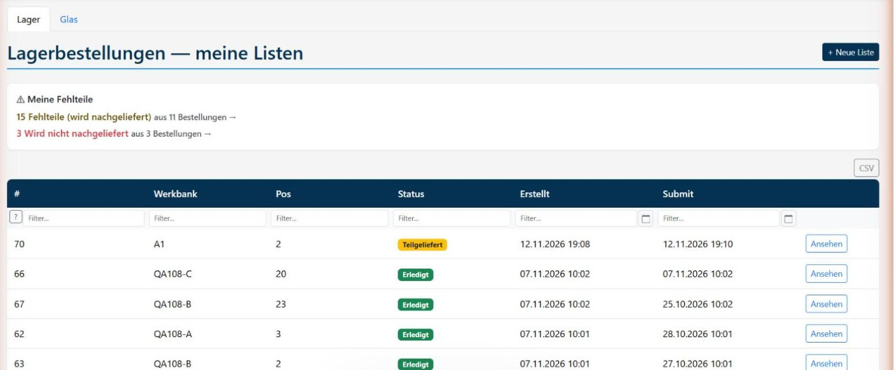
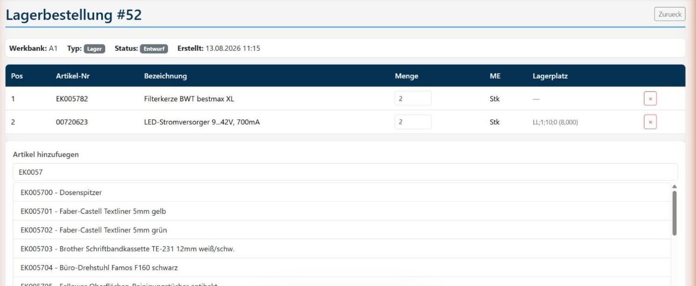
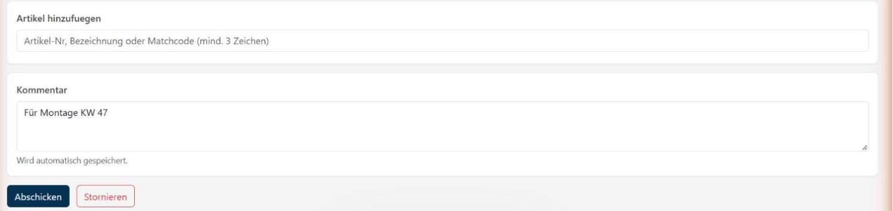
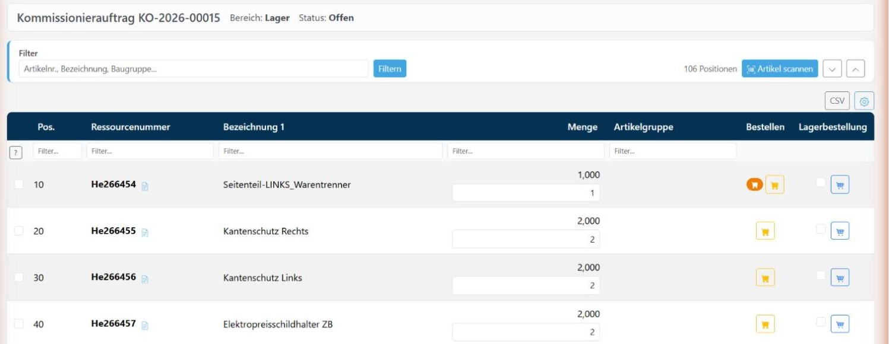
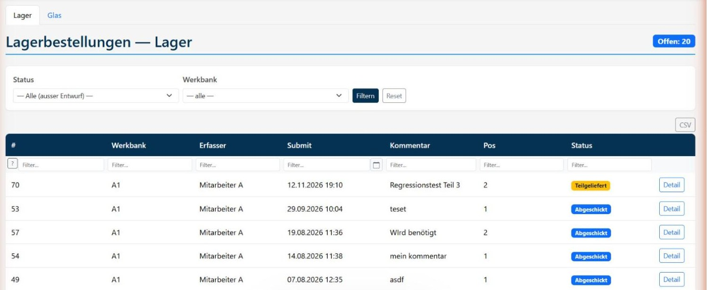
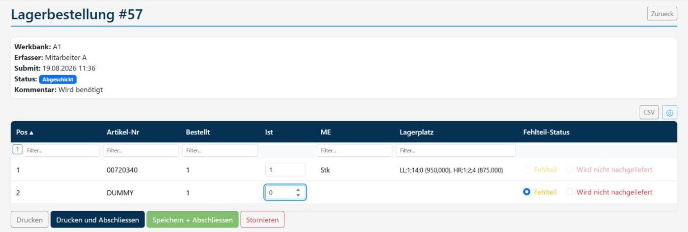
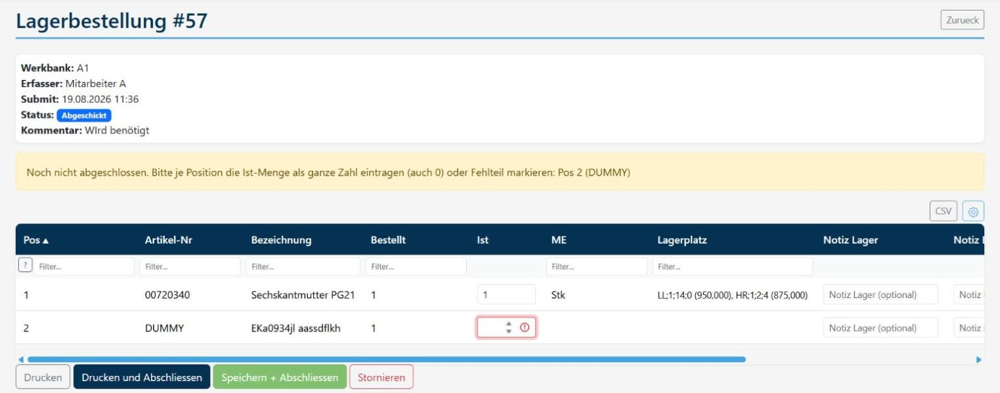
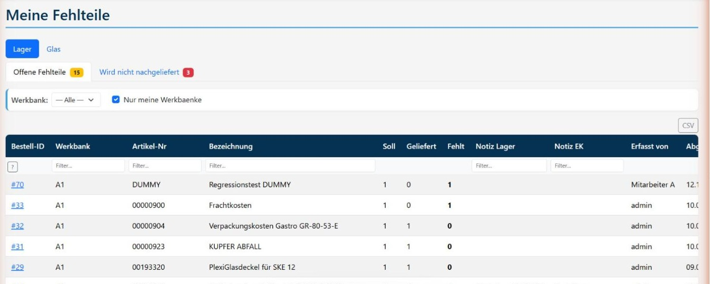
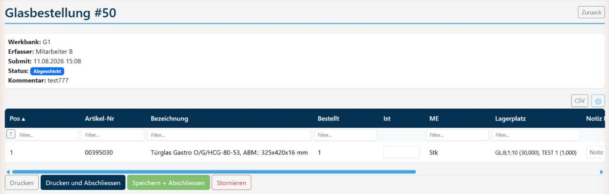

# 03 – Lagerbestellung und Glasbestellung

Stand: Version 1.99.53 (Text; Bilder aus dem AKE-Testsystem, Stand 1.99.29 – Bild zu „Entnahme aus“ folgt) · Standorte AKE und IDEAL

## Zweck

Mit einer **Lagerbestellung** holt sich die Produktion Material aus dem eigenen Lager an ihre Werkbank: Die Werkbank stellt eine Liste
zusammen und schickt sie ab, das Lager stellt die Teile bereit, trägt die gelieferten Mengen ein und schließt die Liste ab. Was nicht
geliefert werden konnte, bleibt als **Fehlteil** sichtbar, bis es nachgeliefert ist.

Die **Glasbestellung** ist derselbe Ablauf für Glasteile: eigener Reiter **Glas**, eigene Empfänger, eigene Artikelgruppen. Eine Liste ist
entweder Lager oder Glas – gemischte Listen gibt es nicht.

Eine Lagerbestellung ist **keine** Bestellung beim Lieferanten. Fehlt ein Teil im Haus, ist die [Bedarfsmeldung (Anleitung 04)](04-bedarfsmeldung.md)
der richtige Weg.

## Wer darf

| Aufgabe | Rolle (wie unter *Stammdaten → Rollen*) |
|---|---|
| Lagerbestellungen erfassen und abschicken, eigene Fehlteile ansehen | **Lagerbestellungen** |
| Glasbestellungen erfassen und abschicken, eigene Glas-Fehlteile ansehen | **Glasbestellungen** |
| beides (Reiter Lager und Glas) | **Kommissionierer**, **Lager** oder **Lager Keyuser** |
| eingehende Listen bearbeiten und abschließen, „Lager: Fehlteile“ | **Lager** oder **Lager Keyuser** |
| alles | **Administrator** |

Zusätzlich gilt:

- Man sieht und bearbeitet unter *meine Listen* nur **eigene** Listen.
- Wer eine Liste anlegt, braucht eine **Werkbank-Zuordnung** (Benutzerverwaltung). Ohne Zuordnung erscheint „Bitte Werkbank-Zuordnung in
  Stammdaten pflegen.“
- **Einstellungen** (*Stammdaten → Einstellungen*, pflegt die WMS-Betreuung): „Lagerbestellungen“ muss an sein (Standard an), sonst fehlen
  alle Menüpunkte. Für das Abschicken muss je Typ eine Empfängergruppe eingetragen sein; die Glas-Artikelgruppen legen fest, welche Artikel
  in den Reiter Glas gehören.

## Schritt für Schritt

### 1. Meine Listen öffnen

Menü **Bestellungen → Lagerbestellungen**. Oben die Reiter **Lager** und **Glas** (nur wer beides darf, sieht beide).

- Die Liste zeigt die eigenen Listen mit **Status**: Entwurf, Abgeschickt, Teilgeliefert, Erledigt, Storniert.
- Der gelbe Kasten **Meine Fehlteile** zählt offene Fehlteile; ein Klick öffnet die Fehlteil-Liste (Schritt 6).
- **Bearbeiten** (bei Entwürfen) bzw. **Ansehen** öffnet eine Liste.

### 2. Neue Liste anlegen und Artikel erfassen

1. Im richtigen Reiter (Lager oder Glas) auf **+ Neue Liste** klicken. Wer mehreren Werkbänken zugeordnet ist, wählt vorher die Werkbank.
2. Unter **Artikel hinzufuegen** mindestens 3 Zeichen eingeben (Artikelnummer, Bezeichnung oder Matchcode) und den Artikel in der
   Trefferliste anklicken. Er kommt mit Menge 1 in die Liste.
3. **Menge** in der Zeile anpassen (ganze Zahlen). Mit **×** entfernt man eine Zeile.

- Die Spalte **Lagerplatz** zeigt, wo der Artikel liegt und wie viel (z. B. `LL;1;10;0 (8,000)`), „—“ = kein Bestand gebucht.
  Seit 1.99.45 nur der Bestand **genau dieses** Artikels (vorher kamen Artikel mit ähnlicher Nummer dazu), der Hauptlagerplatz zuerst,
  Kommissionierwagen stehen hier nicht mehr in der Lagerplatz-Angabe. Die *Artikelinfo* zeigt ebenfalls nur den gesuchten Artikel
  (Kommissionierwagen zählen dort weiterhin mit).
- **Artikel nicht gefunden?** Dann bietet die Suche eine **DUMMY-Position** an: eigene Bezeichnung eingeben (Pflicht), Menge,
  **DUMMY-Position anlegen**.
- Ein Glas-Artikel lässt sich nicht in eine Lager-Liste aufnehmen und umgekehrt („Artikelgruppe … gehoert zur Glas-Bestellung.“).

### 3. Kommentar und Abschicken

1. Optional einen **Kommentar** schreiben (z. B. wofür das Material ist). Er wird beim Verlassen des Feldes automatisch gespeichert.
2. **Abschicken** klicken. Meldung: „Liste #… abgeschickt — wird per E-Mail gesendet (max. 15 Min).“

Nach dem Abschicken kann man die Liste nicht mehr ändern, nur noch **stornieren** (siehe Schritt 7).

### Schneller Weg: direkt aus der Stückliste

In der Stückliste eines FA bzw. im Kommissionierauftrag gibt es die Spalte **Lagerbestellung** (blauer Einkaufswagen). Ein Klick legt die
Position in den **offenen Entwurf** der eigenen Liste – Lager oder Glas wird automatisch aus der Artikelgruppe bestimmt. Mehrere Zeilen
anhaken und oben **Lagerbestellung (Auswahl)** wählen geht ebenfalls. Gibt es noch keinen Entwurf, wird einer angelegt (Werkbank = erste
zugeordnete Werkbank). **Abschicken** muss man danach wie oben unter *Bestellungen → Lagerbestellungen*.

### 4. Lager: eingehende Listen

Menü **Bestellungen → Lager: Eingehende Listen** (nur Rolle Lager / Lager Keyuser). Reiter **Lager** und **Glas**, oben rechts die Zahl
der offenen Listen.

- **Status-Filter:** Standard „Alle (ausser Entwurf)“; Entwürfe der Werkbank sieht das Lager nicht.
- **Detail** öffnet die Liste.

### 5. Lager: Ist-Mengen eintragen und abschließen

In der Liste je Position eintragen, was geliefert wird:

- **Ist** = gelieferte Menge als ganze Zahl. **0** ist erlaubt und heißt „nichts geliefert“.
- Ist kleiner als bestellt: in **Fehlteil-Status** wählen
  - **Fehlteil** – kommt noch (Restlieferung erwartet), oder
  - **Wird nicht nachgeliefert** – endgültig nicht lieferbar.
- **Notiz Lager** und **Notiz EK** (optional) werden beim Verlassen des Feldes gespeichert und stehen auf dem Ausdruck.

Dann einen der Knöpfe:

- **Drucken** – Druckansicht (ohne Abschluss).
- **Drucken und Abschliessen** – schließt ab und öffnet den Druck.
- **Speichern + Abschliessen** – schließt ab.

Jede Position braucht eine Ist-Menge **oder** eine Fehlteil-Markierung. Fehlt beides, bleibt die Liste offen und ein gelber Hinweis nennt
die Positionen:

Ergebnis des Abschlusses:

- Alles geliefert oder kein offenes „Fehlteil“ → Status **Erledigt**.
- Mindestens ein „Fehlteil“ (kommt noch) → Status **Teilgeliefert**. Die Liste bleibt in „Eingehende Listen“ und kann später erneut
  abgeschlossen werden, wenn der Rest geliefert ist.

Abschließen geht nur bei **abgeschickten** oder **teilgelieferten** Listen. Bei einer erledigten oder stornierten Liste erscheint
„Liste #… ist erledigt – nichts gebucht.“ (bzw. „storniert“).

### 5a. Lieferung ausbuchen (seit 1.99.53, nur wenn eingeschaltet)

Ist die Einstellung **Lagerbestellung: Lieferung ausbuchen** an (WMS-Betreuung, Standard aus), bucht das Abschließen die gelieferte
Menge im WMS vom Lager aus. Oben in der Liste steht dann der blaue Hinweis „Lieferung wird ausgebucht.“

- In der Spalte **Lagerplatz** hat jede Position die Auswahl **Entnahme aus**. Vorgeschlagen ist der Platz, den auch die Kommissionierung
  nimmt: der Hauptlagerplatz, wenn dort Bestand liegt, sonst der Platz mit dem meisten Bestand; ohne Bestand `NAN`. Der Hinweis darunter
  sagt, woher der Vorschlag kommt. Einen anderen Platz wählen geht jederzeit; gespeichert wird die Auswahl nicht.
- **Ausgebucht wird die Ist-Menge.** Wird eine teilgelieferte Liste später erneut abgeschlossen, bucht das WMS nur, was seitdem
  dazugekommen ist. Unter dem Lagerplatz steht „bereits ausgebucht: …“.
- **DUMMY-Positionen** und Artikel, die es im WMS nicht gibt, haben keine Auswahl („wird nicht gebucht (kein Lagerartikel)“). Die
  Erfolgsmeldung zählt sie auf.
- Die Erfolgsmeldung nennt je Position Menge und Platz, z. B. „Pos 1 5 Stk von A-01“.

**Alles oder nichts:** Passt bei einer Position etwas nicht, wird **nichts** abgeschlossen und **nichts** gebucht. Der gelbe Hinweis nennt
alle Positionen auf einmal, die Eingaben bleiben erhalten:

| Hinweis | Was tun |
|---|---|
| „Pos 2: kein Entnahme-Platz gewählt“ | Platz in „Entnahme aus“ wählen |
| „Pos 2: nicht genug Bestand auf A-01, verfügbar …“ | anderen Platz wählen oder Bestand klären |
| „Pos 2: Ist 2 kleiner als bereits ausgebucht 3 …“ | Ist-Menge nicht senken; Korrektur über Wareneingang/Umbuchung |
| „Pos 2: HR 1 ist ein Sage-Platz ohne Sage-Buchung …“ | einen WMS-Platz wählen (die WMS-Betreuung kann die Sage-Buchung am Platz einschalten) |
| „Die Entnahme-Plätze fehlen oder passen nicht …“ | Liste neu laden (Seite war vor dem Einschalten geöffnet) |

Ist „Minus-Buchung erlaubt“ eingeschaltet, wird bei zu wenig Bestand wie im Warenausgang vom Ausweichplatz (Standard `NAN`) gebucht; ein
gelber Hinweis sagt das.

**Wichtig ab dem Einschalttag:** Diese Lieferungen in Sage **nicht mehr von Hand** ausbuchen – das WMS übergibt die Entnahme (bei Sage-Plätzen
mit Sage-Buchung) selbst. Sonst wird doppelt entnommen.

### 6. Fehlteile verfolgen

- **Bestellungen → Meine Fehlteile** (Werkbank-Sicht): Reiter Lager/Glas, darunter **Offene Fehlteile** und **Wird nicht nachgeliefert**.
  Haken **Nur meine Werkbaenke** und Werkbank-Auswahl schränken ein.
- **Bestellungen → Lager: Fehlteile** (Lager-Sicht): dieselben Fehlteile aller Werkbänke, zusätzlich mit Lagerplatz und Bestand.

Ein Klick auf die **Bestell-ID** öffnet die zugehörige Liste.

### 7. Stornieren

- Werkbank: in der eigenen Liste **Stornieren** (bei Entwurf oder Abgeschickt), Grund optional.
- Lager: in der Liste **Stornieren** (bei Abgeschickt oder Teilgeliefert), Grund optional.
- War die Liste schon abgeschickt, geht eine Storno-Mail an die Empfänger.

## Glasbestellung

Die Glasbestellung funktioniert genau wie die Lagerbestellung, nur im Reiter **Glas**:

- Im Reiter Glas lassen sich nur Artikel der Glas-Artikelgruppen (und der gemeinsamen Gruppen, z. B. EUZ) erfassen.
- Abgeschickte Glasbestellungen gehen an die Glas-Empfängergruppe. Fehlt sie in den Einstellungen, meldet das Abschicken
  „Default-Glasbestellempfaenger nicht konfiguriert (Einstellungen).“
- Der Typ (Lager oder Glas) steht als Kennzeichen oben in der Liste und lässt sich nicht ändern.

## Unterschiede AKE und IDEAL

Die Masken sind an beiden Standorten gleich. Welche Artikelgruppen als Glas gelten und wer die Mails bekommt, ist je Standort eingestellt.

## Hinweise und Stolperfallen

**Bekannte Fehler (Stand 14.11.2026, Behebung geplant):**

- **Glasbestellung heißt im Wareneingang „Lagerbestellung“.** Der Hinweis „Offener Bedarf“ in *Wareneingang zu Bestellung* (Anleitung 05)
  schreibt bei einer Glasbestellung „Lagerbestellung Nr. …“. Der Link führt trotzdem auf die richtige Glasbestellung.
- **Link aus dem Wareneingang zeigt „Zugriff verweigert“.** Wer im Wareneingang bucht, aber nur Rolle Kommissionierer hat, kann den Link
  „Lagerbestellung Nr. …“ nicht öffnen. Das ist kein Bedienfehler.
- **Teilgelieferte Liste ohne Status.** Öffnet die Werkbank eine eigene teilgelieferte Liste über **Ansehen**, ist das Feld „Status“ leer.
  Der richtige Status steht in der Übersicht *meine Listen*.
- **Meldung „Bitte Standard-Werkbank im Profil hinterlegen.“** (beim Bestellen aus der Stückliste) bedeutet: Dem Benutzer ist keine Werkbank
  zugeordnet. Die WMS-Betreuung ordnet die Werkbank in der Benutzerverwaltung zu.

**Allgemein:**

- Erst **Abschicken** schickt die Liste an das Lager. Ein Entwurf bleibt liegen – auch der, in den die Stückliste Positionen legt.
- Ein Artikel kann in einer Liste nur einmal stehen; die Menge in der Zeile ändern.
- Das Abschließen einer Lagerbestellung bucht nur dann Bestand aus, wenn „Lagerbestellung: Lieferung ausbuchen“ eingeschaltet ist
  (Schritt 5a). Sonst hält es nur fest, was geliefert wurde.
- Abgeschickte Listen zählen in den Bestellvorschlägen des Einkaufs als „offene Bedarfe“ (teilgeliefert nur der Rest der Fehlteile).

## Häufige Fragen

**Ich sehe den Reiter Glas nicht.**
Mit der Rolle „Lagerbestellungen“ gibt es nur den Reiter Lager. Für Glas braucht es die Rolle „Glasbestellungen“.

**Kann ich eine abgeschickte Liste noch ändern?**
Nein. Liste stornieren und eine neue anlegen – oder das Lager bitten, die Änderung als Notiz zu vermerken.

**Was ist der Unterschied zwischen „Fehlteil“ und „Wird nicht nachgeliefert“?**
„Fehlteil“ heißt, der Rest kommt noch – die Liste bleibt teilgeliefert und der Rest zählt weiter als Bedarf. „Wird nicht nachgeliefert“
schließt die Position endgültig.

**Warum steht in „Lagerplatz“ ein Strich?**
Für den Artikel ist im WMS kein Bestand gebucht. Das Lager weiß dann evtl. mehr; sonst eine Bedarfsmeldung an den Einkauf.

**Wann kommt die Mail beim Lager an?**
Der Dienst verschickt abgeschickte Listen spätestens nach etwa 15 Minuten (nur wenn der Mailversand für Lagerbestellungen eingeschaltet ist).
Das Lager sieht die Liste sofort unter *Lager: Eingehende Listen*.
