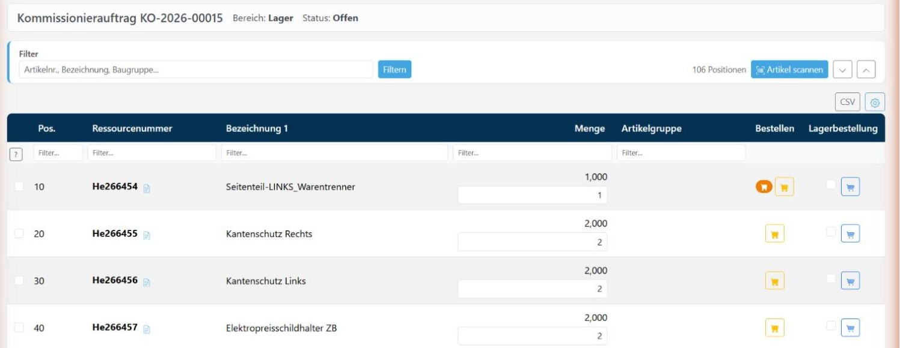
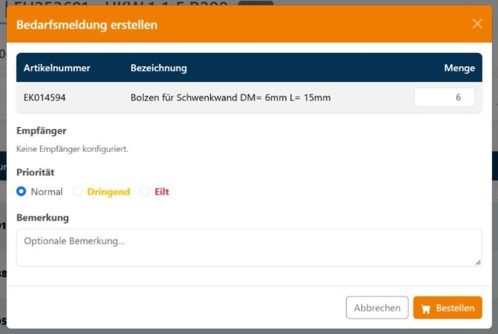
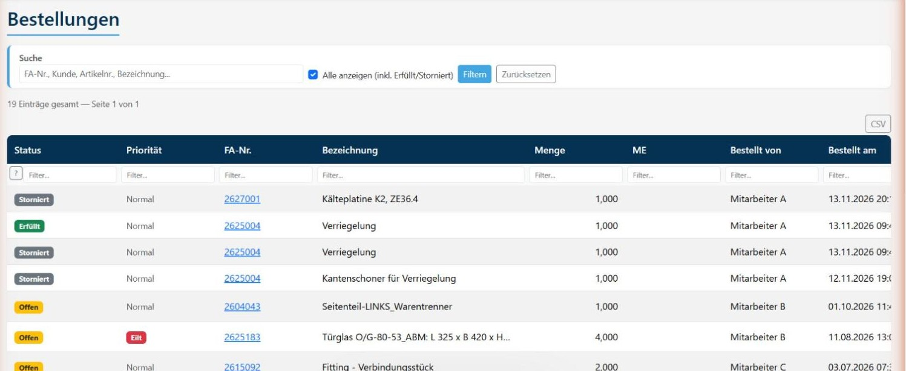
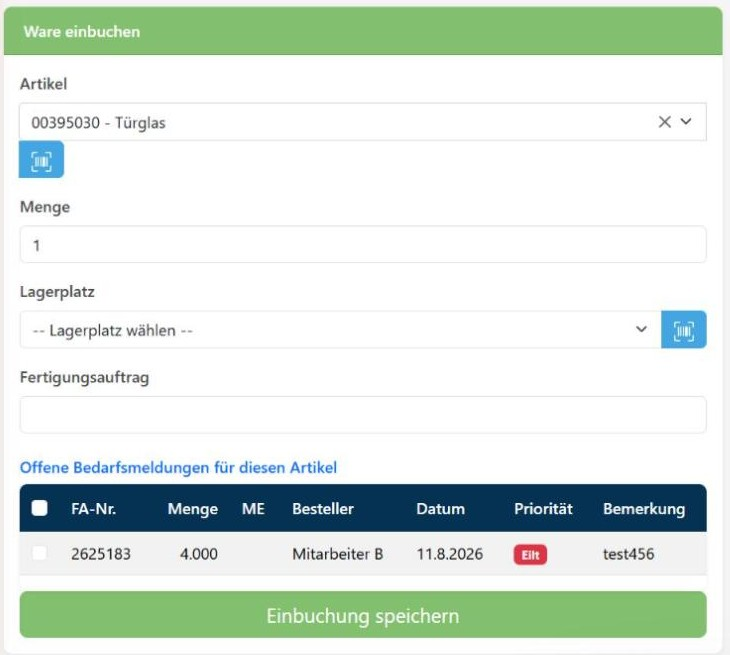

# 04 – Bedarfsmeldung

Stand: Version 1.99.22 · Standorte AKE und IDEAL · Bilder aus dem AKE-Testsystem

## Zweck

Mit einer **Bedarfsmeldung** meldet die Produktion bzw. das Lager dem Einkauf ein **Fehlteil**: ein Bauteil aus der Stückliste eines
Fertigungsauftrags (FA), das nicht im Haus ist und bestellt werden muss. Die Meldung hängt am FA, hat eine Menge, eine Priorität und
optional eine Bemerkung. Sie geht per Mail an die Empfängergruppe, die für die **Artikelgruppe** des Teils zuständig ist.

Bedarfsmeldung und [Lagerbestellung (Anleitung 03)](03-lagerbestellung-glasbestellung.md) sind zwei verschiedene Dinge:

| | Bedarfsmeldung | Lagerbestellung |
|---|---|---|
| an wen | Einkauf (Bestellung beim Lieferanten) | eigenes Lager |
| gehört zu | einem FA und einer Stücklistenposition | einer Werkbank |
| Spalte in der Stückliste | **Bestellen** (oranger Einkaufswagen) | **Lagerbestellung** (blauer Einkaufswagen) |

## Wer darf

| Aufgabe | Rolle (wie unter *Stammdaten → Rollen*) |
|---|---|
| Bedarfsmeldung aus Stückliste oder Kommissionierauftrag erstellen | **Kommissionierer** |
| Liste der Bedarfsmeldungen ansehen, offene Meldungen stornieren | **Kommissionierer**, **Lager** oder **Lager Keyuser** |
| Meldung beim Einbuchen als erfüllt kennzeichnen | **Kommissionierer**, **Lager** oder **Lager Keyuser** |
| alles | **Administrator** |

**Einstellungen** (pflegt die WMS-Betreuung):

- *Stammdaten → Einstellungen*: **Bedarfsmeldungen aus der Stückliste** muss an sein (Standard aus). Sonst fehlen die Spalte „Bestellen“
  und der Menüpunkt *Bestellungen → Bedarfsmeldungen*.
- *Stammdaten → Empfänger* und *Stammdaten → Artikelgruppen-Zuordnung*: welche Empfängergruppe für welche Artikelgruppe zuständig ist.
- Der Mailversand läuft über den WMS-Dienst und muss in den Service-Einstellungen eingeschaltet sein.

## Schritt für Schritt

### 1. Fehlteil in der Stückliste bzw. im Kommissionierauftrag finden

Die Bedarfsmeldung entsteht dort, wo man das Fehlteil bemerkt: in der Stückliste eines FA oder in einem offenen Kommissionierauftrag
(siehe [Anleitung 01](01-kommissionierung.md), Schritt 9).

- **Oranger Einkaufswagen** in der Spalte **Bestellen** = Bedarfsmeldung für diese Zeile.
- **Gefülltes oranges Symbol** daneben = für diesen FA und Artikel gibt es schon eine offene Meldung (Maus darüber: wann und von wem).
- Mehrere Zeilen anhaken und oben **Ausgewählte bestellen** = eine Sammelmeldung für alle markierten Zeilen.

### 2. Meldung erstellen

1. Auf den orangen Einkaufswagen klicken (oder **Ausgewählte bestellen**).
2. Im Fenster **Bedarfsmeldung erstellen** die **Menge** je Artikel prüfen.
3. **Empfänger**: Das WMS wählt die Empfänger der zuständigen Gruppe vor (nach Artikelgruppe).
4. **Priorität** wählen: **Normal**, **Dringend** oder **Eilt**.
5. Optional eine **Bemerkung** (z. B. „für Montage Donnerstag“).
6. **Bestellen** klicken.

Gibt es zum FA und Artikel schon eine offene Meldung, zeigt das Fenster oben einen gelben Hinweis mit Datum und Besteller. Man kann trotzdem
eine weitere Meldung anlegen – dann bitte in der Bemerkung erklären, warum.

### 3. Meldungen ansehen und stornieren

Menü **Bestellungen → Bedarfsmeldungen** (die Seite heißt „Bestellungen“).

- Standard: nur **offene** Meldungen. Haken **Alle anzeigen (inkl. Erfüllt/Storniert)** und **Filtern** zeigt auch erledigte.
- **Suche** nach FA-Nr., Kunde, Artikelnummer oder Bezeichnung; dazu die Spaltenfilter unter den Spaltenköpfen.
- **Status**: Offen, Erfüllt, Storniert. **Priorität**: Normal, Dringend (gelb), Eilt (rot) – immer auch als Text.
- Spalte **E-Mail**: Briefsymbol = Mail versendet (Maus darüber: wann); „—“ = noch nicht versendet.
- Ein Klick auf die **FA-Nr.** öffnet die Stückliste.
- **Stornieren** (nur bei offenen Meldungen) fragt einmal nach und setzt die Meldung auf „Storniert“.

### 4. Ware ist da: Meldung beim Einbuchen erfüllen

Kommt das bestellte Teil, wird es unter **Lager → Einbuchung** eingebucht. Nach der Auswahl des Artikels zeigt die Seite den Kasten
**Offene Bedarfsmeldungen für diesen Artikel**:

1. Menge und Lagerplatz wie gewohnt eintragen.
2. Die Meldung(en), die mit dieser Lieferung erledigt sind, **anhaken**.
3. **Einbuchung speichern**. Die angehakten Meldungen stehen danach auf **Erfüllt** und sind mit der Einbuchung verknüpft.

Nicht angehakte Meldungen bleiben offen.

### 5. Hinweis im Wareneingang zu Bestellung

Bucht das Lager über **Lager → Wareneingang zu Bestellung** (Anleitung 05), steht unter dem Artikel ein gelb umrandeter Hinweis
„Offener Bedarf zu diesem Artikel: Bedarfsmeldung FA … – Besteller: Menge“. Das ist **nur ein Hinweis**: Diese Maske erfüllt die Meldung
**nicht**. Die Ware bitte an den FA weiterleiten und die Meldung bei Bedarf in der Liste prüfen (Link „FA …“ öffnet die Bedarfsmeldungen
mit dem Artikel als Suchbegriff).

## Unterschiede AKE und IDEAL

Ablauf und Masken sind gleich. Welche Artikelgruppe welcher Empfängergruppe zugeordnet ist, ist je Standort gepflegt.

## Hinweise und Stolperfallen

**Bekannte Fehler (Stand 14.11.2026, Behebung geplant):**

- **„Keine Empfänger konfiguriert“ – Meldung wird trotzdem gespeichert.** Hat die Artikelgruppe keine Empfängergruppe (oder der Artikel keine
  Artikelgruppe), lässt sich die Meldung anlegen, aber niemand wird benachrichtigt. Dann den Einkauf direkt informieren und die WMS-Betreuung
  bitten, die Artikelgruppen-Zuordnung zu ergänzen.
- **Menge ohne Einheit.** Bei älteren Meldungen fehlt die Einheit; im Hinweis des Wareneingangs steht dann nur die Zahl (z. B. „: 4“) und in der
  Liste ist die Spalte „ME“ leer.

**Allgemein:**

- Die Seite heißt „Bestellungen“, der Menüpunkt „Bedarfsmeldungen“ – gemeint ist dasselbe.
- **Wareneingang zu Bestellung** erfüllt keine Bedarfsmeldung. Nur **Lager → Einbuchung** mit Häkchen setzt sie auf „Erfüllt“.
- Offene Bedarfsmeldungen zählen in den Bestellvorschlägen des Einkaufs als „offene Bedarfe“ (Anleitung 08). Erledigte Meldungen bitte
  erfüllen oder stornieren, sonst rechnet der Einkauf mit zu hohem Bedarf.

## Häufige Fragen

**Ich sehe keinen orangen Einkaufswagen.**
Entweder ist „Bedarfsmeldungen aus der Stückliste“ ausgeschaltet, oder die Stückliste ist nur zum Lesen geöffnet. Aus einem offenen
Kommissionierauftrag geht es immer, wenn die Einstellung an ist und man Kommissionierer ist.

**Bekommt der Einkauf sofort eine Mail?**
Der WMS-Dienst verschickt offene Meldungen in seinem nächsten Lauf, wenn der Mailversand eingeschaltet ist. In der Liste zeigt das
Briefsymbol, wann die Mail versendet wurde.

**Kann ich Menge oder Priorität nachträglich ändern?**
Nein. Meldung stornieren und neu anlegen.

**Wer setzt eine Meldung auf „Erfüllt“?**
Wer die Ware unter *Lager → Einbuchung* einbucht und die Meldung dabei anhakt.
