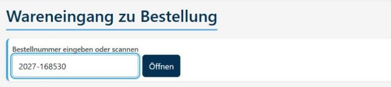
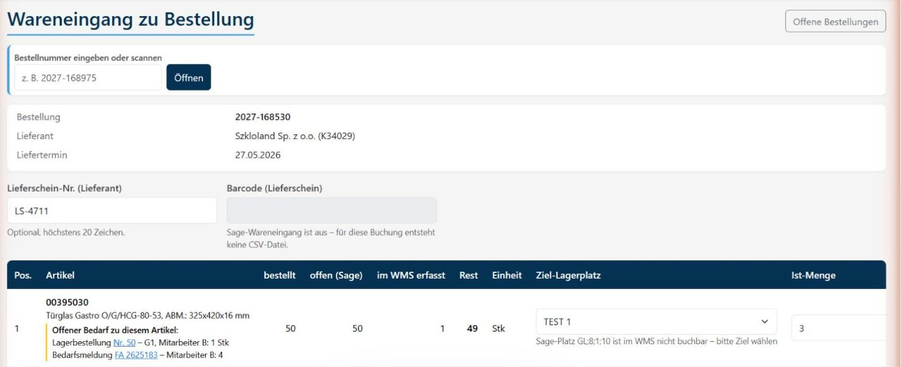
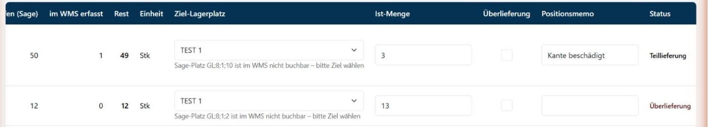
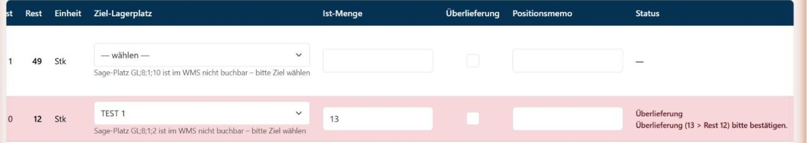
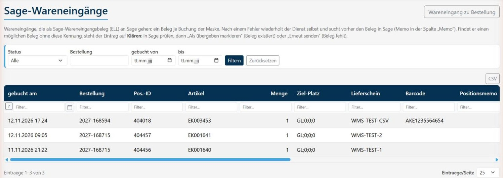

# 05 – Wareneingang zu Bestellung

Stand: Version 1.99.22 · Standort AKE (IDEAL siehe unten) · Bilder aus dem AKE-Testsystem

## Zweck

Kommt Ware zu einer **Sage-Bestellung** (oder einem Rahmenabruf), bucht das Lager sie in der Maske **Wareneingang zu Bestellung** ein:
Bestellnummer scannen, je Position Ziel-Lagerplatz und gelieferte Menge eintragen, **Einbuchen**. Das WMS führt mit, wie viel jeder
Position schon im WMS erfasst ist, und zeigt den **Rest**. Hinweise in der Maske melden, wenn es zum Artikel offene Lagerbestellungen oder
Bedarfsmeldungen gibt – dann die Ware gleich weiterleiten.

Die Bestellungen kommen aus Sage (Abgleich durch den WMS-Dienst). Die Liste dazu ist **Lager → Offene Bestellungen**
([Anleitung 06](06-offene-bestellungen-rahmenabrufe.md)).

## Wer darf

| Aufgabe | Rolle (wie unter *Stammdaten → Rollen*) |
|---|---|
| Offene Bestellungen ansehen, Liste „Sage-Wareneingänge“ ansehen | **Lagerbestand-Ansicht**, **Lager**, **Lager Keyuser**, **Kommissionierer** |
| Wareneingang zu Bestellung einbuchen | **Lager**, **Lager Keyuser** oder **Kommissionierer** |
| In „Sage-Wareneingänge“: Erneut senden, Als übergeben markieren, CSV erneut schreiben | **Lager Keyuser** |
| alles | **Administrator** |

**Einstellungen** (pflegt die WMS-Betreuung): **Wareneingang zu Sage-Bestellungen** muss an sein, sonst fehlen die Menüpunkte. Weitere
Schalter: Lieferschein-Nr. als Pflichtfeld, Feld „Barcode (Lieferschein)“, und im Dienst der **Sage-Wareneingang** (siehe Abschnitt
„Sage-Wareneingang“ unten).

## Schritt für Schritt

### 1. Bestellung öffnen

Menü **Lager → Wareneingang zu Bestellung** – oder in **Lager → Offene Bestellungen** in der Zeile auf **Wareneingang**.

1. Bestellnummer vom Lieferschein scannen (Handscanner) oder eintippen, z. B. `2027-168530`. Leerzeichen vorne/hinten stören nicht.
2. **Öffnen**.

Unbekannte Nummer: „Bestellung „…“ nicht gefunden (nur offene Bestellungen und Rahmenabrufe aus Sage, Stand des letzten Abgleichs).“ Dann ist
die Bestellung in Sage schon erledigt, noch nicht abgeglichen oder die Nummer falsch.

### 2. Kopf und Positionen lesen

- **Kopf:** Bestellnummer (bei Abrufen mit Kennzeichen **Rahmenabruf**), Lieferant, Liefertermin.
- **Lieferschein-Nr. (Lieferant):** Nummer vom Lieferschein, höchstens 20 Zeichen. Gilt für alle Positionen dieser Buchung. Pflicht nur, wenn
  die Einstellung das verlangt (dann mit `*`).
- **Barcode (Lieferschein):** nur sichtbar, wenn eingeschaltet. Bei ausgeschaltetem Sage-Wareneingang **grau** mit dem Text „Sage-Wareneingang
  ist aus – für diese Buchung entsteht keine CSV-Datei.“ (siehe unten).
- Je Position: **bestellt**, **offen (Sage)**, **im WMS erfasst**, **Rest** (= was noch fehlt), **Einheit** (Basiseinheit).
- **Ziel-Lagerplatz:** vorbelegt mit dem Sage-Platz der Bestellposition. Ist dieser Platz im WMS nicht buchbar, steht darunter „Sage-Platz …
  ist im WMS nicht buchbar – bitte Ziel wählen“ – dann einen Platz auswählen.

**Hinweis „Offener Bedarf zu diesem Artikel“** (gelber Rand links): Es gibt zu diesem Artikel

- eine abgeschickte oder teilgelieferte **Lagerbestellung** einer Werkbank (Nr., Werkbank, Besteller, Menge) und/oder
- eine offene **Bedarfsmeldung** zu einem FA (FA-Nr., Besteller, Menge).

Das ist nur ein Hinweis: Beim Einbuchen wird nichts erfüllt oder abgeschlossen. Die Ware bitte gleich an die Werkbank bzw. den FA weitergeben.

### 3. Ist-Mengen, Überlieferung, Positionsmemo

Die Tabelle ist breit – nach rechts scrollen bis **Ist-Menge**, **Überlieferung**, **Positionsmemo** und **Status**.

1. **Ist-Menge** eintragen (Komma oder Punkt, höchstens 3 Nachkommastellen). **Leer = Position nicht buchen.**
2. Die Spalte **Status** zeigt sofort: **vollständig** (= Rest), **Teillieferung** (weniger), **Überlieferung** (mehr).
3. Bei **Überlieferung** das Häkchen in der Spalte **Überlieferung** setzen – damit bestätigt man die Mehrmenge.
4. Optional **Positionsmemo** (höchstens 200 Zeichen), z. B. „Kante beschädigt“. Der Text steht als Notiz an der Einbuchung.
5. **Einbuchen** (unter der Tabelle) – **einmal** klicken.

Erfolg: z. B. „1 Position(en) eingebucht (davon 1 Teil-, 0 Überlieferung).“ Der Wert in **im WMS erfasst** steigt, der **Rest** sinkt.

### 4. Wenn etwas nicht stimmt

Gebucht wird nur, wenn **alle** eingegebenen Zeilen gültig sind. Sonst steht oben „Nichts gebucht: bitte die markierten Zeilen korrigieren.“
und die betroffene Zeile ist rot mit dem Grund, z. B. bei fehlendem Überlieferungs-Häkchen:

Weitere Meldungen: „Menge muss größer als 0 sein.“, „„abc“ ist keine Zahl.“, „Höchstens 3 Nachkommastellen …“, „Bitte einen Ziel-Lagerplatz
wählen.“, „Bitte die Lieferschein-Nummer des Lieferanten eingeben.“ (wenn Pflicht), „Lieferschein-Nr. höchstens 20 Zeichen …“,
„Positionsmemo höchstens 200 Zeichen.“ Die Eingaben bleiben stehen – korrigieren und erneut **Einbuchen**.

**Nicht buchbare Positionen** haben kein Mengenfeld; in **Status** steht der Grund, z. B. „Einheit abweichend (Bestellung lfm, Basis Stk, Lager lfm)
– nicht buchbar, bis geklärt“ oder „Artikel nicht im WMS“. Diese Positionen klärt der Einkauf.

**Lieferant gesperrt:** Ein gelber Kasten „Lieferant gesperrt“ ist ein Hinweis aus Sage. Buchen geht trotzdem – bitte mit dem Einkauf klären.

**Charge/Seriennummer:** Steht unter dem Artikel „Charge/Seriennummer in Sage erfassen“, gehört die Charge/Seriennummer in Sage.

## Sage-Wareneingang (Erklärung)

> Auf dem Testsystem ist der Sage-Wareneingang **ausgeschaltet**; dieser Abschnitt erklärt nur, was passiert, wenn er im Echtbetrieb an ist.
> Das Einschalten entscheidet die WMS-Betreuung zusammen mit dem Einkauf.

**Ausgeschaltet** (Stand Testsystem): Jede Position wird als normale Einbuchung gebucht (an Plätzen mit Sage-Buchung wie jede Einbuchung als
Lagerbuchung an Sage). Die Bestellposition in Sage schließt der Einkauf von Hand.

**Eingeschaltet** (nur AKE):

- Je Klick auf **Einbuchen** legt der WMS-Dienst in Sage **einen Wareneingangsbeleg** zur Bestellung an – mit Lieferschein-Nr. und
  Positionsmemo. Die Bestellung ist damit in Sage beliefert, der Einkauf schließt sie **nicht** mehr von Hand.
- Als Ziel sind nur Plätze erlaubt, die es in Sage gibt und bei denen „Sage-Buchung erlaubt“ an ist.
- Positionen mit Charge/Seriennummer bucht der Einkauf in Sage.
- **Barcode (Lieferschein):** Den Aufkleber auf dem Lieferschein scannen (Handscanner, Kamera-Knopf oder Tastatur; nur Buchstaben, Ziffern, `-`
  und `_`, höchstens 50 Zeichen). Derselbe Barcode darf nur an **einem** Wareneingang hängen. Nach der Übergabe an Sage schreibt der Dienst
  eine **CSV-Datei** mit diesem Namen auf eine Netzfreigabe (Übergabe an die Belegablage).
- **Rahmenabrufe** gehen nie als Sage-Wareneingang, sondern wie bisher als Lagerbuchung; das Barcode-Feld ist dort gesperrt.

**Liste Lager → Sage-Wareneingänge:** zeigt jeden Wareneingang, der an Sage gehen soll, mit Status, Lieferschein, Barcode, Positionsmemo und
CSV-Stand.

- Status u. a. **an Sage übergeben**, **Fehler** (der Dienst wiederholt selbst) und **Klären**.
- **Klären** heißt: In Sage könnte es schon einen Beleg ohne WMS-Kennung geben (gleiche Bestellung, gleicher Tag, gleiche Lieferschein-Nr.),
  oder der Sage-Wareneingang wurde ausgeschaltet, während Einträge offen waren. Der Dienst sendet dann **nicht** von selbst. Lager Keyuser
  prüft in Sage und klickt **Als übergeben markieren** (Beleg existiert, Sage-Belegnummer eintragen, höchstens 45 Zeichen) oder **Erneut senden**
  (Beleg fehlt).
- **CSV:** wartet / offen / geschrieben / Fehler. Bei Fehler oder „Datei existiert bereits“ auf der Freigabe nachsehen und **CSV erneut schreiben**.

## Unterschiede AKE und IDEAL

- **AKE:** Abgleich der offenen Bestellungen aus Sage läuft; Sage-Wareneingang und Barcode/CSV gibt es nur hier.
- **IDEAL:** Solange es dort keinen Bestellungs-Abgleich gibt, bleibt „Wareneingang zu Sage-Bestellungen“ ausgeschaltet. Bitte dort wie bisher
  über **Lager → Einbuchung** buchen.

## Hinweise und Stolperfallen

**Bekannte Fehler (Stand 14.11.2026, Behebung geplant):**

- **„Einbuchen“ nur einmal drücken.** Wird zweimal abgeschickt (Doppeltipp am Handgerät, Netz hängt und man drückt nochmal, F5 nach dem
  Buchen), bucht das WMS zweimal – bei eingeschaltetem Sage-Wareneingang entstehen dann auch zwei Belege in Sage. Nach dem Klick warten, bis die
  grüne Meldung kommt. Im Zweifel nicht nochmal buchen, sondern die Spalte **im WMS erfasst** prüfen.
- **Fehlermeldung mitten im Buchen.** Bricht das Speichern bei mehreren Positionen mit einer Fehlerseite ab (sehr selten, z. B. Datenbank kurz
  weg), können die ersten Positionen schon gebucht sein. Bestellung neu öffnen, **im WMS erfasst** prüfen und nur den Rest buchen.
- **Glasbestellung heißt „Lagerbestellung“.** Im Hinweis „Offener Bedarf“ steht bei einer Glasbestellung „Lagerbestellung Nr. …“. Der Link
  führt auf die richtige Glasbestellung.
- **Link „Lagerbestellung Nr. …“ – Zugriff verweigert.** Wer nur Kommissionierer ist, darf die Lagerbestellung nicht öffnen.
- **Spalten rechts außerhalb des Bildes.** Auf normalen Bildschirmen und am Terminal stehen **Überlieferung**, **Positionsmemo** und **Status**
  erst nach Querscrollen im Bild. Vor dem Einbuchen nach rechts scrollen und den Status jeder Zeile prüfen.
- **Meldungen doppelt (Sage-Wareneingänge).** Nach „Erneut senden“ oder „Als übergeben markieren“ steht die Meldung zweimal da. Es ist nur
  einmal passiert.
- **Barcode zweimal gleichzeitig.** Buchen zwei Personen im selben Moment mit demselben Barcode, nimmt das WMS beide an (nur bei eingeschaltetem
  Sage-Wareneingang relevant).

**Allgemein:**

- Mengen immer in der **Basiseinheit** (Spalte „Einheit“).
- Die offenen Bestellungen sind so aktuell wie der letzte Abgleich (Uhrzeit „Stand“ in *Offene Bestellungen*). Was in Sage gerade erst
  bestellt wurde, kann noch fehlen.
- Eine Buchung hier ist eine normale Einbuchung und steht in der Bewegungshistorie. In der Maske gibt es kein „Rückgängig“. Eine
  Fehlbuchung bitte mit Bestellnummer und Position an die WMS-Betreuung melden.

## Häufige Fragen

**Muss ich alle Positionen ausfüllen?**
Nein. Nur die Positionen mit Ist-Menge werden gebucht, leere bleiben offen.

**Die Lieferung hat mehr als bestellt.**
Ist-Menge eintragen und das Häkchen **Überlieferung** setzen. Ohne Häkchen wird nichts gebucht.

**Kann ich eine Position in zwei Teilen buchen?**
Ja. Jede Buchung erhöht „im WMS erfasst“; der Rest sinkt. Die Maske bleibt auch bei Rest 0 aufrufbar.

**Warum ist der Ziel-Lagerplatz leer?**
Der Sage-Platz ist im WMS nicht buchbar oder nicht vorhanden. Richtigen Platz auswählen.

**Wird die Bedarfsmeldung automatisch erledigt?**
Nein, der Hinweis ist nur zur Information. Erfüllen geht über **Lager → Einbuchung** (Anleitung 04).
