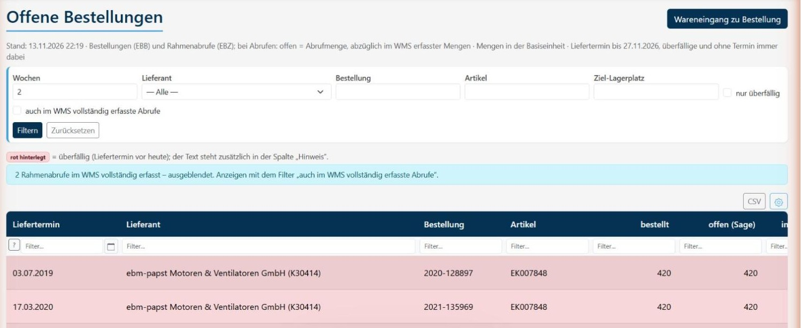
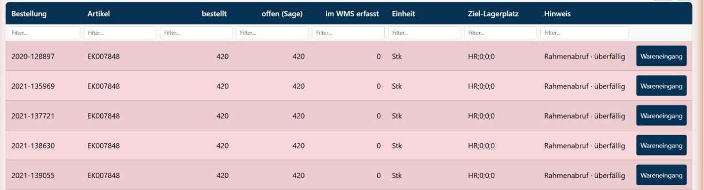
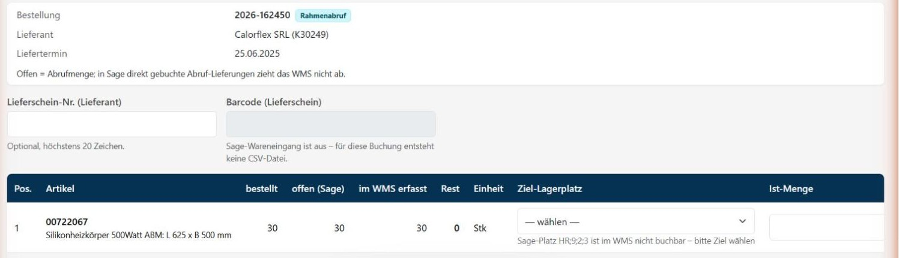

# 06 – Offene Bestellungen und Rahmenabrufe

Stand: Version 1.99.22 · Standort AKE (IDEAL siehe unten) · Bilder aus dem AKE-Testsystem

## Zweck

**Lager → Offene Bestellungen** zeigt, welche Ware aus Sage-Bestellungen demnächst kommen sollte oder überfällig ist. Das Lager plant damit
den Wareneingang, der Einkauf sieht auf einen Blick, was noch fehlt. Aus jeder Zeile führt der Knopf **Wareneingang** direkt in die
Buchungsmaske ([Anleitung 05](05-wareneingang-zu-bestellung.md)).

Die Liste enthält zwei Arten von Sage-Belegen:

- **Bestellungen** (in Sage „EBB“) – normale Bestellungen beim Lieferanten.
- **Rahmenabrufe** (in Sage „EBZ“) – Abrufe aus einer Rahmenbestellung; je Abruf eine Zeile. In der Spalte **Hinweis** steht „Rahmenabruf“.

Die Daten liest der WMS-Dienst regelmäßig aus Sage. Wie aktuell sie sind, steht oben bei **Stand**.

## Wer darf

| Aufgabe | Rolle (wie unter *Stammdaten → Rollen*) |
|---|---|
| Offene Bestellungen ansehen, filtern, CSV | **Lagerbestand-Ansicht**, **Lager**, **Lager Keyuser** oder **Kommissionierer** |
| Knopf **Wareneingang** (buchen) | **Lager**, **Lager Keyuser** oder **Kommissionierer** |
| alles | **Administrator** |

**Einstellungen** (pflegt die WMS-Betreuung): **Wareneingang zu Sage-Bestellungen** muss an sein; **Vorschau Wochen** legt fest, wie weit die
Liste standardmäßig in die Zukunft schaut (Standard 2 Wochen, erlaubt 1 bis 26). Ohne den Dienst-Abgleich „Offene Bestellungen (Sage)“
steht oben „Noch keine offenen Bestellungen gelesen.“

## Schritt für Schritt

### 1. Liste öffnen und filtern

Menü **Lager → Offene Bestellungen**.

- **Stand:** Zeitpunkt des letzten Abgleichs. Darunter, bis zu welchem Liefertermin die Liste reicht. **Überfällige** Positionen und solche
  **ohne Termin** sind immer dabei.
- **Filterkarte:**
  - **Wochen** – Vorschau ändern (1–26), gilt nur für diesen Aufruf.
  - **Lieferant**, **Bestellung**, **Artikel**, **Ziel-Lagerplatz** – eingrenzen.
  - **nur überfällig** – nur Positionen mit Liefertermin vor heute.
  - **auch im WMS vollständig erfasste Abrufe** – siehe Schritt 3.
  - **Filtern** bzw. **Zurücksetzen**.
- **Spaltenfilter** unter jedem Spaltenkopf, z. B. `Rahmenabruf` in der Spalte **Hinweis**. Das **?** erklärt die Suchsyntax.
- **CSV** exportiert die Liste; das **Zahnrad** blendet Spalten aus (wird für den eigenen Benutzer gespeichert).

### 2. Zeilen lesen

| Spalte | Bedeutung |
|---|---|
| Liefertermin | Termin aus Sage („ohne Termin“ = keiner gepflegt) |
| Lieferant | Name und Kreditor-Nummer |
| Bestellung, Artikel, Bezeichnung | aus der Sage-Bestellung |
| bestellt / geliefert (Sage) / offen (Sage) | Mengen laut Sage in der **Basiseinheit**; bei Rahmenabrufen steht bei „geliefert (Sage)“ ein „–“ |
| im WMS erfasst | was schon über *Wareneingang zu Bestellung* gebucht, aber in Sage noch nicht enthalten ist |
| Ziel-Lagerplatz | Sage-Platz der Position; „(nicht im WMS)“, wenn es den Platz im WMS nicht gibt |
| Hinweis | „Rahmenabruf“, „überfällig“, „ohne Termin“, „Einheit abweichend“, „Charge/Seriennr. in Sage“, „Lieferant gesperrt“ – auch mehrere, mit · getrennt |

**Rot hinterlegt** = überfällig. Das steht immer auch als Text in **Hinweis**, die Farbe ist nur eine Hilfe.

**Wareneingang** öffnet die Buchungsmaske zu dieser Bestellung. Der Knopf **Wareneingang zu Bestellung** oben rechts öffnet die leere Maske
zum Scannen.

### 3. Rahmenabrufe

Ein Rahmenabruf verhält sich in der Liste und im Wareneingang wie eine Bestellung, mit diesen Besonderheiten:

- **Offen = Abrufmenge**, abzüglich der im WMS erfassten Mengen. Sage liefert die gelieferte Menge nur für den ganzen Rahmen, nicht je Abruf –
  darum „–“ bei **geliefert (Sage)**.
- Ist ein Abruf im WMS **vollständig erfasst** (Rest 0), blendet die Liste ihn aus und meldet das oben, z. B. „2 Rahmenabrufe im WMS
  vollständig erfasst – ausgeblendet.“ Mit dem Haken **auch im WMS vollständig erfasste Abrufe** sind sie wieder sichtbar.
- Im **Wareneingang** zeigt der Kopf das Kennzeichen **Rahmenabruf** und den Satz „Offen = Abrufmenge; in Sage direkt gebuchte
  Abruf-Lieferungen zieht das WMS nicht ab.“

- Abrufe gehen beim Einbuchen **nie** als Sage-Wareneingangsbeleg an Sage, sondern als normale Lagerbuchung. Den Abruf in Sage schließt der
  **Einkauf von Hand**. Das Barcode-Feld ist bei Abrufen gesperrt.

## Unterschiede AKE und IDEAL

- **AKE:** Die offenen Bestellungen werden aus Sage abgeglichen.
- **IDEAL:** Es gibt (noch) keinen Abgleich mit Sage. Der Menüpunkt soll dort ausgeschaltet bleiben, bis der Abgleich eingerichtet ist. Ist er
  doch sichtbar, zeigt er alte Daten (siehe „Stand“) – nicht danach buchen, sondern die WMS-Betreuung informieren.

## Hinweise und Stolperfallen

**Bekannte Grenzen:**

- **Abruf-Lieferung direkt in Sage gebucht:** Bucht jemand eine Abruf-Lieferung in Sage ohne das WMS, bleibt der Abruf im WMS offen, bis der
  Rahmen in Sage endet. Abruf-Lieferungen daher immer über *Wareneingang zu Bestellung* buchen. Der Einkauf erkennt solche Fälle auch in der
  Lieferverzug-Sammelliste unter „Zu klären“ ([Anleitung 07](07-lieferverzug-mail.md)).
- **Nicht tagesaktuell:** Eine eben in Sage angelegte oder geänderte Bestellung erscheint erst nach dem nächsten Abgleich (Uhrzeit „Stand“).
- **„Einheit abweichend“:** Bestell- und Lagereinheit passen nicht zusammen. Die Position ist im Wareneingang gesperrt, bis der Einkauf sie in
  Sage klärt.

**Allgemein:**

- Die Vorschau-Wochen in der Filterkarte ändern nur die eigene Ansicht. Den Standard ändert die WMS-Betreuung.
- Der Knopf **Wareneingang** fehlt bei Benutzern mit „Lagerbestand-Ansicht“ – die Rolle darf nur lesen.

## Häufige Fragen

**Warum steht eine Bestellung von 2019 in der Liste?**
Überfällige Positionen sind immer dabei, solange sie in Sage offen sind. Bitte dem Einkauf melden – er prüft in Sage, ob geliefert,
storniert oder der Termin anzupassen ist.

**Was heißt „im WMS erfasst“?**
Diese Menge ist im WMS schon eingebucht, steht in Sage aber noch als offen. Der Rest (offen minus im WMS erfasst) ist das, was noch kommt.

**Ich finde einen Abruf nicht mehr.**
Er ist vermutlich vollständig erfasst und ausgeblendet. Haken **auch im WMS vollständig erfasste Abrufe** setzen und **Filtern**.

**Wie finde ich nur Rahmenabrufe?**
Im Spaltenfilter **Hinweis** `Rahmenabruf` eingeben (ggf. Wochen auf 26 stellen).
