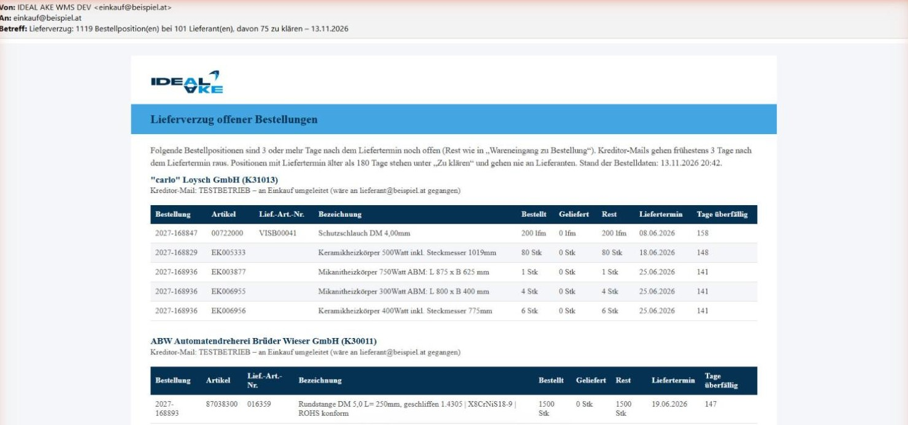
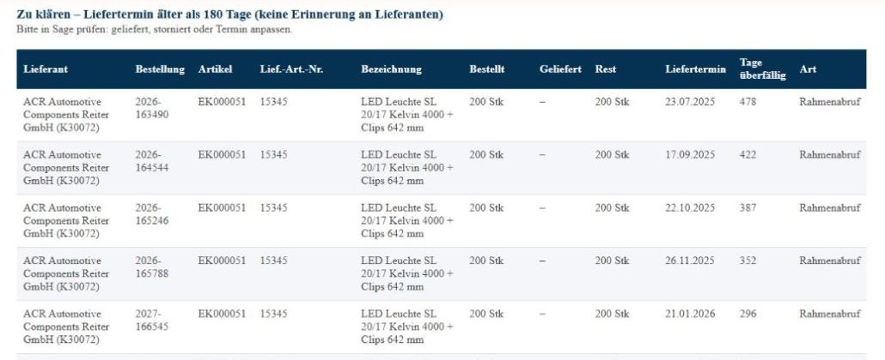
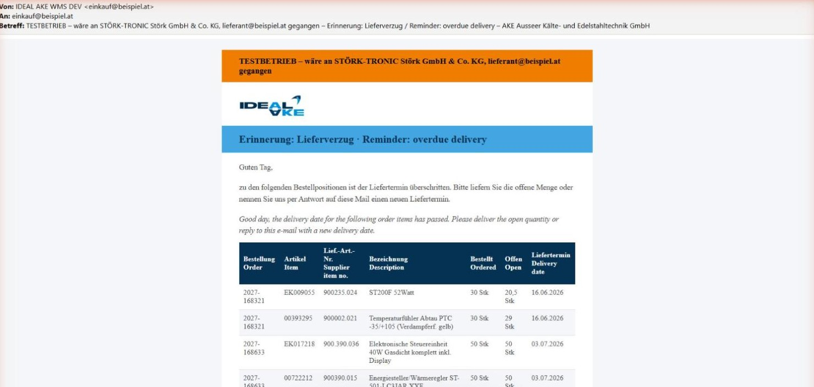

# 07 – Lieferverzug-Mail (für den Einkauf)

Stand: Version 1.99.22 · Standort AKE · Bilder aus einer Testmail des AKE-Testsystems (Mailadressen ersetzt)

## Zweck

Der WMS-Dienst prüft einmal am Werktag die offenen Sage-Bestellungen (dieselben Daten wie **Lager → Offene Bestellungen**,
[Anleitung 06](06-offene-bestellungen-rahmenabrufe.md)) und meldet **verzögerte Lieferungen**:

1. **Sammelliste an den Einkauf** – eine Mail mit allen verzögerten Bestellpositionen, nach Lieferant gruppiert, mit dem Abschnitt
   **„Zu klären“** für sehr alte Positionen.
2. **Kreditor-Mail** – je Lieferant eine Erinnerung (Deutsch und Englisch) mit seinen verzögerten Positionen. Solange der **Testbetrieb** an ist,
   gehen diese Mails **nicht** an den Lieferanten, sondern an den Einkauf.

Der Einkauf muss im WMS nichts anklicken. Diese Anleitung erklärt, wie man die Mails liest und was zu tun ist.

## Wer darf

Die Mails gehen an die Adressen in der Service-Einstellung **Einkauf: Empfänger**. Eine Rolle im WMS braucht man dafür nicht.

Alle Einstellungen stehen unter *Stammdaten → Service-Einstellungen → Lieferverzug-Mail* und werden von der **WMS-Betreuung (Administrator)**
gepflegt. Wichtig für den Einkauf:

| Einstellung | Standard | Wirkung |
|---|---|---|
| Lieferverzug-Mails | aus | Hauptschalter |
| Sammelliste: Tage nach Liefertermin | 3 | ab wann eine Position in der Sammelliste steht (Kalendertage) |
| Kreditor-Mail: Tage nach Liefertermin | 3 | ab wann eine Position in die Kreditor-Mail kommt (wirksam ist der größere der beiden Werte) |
| Altersgrenze (Tage nach Liefertermin) | 180 | ältere Positionen nur unter „Zu klären“, nie an Lieferanten (0 = keine Grenze) |
| Kreditor-Mail auch für Rahmenabrufe | aus | aus: Abrufe nur in der Sammelliste |
| Versand ab (Uhr) | 7 | Versand im ersten Dienstlauf ab dieser Uhrzeit, Montag bis Freitag |
| Erinnerung an Kreditoren | aus | Kreditor-Mails überhaupt erzeugen |
| Testbetrieb (Kreditor-Mails an den Einkauf) | an | an: Kreditor-Mails gehen an den Einkauf statt an den Lieferanten |
| Kreditor: erneut erinnern nach | 7 | Abstand in Tagen bis zur nächsten Erinnerung derselben Position |
| Kreditor: max. Mails je Lauf | 30 | Sicherheitsgrenze; wären es mehr, geht keine Kreditor-Mail raus |
| Absenderadresse / Antwortadresse Kreditor-Mail | – | Antworten der Lieferanten landen bei der Antwortadresse |

Je Lieferant: *Stammdaten → Kreditoren → Bearbeiten* – Haken **Erinnerungen bei Lieferverzug** (abschalten für einzelne Lieferanten) und
Feld **Adresse für Erinnerungen** (sonst die E-Mail aus dem Kreditor-Stamm).

## Schritt für Schritt

### 1. Sammelliste lesen

Betreff z. B.: „Lieferverzug: 1119 Bestellposition(en) bei 101 Lieferant(en), davon 75 zu klären – 13.11.2026“.

- **Einleitung:** ab wie vielen Tagen eine Position aufgeführt ist, ab wann Kreditor-Mails rausgehen, die Altersgrenze und der **Stand der
  Bestelldaten**.
- **Je Lieferant** eine Überschrift (Name und Kreditor-Nummer) und darunter die Zeile **„Kreditor-Mail: …“** – was mit der Erinnerung an diesen
  Lieferanten passiert ist, z. B.:
  - „gesendet“ bzw. im Testbetrieb „TESTBETRIEB – an Einkauf umgeleitet (wäre an … gegangen)“,
  - „nächste Erinnerung am …“ (schon erinnert, Wartezeit läuft),
  - „Kreditor-Mail ab <Datum>“ bzw. „n Position(en) erst ab <Datum>“ (noch zu früh),
  - „keine Adresse“ / ungültige Adresse, „abgeschaltet“, „Lieferant gesperrt“, „Kreditor inaktiv“, „kein Kreditor im WMS“, „ausgesetzt“,
  - „n Rahmenabruf/-abrufe nicht an Lieferanten (Einstellung)“.
- **Tabelle:** Bestellung, Artikel, **Lief.-Art.-Nr.** (Bestellnummer des Artikels beim Lieferanten), Bezeichnung, Bestellt, Geliefert, **Rest**,
  Liefertermin, **Tage überfällig**. Bei Rahmenabrufen steht unter „Geliefert“ ein „–“.
- Am Ende ein Link **Zu den offenen Bestellungen** – öffnet die Liste im WMS mit „nur überfällig“.

**Rest** ist derselbe Wert wie in *Wareneingang zu Bestellung*: was laut Sage offen ist, abzüglich der im WMS schon eingebuchten Menge.

### 2. Abschnitt „Zu klären“

Positionen, deren Liefertermin länger als die **Altersgrenze** (Standard 180 Tage) zurückliegt, stehen gesammelt am Ende:

Diese Positionen gehen **nie** an den Lieferanten. Meist sind sie in Wirklichkeit geliefert, storniert oder der Termin ist veraltet.
**Bitte in Sage prüfen:** geliefert, storniert oder Termin anpassen. Die Spalte **Art** sagt, ob es eine Bestellung oder ein Rahmenabruf ist.

### 3. Kreditor-Mail (im Testbetrieb)

Im Testbetrieb kommt jede Lieferanten-Erinnerung zusätzlich als eigene Mail an den Einkauf – mit oranger Zeile und Betreff
„TESTBETRIEB – wäre an <Lieferant>, <Adresse> gegangen – Erinnerung: Lieferverzug / Reminder: overdue delivery – …“.

So prüft der Einkauf vor dem Echtbetrieb: Stimmen Lieferant, Adresse, Positionen und Mengen? Würde man diese Mail so an den Lieferanten
schicken wollen?

Im **Echtbetrieb** (Testbetrieb aus) bekommt der Lieferant genau diese Mail ohne orange Zeile. Antworten gehen an die eingestellte
Antwortadresse.

### 4. Was tun mit der Sammelliste?

1. **Lieferanten mit „Kreditor-Mail: keine Adresse“** o. ä.: Adresse im Kreditor-Stamm (Sage bzw. *Adresse für Erinnerungen*) ergänzen lassen
   oder den Lieferanten selbst anrufen.
2. **„Zu klären“**: in Sage bereinigen (siehe Schritt 2).
3. **Rahmenabrufe**: prüfen, ob die Lieferung vielleicht direkt in Sage gebucht wurde – das WMS zieht solche Lieferungen nicht ab.
4. Lieferanten, die keine Erinnerung bekommen sollen: WMS-Betreuung bitten, beim Kreditor **Erinnerungen bei Lieferverzug** abzuschalten.

## Wann kommt die Mail?

- Montag bis Freitag, im ersten Dienstlauf ab **Versand ab (Uhr)** (Standard 7 Uhr), **höchstens einmal am Tag** – auch nach einem
  Dienst-Neustart. Feiertage zählen als Versandtag.
- Nur wenn mindestens eine Position verzögert ist.
- **Schutz:** Sind die Bestelldaten älter als 24 Stunden, gehen keine Lieferanten-Mails raus (Hinweis in der Sammelliste).
- Eine Position wird dem Lieferanten frühestens nach **Kreditor: erneut erinnern nach** Tagen (Standard 7) wieder gemeldet. Ändert sich der
  Liefertermin in Sage, beginnt die Zählung neu.

## Unterschiede AKE und IDEAL

Die Lieferverzug-Mail setzt den Abgleich der offenen Bestellungen voraus. Den gibt es derzeit nur bei **AKE**; bei IDEAL ist sie aus.

## Hinweise und Stolperfallen

**Bekannte Fehler (Stand 14.11.2026, Behebung geplant):**

- **Keine Sammelliste an einem Tag.** Scheitert nur das Senden der Sammelliste (z. B. Mailserver kurz weg), wird sie an diesem Tag nicht
  nachgeholt – die Kreditor-Mails können trotzdem rausgegangen sein. Fehlt die Sammelliste an einem Werktag (bis ca. 1 Stunde nach der
  Versandzeit), bitte die WMS-Betreuung informieren; sie sieht im Aktivitäts-Protokoll (Lauf „Lieferverzug-Mails“), was passiert ist.
- **Doppelte Erinnerung (selten).** Bei einer Datenbankstörung während des Versands kann ein Lieferant dieselbe Erinnerung zweimal bekommen.
- **Fehlermail im Echtbetrieb.** Wären mehr Kreditor-Mails fällig als die Sicherheitsgrenze erlaubt, geht keine raus und die WMS-Betreuung
  bekommt eine Fehlermail – unter Umständen bei jedem Dienstlauf, bis die Grenze angepasst ist.

**Allgemein:**

- **Testbetrieb ausschalten heißt: echte Mails an Lieferanten.** Das ist nicht rückholbar. Vorher mit der WMS-Betreuung die Sammellisten und
  Testmails einige Tage prüfen, die Adressen der Lieferanten bereinigen und die Grenze je Lauf festlegen.
- **Rahmenabrufe** gehen standardmäßig nicht an Lieferanten. Erst einschalten, wenn feststeht, dass Abruf-Lieferungen nicht direkt in Sage
  gebucht werden – sonst erinnert die Mail an bereits Geliefertes.
- **Lief.-Art.-Nr.** ist leer, wenn für den Artikel beim Lieferanten in Sage keine Bestellnummer gepflegt ist.
- Positionen **ohne Liefertermin** erscheinen nie.

## Häufige Fragen

**Ein Lieferant hat schon geliefert, steht aber noch in der Liste.**
Entweder ist die Ware noch nicht im WMS eingebucht (dann einbuchen, Anleitung 05) oder Sage hat den Wareneingang, aber der nächste Abgleich
lief noch nicht. Bei Rahmenabrufen: Lieferung wurde evtl. direkt in Sage gebucht (siehe oben).

**Warum steht bei einem Lieferanten „Kreditor-Mail ab …“?**
Die Position ist schon in der Sammelliste, aber noch nicht lange genug überfällig für die Kreditor-Mail.

**Wie stoppe ich die Erinnerungen an einen bestimmten Lieferanten?**
WMS-Betreuung bitten, beim Kreditor **Erinnerungen bei Lieferverzug** abzuschalten. In der Sammelliste steht er dann mit „abgeschaltet“.

**Bekomme ich die Sammelliste auch am Samstag?**
Nein, nur Montag bis Freitag.
