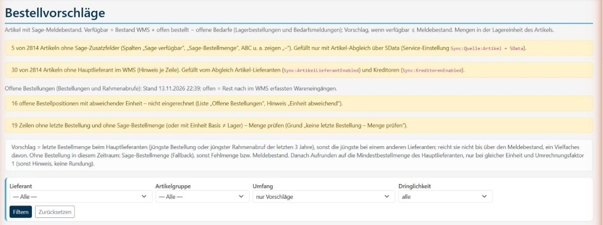
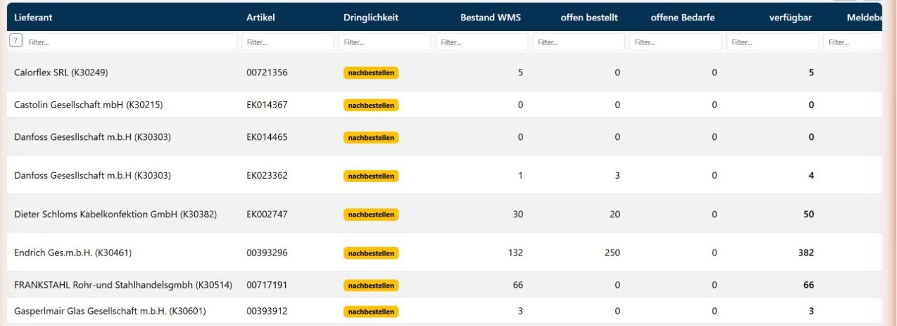
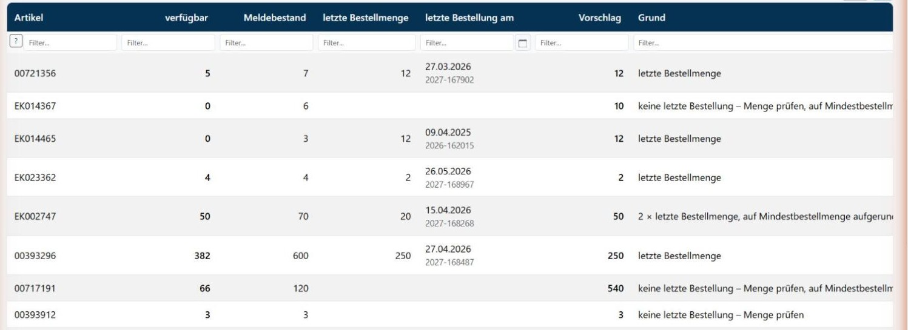

# 08 – Bestellvorschläge

Stand: Version 1.99.22 · Standort AKE · Bilder aus dem AKE-Testsystem

## Zweck

**Einkauf → Bestellvorschläge** ist die Arbeitsliste des Einkaufs für alle Artikel mit **Meldebestand in Sage**. Das WMS rechnet je Artikel,
wie viel verfügbar ist, und schlägt eine Bestellmenge vor, wenn der Meldebestand erreicht ist. Die Liste ist **nur zum Lesen**: Die Bestellung
legt der Einkauf wie gewohnt in Sage an; das WMS schickt nichts an Sage.

## Wer darf

| Aufgabe | Rolle (wie unter *Stammdaten → Rollen*) |
|---|---|
| Bestellvorschläge ansehen, filtern, CSV | **Einkauf** |
| alles | **Administrator** |

**Einstellung** (*Stammdaten → Einstellungen*, pflegt die WMS-Betreuung): **Einkauf – Bestellvorschläge** muss an sein (Standard **aus**, auch
für Administratoren). Damit die Spalten gefüllt sind, müssen die Dienst-Abgleiche Artikel (über SData), Kreditoren, Artikel-Lieferanten und
Offene Bestellungen gelaufen sein. Die Einstellung **Offene Bedarfe (Einkauf)** legt fest, ob Lagerbestellungen und/oder Bedarfsmeldungen
abgezogen werden (Standard beide).

## So rechnet die Liste

**verfügbar = Bestand WMS + offen bestellt − offene Bedarfe.** Ein Vorschlag entsteht, wenn *verfügbar* **kleiner oder gleich** dem
*Meldebestand* ist. Alle Mengen in der **Lagereinheit** des Artikels.

| Begriff | Bedeutung |
|---|---|
| Bestand WMS | Bestand auf allen Lagerplätzen außer Kommissionierwagen (auch inaktive und nicht buchbare Plätze) |
| offen bestellt | Rest aller offenen Sage-Bestellungen und Rahmenabrufe des Artikels, abzüglich der im WMS schon eingebuchten Mengen – wie in *Offene Bestellungen* |
| offene Bedarfe | abgeschickte Lagerbestellungen (teilgeliefert: nur der Rest der Fehlteile) und offene Bedarfsmeldungen |
| Meldebestand | aus Sage |
| Sage verfügbar | nur zum Vergleich (Stand letzter Artikel-Abgleich, siehe Tooltip), wird nicht eingerechnet |

**Vorschlagsmenge** in dieser Reihenfolge:

1. **Letzte Bestellmenge** beim Hauptlieferanten: Menge der jüngsten Sage-Bestellung oder des jüngsten Rahmenabrufs der **letzten 3 Jahre**
   (Spalten *letzte Bestellmenge* und *letzte Bestellung am* mit Belegnummer).
2. Gibt es beim Hauptlieferanten keine, die jüngste Bestellung bei einem **anderen Lieferanten** (Hinweis „letzte Bestellung bei …“).
3. Reicht diese Menge nicht, um über den Meldebestand zu kommen, ein **Vielfaches** davon (Grund z. B. „2 × letzte Bestellmenge“).
4. Gibt es in 3 Jahren bei keinem Lieferanten eine Bestellung: die **Sage-Bestellmenge** des Artikels – **Fallback** (Kennzeichen „Fallback“,
   Hinweis „Fallback: Sage-Bestellmenge (keine Bestellung in 3 Jahren)“).
5. Fehlt auch sie: die Fehlmenge bis zum Meldebestand (bei Fehlmenge 0 der Meldebestand), Grund „keine letzte Bestellung – Menge prüfen“.

Danach wird auf die **Mindestbestellmenge** des Hauptlieferanten **aufgerundet** – aber nur, wenn deren Einheit leer oder gleich der
Artikel-Einheit ist und der Umrechnungsfaktor 1 beträgt. Sonst steht ein Hinweis da und es wird nicht gerundet.

Weicht in Sage die Basis- von der Lagereinheit ab, wird die letzte Bestellmenge **nicht** verwendet (Hinweis „Einheit Basis ≠ Lager – letzte
Bestellmenge nicht verwendet“).

## Schritt für Schritt

### 1. Liste öffnen, Banner lesen

Menü **Einkauf → Bestellvorschläge**.

Die **Banner** oben melden, wo Daten fehlen – sie zeigen, wie verlässlich die Zahlen sind:

- „… Artikeln ohne Sage-Zusatzfelder“ – Spalten wie *Sage verfügbar*, *Sage-Bestellmenge*, *ABC* zeigen „–“.
- „… Artikeln ohne Hauptlieferant im WMS“ – Hinweis je Zeile.
- „Offene Bestellungen aus Sage nicht gelesen“ – *offen bestellt* zeigt „–“, gerechnet wird ohne offene Bestellungen (Vorschläge dann zu hoch).
- „… offene Bestellpositionen mit abweichender Einheit – nicht eingerechnet“ bzw. „… Bedarfszeilen mit anderer Einheit … – nicht eingerechnet“.
- „Letzte Bestellmengen noch nicht gelesen“.
- „… Zeilen mit Fallback Sage-Bestellmenge“ – mit Spaltenfilter *Hinweis* = `Fallback` sichtbar machen.
- „… Zeilen ohne letzte Bestellung und ohne Sage-Bestellmenge … – Menge prüfen“.

### 2. Filtern

- **Lieferant**, **Artikelgruppe**.
- **Umfang:** „nur Vorschläge“ (Standard) oder „alle Artikel mit Meldebestand“.
- **Dringlichkeit:** „kritisch“ (verfügbar unter 0) oder „nachbestellen“ (verfügbar bis Meldebestand).
- **Filtern** bzw. **Zurücksetzen**. Dazu Spaltenfilter unter jedem Spaltenkopf, z. B. *letzte Bestellmenge* `>=400`.

Sortiert ist nach Lieferant und Artikelnummer; Artikel ohne Lieferant stehen am Ende.

### 3. Zeilen lesen

Die Tabelle hat viele Spalten. Linker Teil – Bestand und Rechnung:

Rechter Teil – Vorschlag und Begründung:

- **Dringlichkeit:** „kritisch“ (rot) bzw. „nachbestellen“ (gelb) – immer als Text.
- **Vorschlag** und **Grund** gehören zusammen: Der Grund sagt, woher die Menge kommt (z. B. „letzte Bestellmenge, auf Mindestbestellmenge
  aufgerundet“).
- Weitere Spalten: *nächster Liefertermin*, *Einheit*, *Mindestbestellmenge*, *Sage-Bestellmenge*, *Bestellnr. Lieferant*, *WBZ (Tage)*
  (Wiederbeschaffungszeit), *Wunschtermin* (= heute + WBZ), *letzter Lieferant*, *ABC*, *USER_Mindestbestand* (nur Anzeige) und *Hinweis*
  (z. B. „Kreditor fehlt im WMS“, „Einheit Basis ≠ Lager …“).
- Über das **Zahnrad** lassen sich Spalten ausblenden (wird für den eigenen Benutzer gespeichert).

### 4. Bestellen und exportieren

1. Vorschlag prüfen (Grund, Hinweis, Mindestbestellmenge).
2. Bestellung in **Sage** anlegen.
3. Optional **CSV** – exportiert die sichtbaren Spalten, z. B. als Arbeitsliste je Lieferant (vorher nach Lieferant filtern).

Nach dem nächsten Abgleich der offenen Bestellungen zählt die neue Bestellung unter *offen bestellt*. Liegt *verfügbar* dann über dem
Meldebestand, verschwindet der Vorschlag aus „nur Vorschläge“.

## Unterschiede AKE und IDEAL

Nur **AKE**. Bei IDEAL bleibt „Einkauf – Bestellvorschläge“ ausgeschaltet, bis dort die SData-Schnittstelle läuft; der Menüpunkt fehlt und ein
direkter Aufruf meldet „Einkauf – Bestellvorschläge ist deaktiviert …“.

## Hinweise und Stolperfallen

**Bekannte Fehler und offene Punkte (Stand 14.11.2026):**

- **Fallback und Einheiten.** Bei Zeilen mit Kennzeichen **Fallback** prüft die Liste nicht, ob Basis- und Lagereinheit des Artikels
  übereinstimmen. Bei Artikeln mit unterschiedlichen Einheiten (z. B. Basis Stk, Lager PKG) die Menge bitte selbst prüfen. Derzeit betrifft das
  im Testsystem keinen Artikel.
- **Glasbestellungen zählen als offene Bedarfe.** Abgeschickte Glasbestellungen werden wie Lagerbestellungen von *verfügbar* abgezogen. Ob
  das so gewollt ist, klärt der Einkauf mit der WMS-Betreuung.

**Allgemein:**

- **Nur so aktuell wie die Abgleiche.** Bestand WMS ist live, *offen bestellt* hat den Stand des letzten Bestellungs-Abgleichs (oben „Stand“),
  letzte Bestellmengen den Stand des Laufs „Artikel-Lieferanten“.
- Eine eben in Sage angelegte Bestellung ist bis zum nächsten Abgleich noch nicht eingerechnet – Vorschlag dann nicht doppelt bestellen.
- **Offene Bedarfe aufräumen:** Erledigte Bedarfsmeldungen erfüllen oder stornieren, erledigte Lagerbestellungen abschließen. Sonst ist
  *verfügbar* zu niedrig und der Vorschlag zu hoch.
- Positionen mit **abweichender Einheit** (Bestellung oder Bedarf) sind nicht eingerechnet – siehe Banner.

## Häufige Fragen

**Warum fehlt ein Artikel?**
Entweder hat er in Sage keinen Meldebestand, oder er braucht gerade keinen Vorschlag. Umfang **alle Artikel mit Meldebestand** zeigt alle.

**Warum ist der Vorschlag so groß?**
Siehe Spalte **Grund**: meist ein Vielfaches der letzten Bestellmenge oder Aufrunden auf die Mindestbestellmenge.

**Was heißt „keine letzte Bestellung – Menge prüfen“?**
In 3 Jahren gab es keine Bestellung und in Sage ist keine Bestellmenge gepflegt (oder die Einheiten passen nicht). Die Menge ist dann nur die
Fehlmenge bis zum Meldebestand – bitte selbst festlegen.

**Wird die Bestellung aus der Liste an Sage geschickt?**
Nein. Die Liste ist nur zum Lesen; bestellt wird in Sage.
