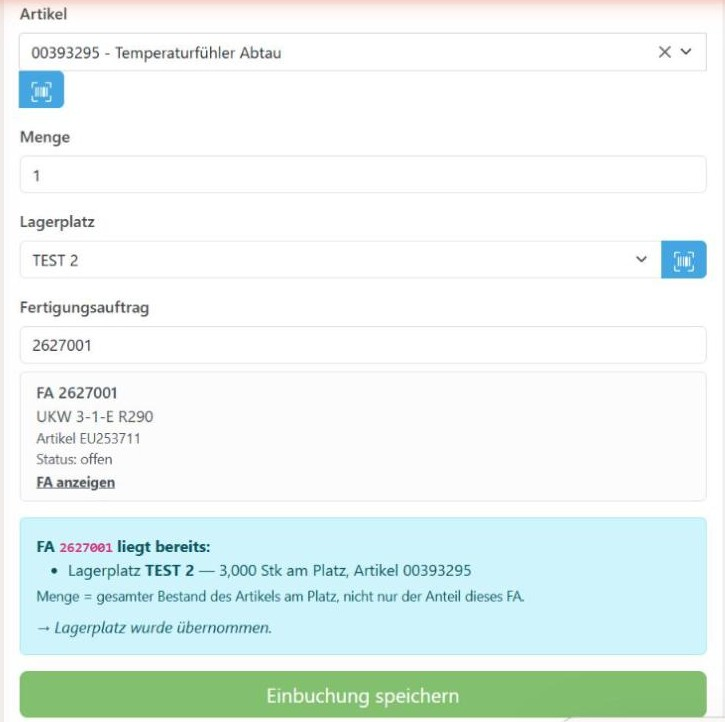
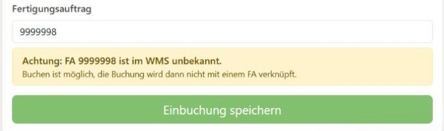
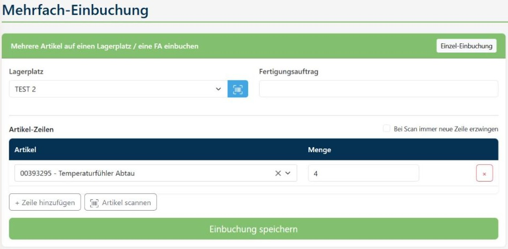
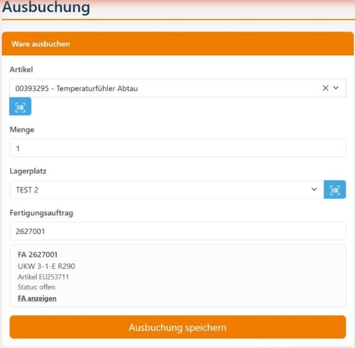
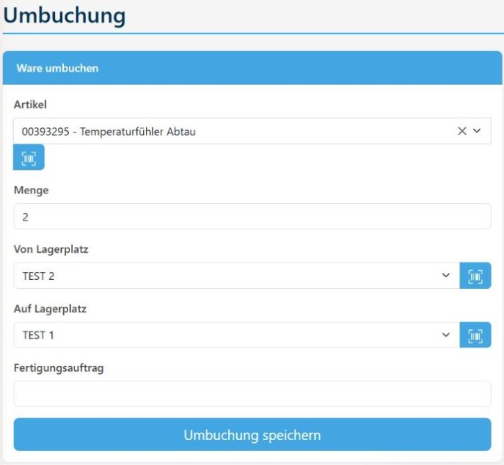
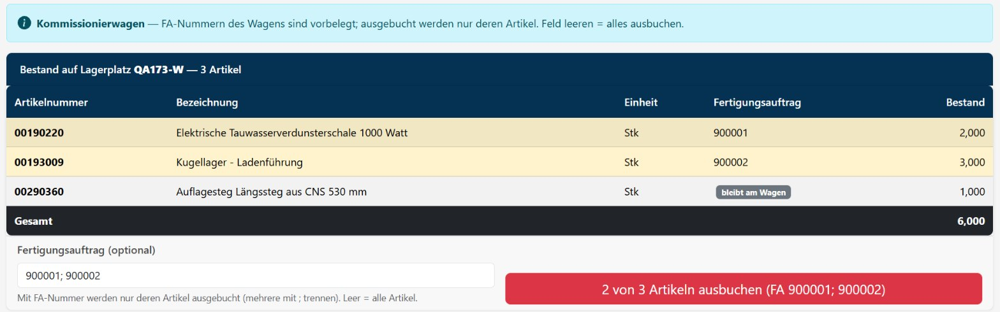
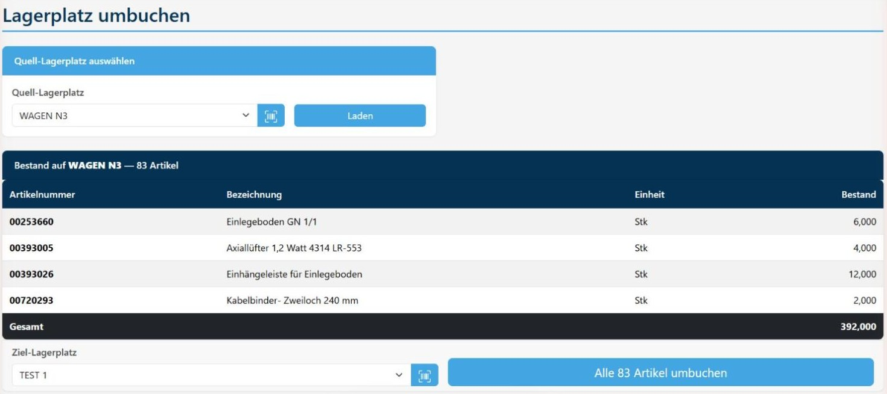

# 09 – Einbuchen, Ausbuchen, Umbuchen

Stand: Version 1.99.66 (Text „Sage-Buchungen“; sonst 1.99.47) · Standorte AKE und IDEAL · Bilder aus dem AKE-Testsystem

## Zweck

Mit diesen Masken hält das Lager den Bestand im WMS aktuell:

| Maske (Menü **Lager**) | wofür |
|---|---|
| **Einbuchung** | Ware kommt auf einen Lagerplatz (ein Artikel) |
| **Mehrfach-Einbuchung** | mehrere Artikel auf einen Lagerplatz, optional zu einem FA |
| **Ausbuchung** | Ware verlässt einen Lagerplatz (ein Artikel) |
| **Umbuchung** | ein Artikel wechselt von einem Lagerplatz auf einen anderen |
| **Lagerplatz ausbuchen** | der ganze Bestand eines Lagerplatzes wird auf einmal ausgebucht |
| **Lagerplatz umbuchen** | der ganze Bestand eines Lagerplatzes wird auf einmal auf einen anderen Platz gebracht, z. B. Kommissionierwagen → Lager |

Jede Buchung steht danach in **Lager → Bewegungshistorie** (mit Datum, Benutzer und FA). Ware, die zu einer Sage-Bestellung geliefert
wird, bucht man besser über **Lager → Wareneingang zu Bestellung** ([Anleitung 05](05-wareneingang-zu-bestellung.md)).

## Wer darf

| Aufgabe | Rolle (wie unter *Stammdaten → Rollen*) |
|---|---|
| Einbuchung, Mehrfach-Einbuchung, Ausbuchung, Umbuchung | **Lager**, **Lager Keyuser** oder **Kommissionierer** |
| Lagerplatz ausbuchen, Lagerplatz umbuchen | **Lager Keyuser** oder **Kommissionierer** |
| Bestände und Bewegungshistorie nur ansehen | zusätzlich **Lagerbestand-Ansicht** |
| alles | **Administrator** |

**Einstellungen** (pflegt die WMS-Betreuung, *Stammdaten → Einstellungen*):

- **Buchungen ins Minus erlauben** (Standard aus) und **Ausweich-Lagerplatz für Minus-Buchungen** (Standard `NAN`) – siehe Hinweise.
- **FA-Pflicht bei Buchungen** (Standard leer = keine Pflicht) – je Buchungsart wählbar.
- **QR-Code mit FA-Nummer**, **QR-Code: erstes Feld**, **QR-Code: Trennzeichen** – wie ein Artikel-Etikett gelesen wird.
- **Bedarfsmeldungen aus der Stückliste** – nur dann zeigt die Einbuchung offene Bedarfsmeldungen.
- **Hardware-Barcodescanner** (Standorteinstellungen) – für Handscanner und Handhelds mit eingebautem Scanner.

## Schritt für Schritt

### 1. Einbuchung

Menü **Lager → Einbuchung**.

1. **Artikel** wählen: Artikelnummer oder Bezeichnung tippen und aus der Liste wählen – oder mit dem Knopf darunter das Artikel-Etikett
   scannen (Kamera oder Handscanner).
2. **Menge** eintragen (steht anfangs auf 1).
3. **Lagerplatz** wählen oder mit dem Knopf daneben den Lagerplatz-Barcode scannen.
4. Optional **Fertigungsauftrag** eintragen, scannen oder aus den Vorschlägen wählen (beim Tippen schlägt das WMS offene FAs vor).
   Steht auf dem Artikel-Etikett eine FA-Nummer und ist „QR-Code mit FA-Nummer“ an, füllt der Scan das Feld mit.
5. **Einbuchung speichern**. Oben erscheint „Einbuchung erfolgreich gespeichert.“

**Was das FA-Feld anzeigt:**

- Eine graue **Karte** mit FA-Nummer, Bezeichnung, Artikel, Status (offen, erledigt, storniert, in Sage vermisst) und dem Link „FA anzeigen“.
- **Blauer Hinweis „FA … liegt bereits“:** Teile dieses FA liegen schon auf einem Lagerplatz. Liegt der FA an genau einem Platz und war noch
  kein Lagerplatz gewählt, übernimmt das WMS diesen Platz („→ Lagerplatz wurde übernommen.“). Die genannte Menge ist der **gesamte Bestand
  des Artikels am Platz**, nicht nur der Anteil dieses FA.
- **Gelbe Warnung** statt der Karte, wenn der FA an mehreren Plätzen liegt (mit Mengen – bitte gezielt wählen) oder auf einem inaktiven bzw.
  nicht buchbaren Platz (Platz von Hand wählen).
- **Gelbe Karte „FA … ist im WMS unbekannt“:** Buchen geht trotzdem, die Buchung wird aber nicht mit einem FA verknüpft (nach dem Speichern
  kommt dazu eine Warnung). Bitte Nummer prüfen.

**Offene Bedarfsmeldungen:** Gibt es zum gewählten Artikel offene Bedarfsmeldungen (Fehlteile, die der Einkauf bestellen sollte), erscheint
unter dem Formular der Kasten **Offene Bedarfsmeldungen für diesen Artikel**. Die Meldungen, die mit dieser Lieferung erledigt sind, anhaken –
nach dem Speichern stehen sie auf „Erfüllt“. Bild und Einzelheiten: [Anleitung 04, Schritt 4](04-bedarfsmeldung.md).

### 2. Mehrfach-Einbuchung

Menü **Lager → Mehrfach-Einbuchung** – wenn mehrere Artikel auf denselben Lagerplatz (und optional denselben FA) kommen.

1. **Lagerplatz** wählen bzw. scannen, optional **Fertigungsauftrag**.
2. Je Artikel eine Zeile: Artikel wählen, **Menge** eintragen. **+ Zeile hinzufügen** für die nächste Zeile, **×** löscht eine Zeile.
3. **Artikel scannen**: Steht der Artikel schon in einer Zeile, erhöht jeder Scan dort die Menge um 1 („— Menge erhöht“); sonst füllt er die
   nächste leere Zeile bzw. legt eine neue an. Mit dem Haken **Bei Scan immer neue Zeile erzwingen** bekommt jeder Scan eine eigene Zeile.
4. **Einbuchung speichern**. Meldung „… Artikel erfolgreich eingebucht.“

Ist eine Zeile fehlerhaft, wird sie markiert und **es wird gar nichts gebucht** („Bitte korrigieren Sie die markierten Zeilen — es wurde
nichts gebucht.“). Oben rechts führt **Einzel-Einbuchung** zurück zur normalen Einbuchung.

### 3. Ausbuchung

Menü **Lager → Ausbuchung**.

1. **Artikel**, **Menge** (steht anfangs auf 0 – bitte eintragen), **Lagerplatz** und optional **Fertigungsauftrag** wie bei der Einbuchung.
2. Optional **Abteilung** (ab 1.99.68): die Werkbank, für die entnommen wird. Leer lassen = keine Abteilung. Die Abteilung steht bei der
   Sage-Buchung (Feld *Referenz* und Memo der Buchungszeile).
3. **Ausbuchung speichern**.

Das WMS prüft den Bestand **an diesem Lagerplatz**. Reicht er nicht, kommt „Nicht genügend Bestand. Verfügbar: …“ und nichts wird gebucht –
außer „Buchungen ins Minus erlauben“ ist an (siehe Hinweise).

### 4. Umbuchung

Menü **Lager → Umbuchung**.

1. **Artikel** und **Menge**.
2. **Von Lagerplatz** (Quelle) und **Auf Lagerplatz** (Ziel) wählen oder scannen. Beide dürfen nicht gleich sein.
3. Optional **Fertigungsauftrag**.
4. **Umbuchung speichern**.

Reicht der Bestand am Quell-Platz nicht: „Nicht genügend Bestand am Quell-Lagerplatz. Verfügbar: …“.

### 5. Lagerplatz ausbuchen

Menü **Lager → Lagerplatz ausbuchen**: bucht den Bestand eines Platzes auf einmal aus – **alle** Artikel bei leerem Feld
**Fertigungsauftrag**, sonst **nur die Artikel dieses FA** (ab 1.99.47).

1. **Lagerplatz** wählen oder scannen, **Laden**. Die Tabelle zeigt jeden Artikel mit Fertigungsauftrag, Bestand und unten die Summe.
   An IDEAL steht bei einer Sub-FA die Haupt-FA dabei („S1 (Haupt-FA H)“).
2. Bei einem **Kommissionierwagen** füllt das WMS das Feld **Fertigungsauftrag (optional)** selbst mit den FAs des Wagens. Die Vorbelegung
   wirkt als Filter: Artikel ohne FA tragen „bleibt am Wagen“ und bleiben auf dem Wagen. **Feld leeren = alles ausbuchen.**
   Optional **Abteilung** (ab 1.99.68) neben dem FA-Feld: gilt für **alle** Artikel, die ausgebucht werden.
3. **Feld leer:** roter Knopf **Alle … Artikel ausbuchen**, Rückfrage „Wirklich alle … Artikel … komplett ausbuchen?“ mit **OK** bestätigen.
   Meldung „… Artikel erfolgreich ausgebucht.“
4. **FA im Feld** (mehrere mit `;` trennen): Zeilen des FA sind gelb hinterlegt, die übrigen tragen „bleibt am Platz“ bzw. „bleibt am Wagen“.
   Der Knopf heißt **M von N Artikeln ausbuchen (FA …)**; gehört kein Artikel dazu, ist er gesperrt („Kein Artikel gehört zu diesem FA.“).
   An IDEAL schließt eine Haupt-FA ihre Sub-FA ein; eine Sub-FA nur sich selbst.
5. Der Knopf (oder Enter im Feld) öffnet einen Dialog: **Wird ausgebucht**, **Bitte entscheiden**, **Bleibt am Platz/Wagen**.
   Zeilen, an denen ein Zugang ohne FA liegt (z. B. aus dem Wareneingang), werden einzeln abgefragt – ebenso Zeilen mit weiteren FA
   oder einem FA nur aus einer Ausbuchung. Je Zeile **Ausbuchen** oder **Nicht ausbuchen** wählen (ausgebucht wird immer der ganze
   Bestand der Zeile); **Jetzt ausbuchen** ist gesperrt, solange Zeilen offen sind. **Abbrechen** bucht nichts.
6. Meldung „… Artikel zu FA … ausgebucht.“ mit den verbleibenden Artikeln („bleibt am Platz/Wagen“); die Seite zeigt den Rest.
   Hat sich der Bestand zwischen Anzeige und Bestätigen geändert, kommt „Bestand oder FA-Zuordnung … hat sich geändert … Nichts
   ausgebucht.“ – Auswahl erneut prüfen.

### 6. Lagerplatz umbuchen

Menü **Lager → Lagerplatz umbuchen**: bringt den ganzen Bestand eines Platzes auf einen anderen, z. B. einen Kommissionierwagen zurück ins Lager.

1. **Quell-Lagerplatz** wählen oder scannen, **Laden**.
2. **Ziel-Lagerplatz** wählen oder scannen.
3. **Alle … Artikel umbuchen** und die Rückfrage „Alle … Artikel von … nach … umbuchen?“ mit **OK** bestätigen.

Hier stehen in beiden Auswahllisten **alle** Lagerplätze, auch Kommissionierwagen.

### 7. Scannen mit Kamera oder Handscanner

- Jeder blaue Knopf mit dem Barcode-Symbol öffnet die **Kamera** (nur über HTTPS) – oder man lädt ein Foto des Codes hoch.
- Mit einem **Handscanner** bzw. einem Handheld mit eingebautem Scanner (Standort-Schalter „Hardware-Barcodescanner“ an): zuerst das Feld oder
  den Scan-Knopf **antippen**, dann scannen. Bei Geräten mit Fokus-Eingabe (z. B. Netum) kommt ohne angetipptes Feld nichts an.
- **Artikel-Etikett** (QR): erstes Feld Artikelnummer (oder Matchcode, je nach Einstellung), drittes Feld die FA-Nummer. Das Trennzeichen ist
  je Standort `;` oder `,`. Ein Etikett mit dem anderen Trennzeichen wird nicht erkannt („✗ Nicht gefunden: …“).
- **Scannen ohne Feld** (nur Einbuchung, Schalter in *Mein Profil*): Oben erscheint ein breites Scan-Feld. Einmal darauf tippen, bis es grün
  „✓ Scan bereit“ zeigt; dann Artikel und Lagerplatz in beliebiger Reihenfolge scannen. Gespeichert wird erst mit „Einbuchung speichern“.

Alles Weitere zum Scanner steht in der Hilfe unter **Barcode / QR-Code Scanner**.

## Unterschiede AKE und IDEAL

Masken und Abläufe sind gleich. Je Standort eingestellt sind:

| | AKE (Testsystem) | IDEAL (Testsystem) |
|---|---|---|
| Trennzeichen im Artikel-QR | `;` | `,` |
| Hardware-Barcodescanner | aus | an |
| Buchungen ins Minus | an | aus |

Diese Werte gelten für die Testsysteme; im Produktivsystem bitte die WMS-Betreuung fragen. Bei IDEAL zeigt die FA-Karte bei einer Sub-FA auch
den Haupt-FA („FA 1065141 (Haupt-FA 1059463)“).

## Hinweise und Stolperfallen

**Bekannte Fehler und offene Punkte (Stand 14.11.2026):**

- **Lagerplatz ausbuchen: Kommissionierwagen fehlen in der Auswahl.** In der Liste „Lagerplatz“ stehen nur aktive Plätze ohne Wagen. Einen
  Wagen erreicht man über das Fenster „Kommissionierwagen belegt“ in der Stückliste (Knopf „Lagerplatz ausbuchen“, siehe
  [Anleitung 01, Schritt 6](01-kommissionierung.md)) oder man nimmt
  **Lagerplatz umbuchen**, dort stehen alle Plätze. Ob das so gewollt ist, klärt die WMS-Betreuung.
- **Scanner-Karte im Profil, obwohl der Standort-Schalter aus ist.** Ist „Hardware-Barcodescanner“ für den Standort aus, zeigt *Mein Profil*
  trotzdem „Dieses Gerät – Hardware-Scanner auf diesem Gerät verwenden“ und das Kamera-Fenster das Feld „Handscanner“. Der Schalter wirkt dann
  nicht – Scannen mit dem Gerät geht erst, wenn der Standort-Schalter an ist.
- Der blaue Hinweis „FA … liegt bereits“ gilt **für den FA**, nicht für den gewählten Artikel: Er kann einen anderen Artikel nennen und
  trotzdem den Lagerplatz übernehmen. Platz vor dem Speichern prüfen.

**Allgemein:**

- **Wagen und inaktive Plätze:** In Einbuchung, Mehrfach-Einbuchung, Ausbuchung und Umbuchung stehen nur aktive Lagerplätze **ohne**
  Kommissionierwagen. Auf Wagen bucht die Kommissionierung ([Anleitung 01](01-kommissionierung.md)).
- **Buchungen ins Minus:** Ist die Einstellung an, wird bei zu wenig Bestand trotzdem gebucht – der fehlende Teil kommt vom
  Ausweich-Lagerplatz (Standard `NAN`). Gelbe Meldung „Lagerstand nicht verfügbar (Bestand: …), buche vom Lagerplatz NAN ab.“ Der Platz `NAN`
  zeigt danach negativen Bestand; das bitte regelmäßig klären.
- **FA-Pflicht:** Ist sie für die Buchungsart eingestellt, wird nur mit einem eindeutig gefundenen FA gebucht. Ein erledigter oder stornierter FA
  ergibt nur eine Warnung.
- **Sage:** Ein- und Ausbuchungen auf Lagerplätzen mit „Sage-Buchung erlaubt“ meldet der WMS-Dienst an Sage, wenn die WMS-Betreuung das
  eingeschaltet hat (Stand unter *Lager → Sage-Buchungen*, bis 1.99.65 „Sage-Lagerbuchungen“). Umbuchungen nur mit einem eigenen Schalter; Umbuchungen mit FA gehen nie an Sage.
  Ab 1.99.68 steht in Sage bei jeder Buchung im Feld *Referenz* „Kennung Abteilung Benutzer“, z. B. „SM#ATI#12345# C1 Gerald Weichbold“
  (höchstens 31 Zeichen – zu lange Texte werden am Ende gekürzt, die Kennung bleibt vollständig), im Memo der Buchungszeile der volle Text
  „WMS: SM#…# Benutzer Abteilung:C1“. Benutzer = Name des WMS-Benutzers, der gebucht hat.
- **Falsch gebucht?** Eine Buchung lässt sich nicht löschen. Mit der Gegenbuchung korrigieren (Einbuchung ↔ Ausbuchung, Umbuchung zurück) und in
  der Bewegungshistorie prüfen.
- Mengen mit Komma eingeben (`2,5`).

## Häufige Fragen

**Warum finde ich meinen Lagerplatz nicht in der Liste?**
Er ist inaktiv oder ein Kommissionierwagen. Inaktive Plätze schaltet die Stammdaten-Pflege unter *Stammdaten → Lagerplätze* frei; Wagen siehe oben.

**Ich sehe „Lagerplatz ausbuchen“ nicht im Menü.**
Dafür braucht man die Rolle **Lager Keyuser** oder **Kommissionierer**.

**Muss ich den FA immer eintragen?**
Nur wenn die FA-Pflicht für diese Buchungsart eingestellt ist. Sonst ist das Feld freiwillig – mit FA findet man die Teile später in der
Bestandsübersicht über den FA-Filter ([Anleitung 10](10-bestaende-spaltenfilter.md)).

**Der Scan füllt nichts aus.**
Feld antippen und erneut scannen. Bei „✗ Nicht gefunden“: Passt das Trennzeichen des Etiketts (`;` oder `,`) zum Standort? Gibt es den Artikel im
WMS? Bei Matchcode-Etiketten muss „QR-Code: erstes Feld“ auf Matchcode stehen.

**Wo sehe ich, was ich gebucht habe?**
*Lager → Bewegungshistorie*, z. B. mit Spaltenfilter „Benutzer“ und dem Datum von heute in „Datum/Zeit“.
