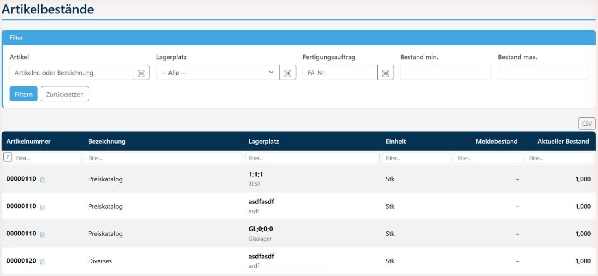
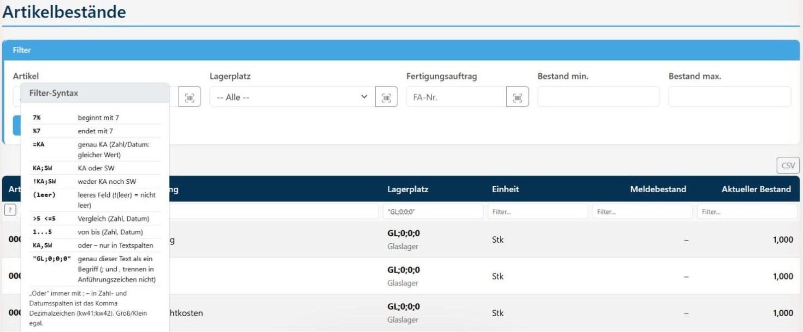
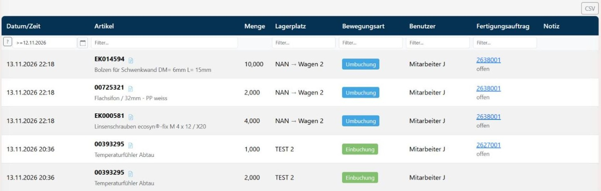
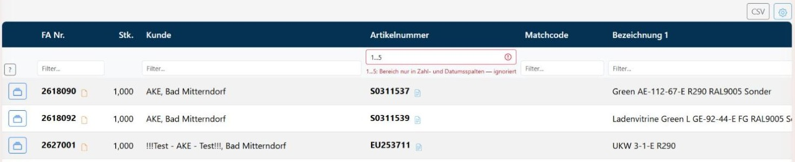
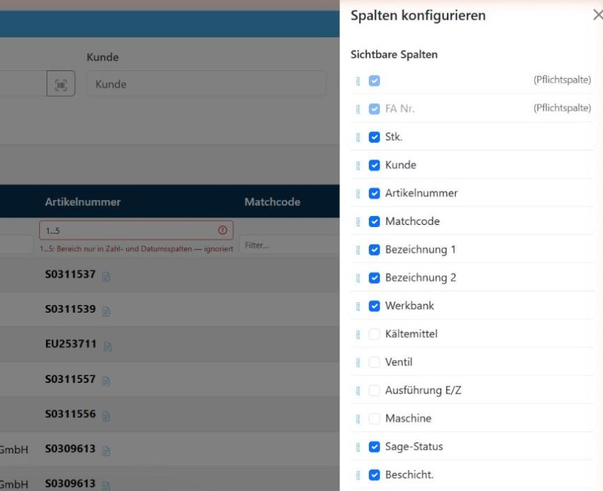
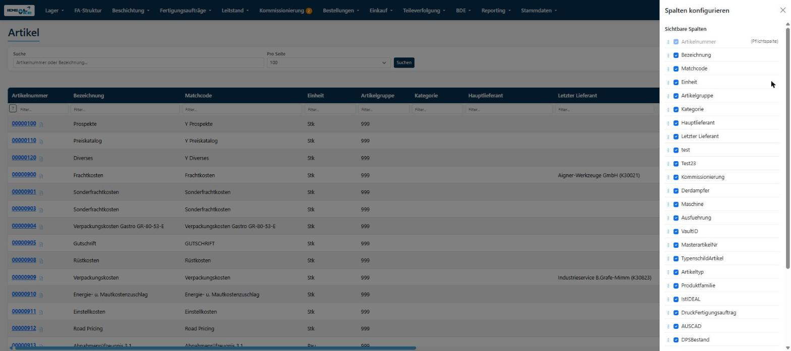
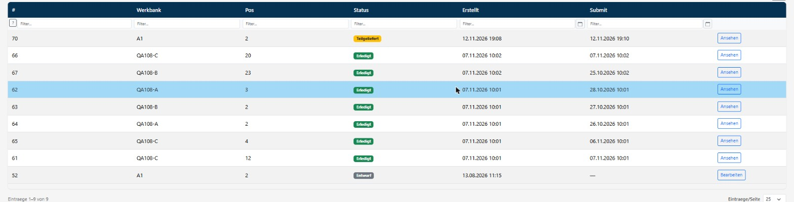

# 10 – Bestände und Spaltenfilter-Suche

Stand: Version 1.99.62 · Standorte AKE und IDEAL · Bilder aus dem AKE-Testsystem

## Zweck

**Lager → Bestände** (Seite „Artikelbestände“) zeigt, wie viel von welchem Artikel auf welchem Lagerplatz liegt. **Lager → Bewegungshistorie**
zeigt jede einzelne Buchung.

Diese Anleitung erklärt außerdem die **Spaltenfilter-Suche**, die in fast allen Listen des WMS gleich funktioniert (FA-Liste, Leitstand,
Kommissionierung, Bestände, Bewegungen, Artikel, Bestellungen, BDE-Buchungen …), die **Spaltenauswahl** über das Zahnrad und den **CSV-Export**.

## Wer darf

| Aufgabe | Rolle (wie unter *Stammdaten → Rollen*) |
|---|---|
| Bestände und Bewegungshistorie ansehen, filtern, CSV | **Lagerbestand-Ansicht**, **Lager**, **Lager Keyuser** oder **Kommissionierer** |
| alles | **Administrator** |

Spaltenfilter, Zahnrad und CSV brauchen kein eigenes Recht: Man filtert und exportiert genau das, was die Liste einem zeigt.

**Einstellungen** (*Stammdaten → Einstellungen*, Gruppe „Lager und Buchungen“): **Bestand: Warnschwelle** (Standard 150 % des Meldebestands, gelb)
und **Bestand: kritische Schwelle** (Standard 100 %, rot).

## Schritt für Schritt

### 1. Bestände ansehen

Menü **Lager → Bestände**.

- Je Zeile: **Artikelnummer**, **Bezeichnung**, **Lagerplatz** (darunter die Beschreibung des Platzes), **Einheit**, **Meldebestand**,
  **Aktueller Bestand**. Bestand 0 ist standardmäßig ausgeblendet.
- Kennzeichen am Lagerplatz: **★ Haupt** (Hauptlagerplatz des Artikels, steht zuerst), **inaktiv**, **nicht buchbar**.
- Farbe beim Bestand: orange = Warnschwelle erreicht, rot = kritisch (unter dem Meldebestand).
- Das kleine Dokument-Symbol neben der Artikelnummer öffnet die Suche nach dem Artikel im Vault (wenn die Vault-Links eingeschaltet sind).

**Filterkarte** oben:

| Feld | Wirkung |
|---|---|
| **Artikel** | Artikelnummer oder Bezeichnung; Knopf daneben = Artikel-Etikett scannen (setzt nur den Artikel, nie den FA) |
| **Lagerplatz** | Auswahl oder Barcode scannen |
| **Fertigungsauftrag** | zeigt, wo die Teile eines FA gerade liegen (z. B. auf welchem Wagen) – mit eigenem Scan-Knopf |
| **Bestand min.** / **Bestand max.** | nur Zeilen in diesem Mengenbereich |

**Filtern** wendet an, **Zurücksetzen** löscht alle Filter. Ist ein **Fertigungsauftrag** eingetragen, gelten die anderen Felder der Karte nicht.
Oben erscheint dann ein Kopf mit FA-Nummer und Status – oder „Achtung: FA im WMS unbekannt – angezeigt werden Buchungen mit diesem Text.“

### 2. Spaltenfilter: in der Zeile unter dem Spaltenkopf tippen

Unter jedem Spaltenkopf steht ein Feld „Filter…“. Tippen genügt, die Liste filtert sofort – **über alle Seiten**, nicht nur die angezeigte. Die
Zahl „Eintraege 1–25 von …“ unten zeigt die echte Trefferzahl. Groß- und Kleinschreibung spielen keine Rolle.

Der Knopf **?** links in der Filterzeile zeigt eine Kurzhilfe:

**Die Regeln mit Beispielen:**

| Eingabe | findet | Beispiel |
|---|---|---|
| `960` | enthält „960“ | Artikelnummer `960` |
| `4711%` | beginnt mit „4711“ | FA-Nr. `2607%` |
| `%-1` | endet mit „-1“ | FA-Nr. `%001` |
| `=KA` | genau „KA“ (nicht „KA2“) | Bewegungsart `=Ausbuchung` |
| `KA;SW` | KA **oder** SW | Artikelnummer `00722001;EK009055` |
| `KA,SW` | KA oder SW – **nur in Textspalten** | Kunde `Nordcap,AKE` |
| `!KA;SW` | weder KA noch SW (das `!` gilt für alle Teile; leere Felder bleiben sichtbar) | Bewegungsart `!Ausbuchung` |
| `(leer)` | Feld ist leer | Fertigungsauftrag `(leer)` |
| `!(leer)` | Feld ist nicht leer | Fertigungsauftrag `!(leer)` |
| `"GL;0;0;0"` | genau dieser Text als **ein** Begriff – in Anführungszeichen trennen `;` und `,` nicht | Lagerplatz `"GL;0;0;0"` |

Mit Anführungszeichen geht auch: `="GL;0;0;0"` (genau), `"GL;0;0;0"%` (beginnt mit), `!"GL;0;0;0"` (nicht), `"GL;0;0;0";LL%` (oder).
**Ohne** Anführungszeichen heißt `GL;0;0;0` „GL oder 0“ und findet viel zu viel – AKE-Lagerplätze daher immer in Anführungszeichen setzen.
Ein `"` mitten im Begriff (z. B. Zoll `1/2"`) ist ein normales Zeichen.

**Zahl- und Datumsspalten** (Mengen, Termine, „Datum/Zeit“, „Erstellt am“ …):

| Eingabe | findet |
|---|---|
| `>2`, `>=5`, `<10`, `<=5` | größer / größer-gleich / kleiner / kleiner-gleich |
| `1...3` | von 1 bis 3, beide Grenzen inklusive |
| `=1` | genau 1 |
| `>=01.10.2026`, `<01.10.2026` | ab / vor einem Datum (Datum als TT.MM.JJJJ) |
| `01.10.2026...31.10.2026` | Zeitraum, beide Tage inklusive |
| `13.11.2026` | genau dieser Tag |
| `KW42` | alle Termine der Kalenderwoche 42 |
| `10.2026` | alle Termine im Oktober 2026 |
| `kw41;kw42` | KW 41 oder KW 42 |

Wichtig: In Zahl- und Datumsspalten ist das **Komma das Dezimalzeichen** (`1.234,5`). „Oder“ schreibt man dort **nur mit Semikolon**:
`kw41;kw42`, nicht `kw41,kw42`. Datumsspalten haben neben dem Feld einen Kalenderknopf.

Bei Datum **mit Uhrzeit** zählt der ganze Tag: `>01.10.2026` heißt ab 02.10. 00:00, `<=01.10.2026` bis 01.10. 23:59.

**Rot umrandet** heißt: Ein Teil der Eingabe passt nicht zur Spalte. Darunter steht, was nicht stimmt; dieser Teil wird ignoriert, die übrigen wirken.

Weitere Regeln: `%` wirkt nur am Anfang oder Ende. Zeichen wie `_` oder `[` werden ganz normal gesucht.

Alle Filter stehen in der Adresszeile des Browsers. Zurück-Knopf, Lesezeichen und ein per Mail geschickter Link zeigen deshalb dieselbe Suche.

### 3. Spalten ein- und ausblenden (Zahnrad)

Über vielen Tabellen steht rechts oben ein **Zahnrad** (neben CSV). Ein Klick öffnet „Spalten konfigurieren“:

- Haken setzen oder entfernen = Spalte ein- oder ausblenden. **Pflichtspalten** lassen sich nicht ausblenden.
- In FA-Liste, Kommissionierliste und seit 1.99.55 auch in Artikel, Lagerplätze, Kreditoren, Debitoren, Offene Bestellungen,
  Wareneingang zu Bestellung und Bestellvorschläge lassen sich Spalten mit dem Griff links verschieben.

- Optional eine **Standard-Sortierung** wählen.
- Spaltenbreite: am rechten Rand des Spaltenkopfs ziehen; Doppelklick setzt sie zurück.
- **Auf Standard zurücksetzen** stellt die ursprünglichen Spalten wieder her.

Die Auswahl wird **für den eigenen Benutzer gespeichert** und gilt beim nächsten Aufruf wieder. Kann sie nicht gespeichert werden, steht links
neben CSV ein gelber Hinweis „Spaltenauswahl konnte nicht gespeichert werden …“ – die Anzeige gilt dann nur bis zum Neuladen.

Nicht jede Liste hat ein Zahnrad: In **Bestände**, **Bewegungshistorie**, Lagerbestellungen, Fehlteilen, Bedarfsmeldungen und einigen weiteren
Listen gibt es nur **CSV**. Ein Rechtsklick auf einen Spaltenkopf öffnet in Listen mit Zahnrad die Auswahl ebenfalls.

**Seit 1.99.72** hat auch **Lager → Bestände** ein Zahnrad. Bei IDEAL (wenn eingeschaltet) lässt sich dort die Spalte **Fräsen-Pfad**
einblenden (Standard ausgeblendet; Spaltenfilter z. B. `gerhard\listen`).

### 4. Liste als CSV für Excel exportieren

1. Liste öffnen und filtern (Filterkarte und/oder Spaltenfilter).
2. Wenn vorhanden: im Zahnrad die gewünschten Spalten einblenden.
3. Knopf **CSV** rechts über der Tabelle. Die Datei (z. B. `StockMovements_2026-11-13_2141.csv`) wird heruntergeladen.
4. Datei per Doppelklick in Excel öffnen.

Was drin ist:

- **alle Treffer** des Filters über alle Seiten, nicht nur die angezeigte Seite – höchstens **5.000** Zeilen (dann gelbe Meldung „Export auf 5.000
  Treffer begrenzt, bitte Filter eingrenzen …“);
- genau die **sichtbaren Spalten** in der Reihenfolge am Bildschirm, Spalten ohne Überschrift (Knöpfe, Haken) fehlen;
- Text wie angezeigt, Haken als „Ja“/„Nein“, Datum ohne KW; Farben nicht;
- **Mengen ohne Tausendertrenner** mit Dezimalkomma (z. B. `-10026,000`), damit Excel sie als Zahl liest – seit Version 1.99.23, auf jedem Server
  gleich. Am Bildschirm stehen Zahlen weiter mit Tausenderpunkt (`10.026,000`).

Keinen CSV-Knopf gibt es in Baumansichten (FA-Struktur, OSEON-Teileverfolgung) und auf Formular- und Druckseiten.

### 5. Zeilen lesen: Streifen, Hellblau, markierte Eingabezeile (seit 1.99.62)

In **allen Tabellen** sind die Zeilen abwechselnd weiß und hellgrau hinterlegt. Die Zeile unter dem Mauszeiger bzw. die zuletzt angetippte
Zeile ist **hellblau** – so verrutscht man beim Ablesen nicht in der Zeile.

Tippen Sie in ein Eingabefeld einer Zeile (Menge, Auswahl, Memo), ist die ganze Zeile **sehr hellblau** und links mit einem **dunkelblauen
Balken** markiert. Mit **Tab** wandert die Markierung zum nächsten Feld. Kästchen markieren die Zeile nur, wenn man sie mit der Tabulatortaste
ansteuert (nicht per Mausklick); Links und Knöpfe markieren nie.

- Rot, grau oder grün hinterlegte Zeilen (z. B. storniert, erledigt, kommissioniert, überfällig) **behalten ihre Farbe**, auch beim Überfahren.
- Links sowie rote und grüne Schrift sind dunkler, die Vault- und enaio-Symbole kräftiger – gut lesbar auch auf Hellblau.
- **Ohne Streifen** bleiben die Baumansichten (FA-Struktur, Teileverfolgung, OSEON-Teileverfolgung) und die kleine Tabelle in der Artikelinfo.
- Beim **Drucken** (Strg+P) erscheinen keine Streifen und kein Hellblau.

## Unterschiede AKE und IDEAL

Filter, Zahnrad und CSV funktionieren an beiden Standorten gleich. Bei IDEAL sind manche Listen nach Haupt-FA gruppiert; die CSV hat dann eine
erste Spalte „HauptFA“ statt eigener Gruppenkopf-Zeilen. Vault- und enaio-Links sind im IDEAL-Testsystem ausgeschaltet.

## Hinweise und Stolperfallen

**Bekannte Fehler (Stand 16.11.2026, Version 1.99.29):**

- ~~CSV: Mengen ab 1.000 kommen in Excel eventuell als Text an~~ – **behoben seit Version 1.99.23** (Mengen ohne Tausendertrenner,
  siehe Schritt 4). Nur CSV-Dateien von **vor** dem Update können noch Leerzeichen oder einen Apostroph in den Mengen haben – dann neu
  exportieren.
- **Seite außerhalb der Treffer (Fehlteile):** Wer über ein altes Lesezeichen eine Seite aufruft, die es nicht mehr gibt, sieht in den
  Fehlteil-Listen „Eintraege 26–15 von 15“ und eine leere Tabelle. Dann auf Seite 1 wechseln.

**Allgemein:**

- **AKE-Lagerplätze mit Semikolon** (`GL;0;0;0`) immer in Anführungszeichen suchen, sonst findet der Filter „GL oder 0“.
- **Oder in Zahl- und Datumsspalten nur mit `;`** – ein Komma ist dort das Dezimalzeichen.
- Der Spaltenfilter „Fertigungsauftrag“ der Bewegungshistorie sucht im **Text** der Buchung. Buchungen vom Kommissionierwagen tragen oft
  mehrere FAs („2607171; 2625004“) und werden mit `2625004` (enthält) gefunden, nicht mit `=2625004`.
- Kleine Listen ohne Seitenumbruch (z. B. Stückliste, Kommissionier-Details) filtern im Browser; dort wirkt der Filter auf alle angezeigten Zeilen.
- Die Seitengröße (25 / 50 / 100 / Alle) wählt man unten rechts; den eigenen Standard unter *Mein Profil → Listen-Ansicht*. „Alle“ zeigt höchstens
  5.000 Zeilen.

## Häufige Fragen

**Warum finde ich mit `GL;0;0;0` tausende Zeilen?**
Ohne Anführungszeichen sind das zwei Begriffe: „GL“ oder „0“. Richtig: `"GL;0;0;0"`.

**Wie finde ich alle Buchungen von gestern bis heute?**
Spalte „Datum/Zeit“: `12.11.2026...13.11.2026` (oder `>=12.11.2026`).

**Wie finde ich alles außer Ausbuchungen?**
Spalte „Bewegungsart“: `!Ausbuchung`.

**Ich habe eine Spalte ausgeblendet und finde sie nicht mehr.**
Zahnrad → Haken wieder setzen, oder **Auf Standard zurücksetzen**. Eine Administratorin kann die Ansicht auch unter *Stammdaten → Benutzer →
Bearbeiten* zurücksetzen.

**Warum sind in der CSV weniger Zeilen als Treffer?**
Bei mehr als 5.000 Treffern wird gekappt. Filter eingrenzen und mehrmals exportieren.

## Mengenfelder: Pfeiltasten und Mausrad

Seit 1.99.54 ändern **Pfeil hoch/runter** und die kleinen Pfeile im Feld eine Menge immer um **1** (auch bei Kommastellen, z. B. 2,5 → 3,5).
Das **Mausrad** ändert keine Menge mehr: Wer über einem Mengenfeld scrollt, scrollt die Seite, das Feld verliert den Fokus.
