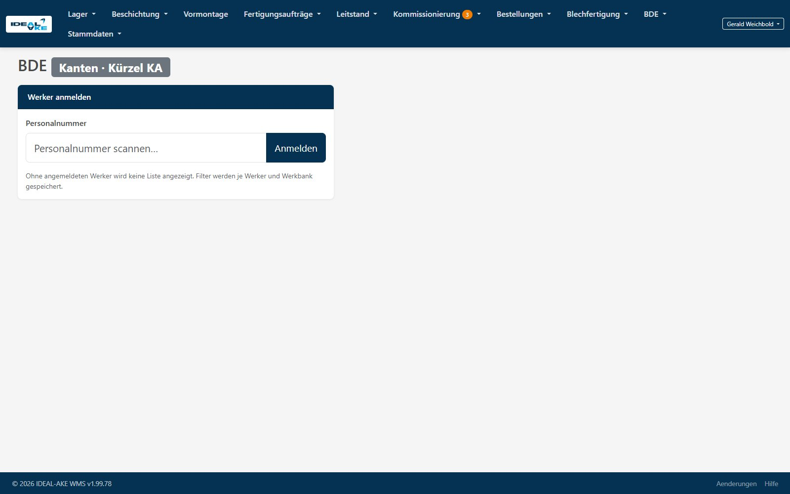
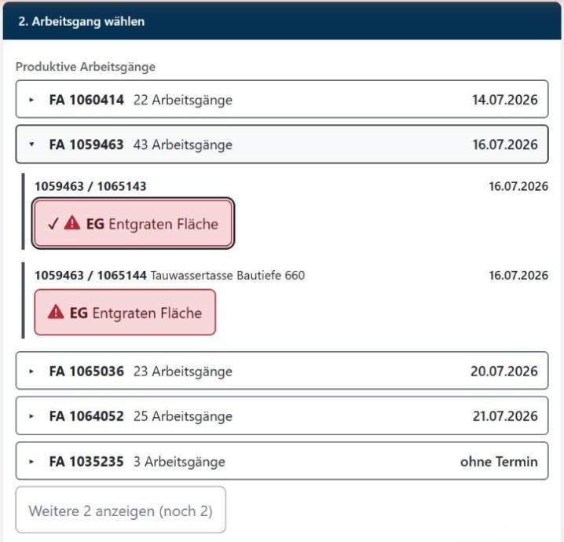
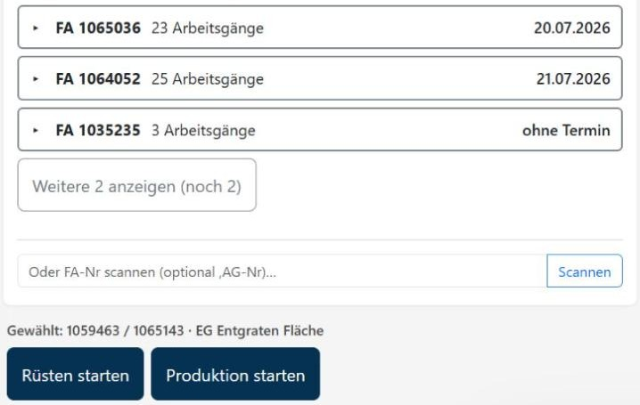

# 11 – BDE-Terminal

Stand: Version 1.99.29 · Standorte AKE und IDEAL · Bilder aus dem IDEAL-Testsystem

## Zweck

Am **BDE-Terminal** (Betriebsdatenerfassung) melden Werker in der Fertigung, woran sie arbeiten: Rüsten, Produktion, Pause, Teil- und
Fertigmeldung mit Gut- und Ausschussmenge, dazu ungeplante Tätigkeiten wie Wartung oder Reinigung. Daraus entstehen die Buchungen, die der
Schichtleiter im Cockpit und in der Buchungsliste sieht, und der Status der Arbeitsgänge in der FA-Struktur.

## Wer darf

| Aufgabe | Rolle (wie unter *Stammdaten → Rollen*) |
|---|---|
| Terminal bedienen (anmelden, starten, pausieren, melden) | **BDE-Mitarbeiter** |
| zusätzlich Cockpit, Buchungsliste, BDE-Stammdaten pflegen | **BDE-Schichtleiter** |
| zusätzlich Buchungen korrigieren und stornieren, Terminals einrichten | **BDE-Admin** |
| alles | **Administrator** |

**Voraussetzungen** (richtet die WMS-Betreuung bzw. der BDE-Admin ein):

- *Stammdaten → Einstellungen*: **BDE (Betriebsdatenerfassung)** an. Sonst fehlt das Menü **BDE**.
- Für den angemeldeten WMS-Benutzer (meist ein Terminal-Benutzer je Arbeitsplatz) ist unter *BDE → Stammdaten → Terminals* ein **Terminal** mit
  Werkbank angelegt. Sonst kommt „Für diesen Benutzer ist kein Terminal konfiguriert. Bitte an den BDE-Admin wenden.“
- Die Werkbank ist unter *Stammdaten → Werkbänke* auf **BDE aktiv** geschaltet.
- Jeder Werker ist unter *BDE → Stammdaten → Operatoren* mit seiner **Personalnummer** angelegt.

## Schritt für Schritt

### 1. Terminal öffnen und anmelden

Menü **BDE → Terminal**.

1. Oben steht die **Werkbank** des Terminals. Über die Auswahl daneben lässt sich eine andere BDE-aktive Werkbank wählen.
2. Bei **1. Operator** die **Personalnummer** scannen (Ausweis) oder eintippen und **Scannen** drücken. Der Name erscheint im dunklen Feld.
3. **Wechseln** meldet den Werker ab, damit sich der nächste anmelden kann.
4. Hat der Werker **pausierte Aufträge**, erscheint ein gelber Hinweis mit Auftrag, Arbeitsgang und Zeitpunkt. **Fortsetzen** setzt die Arbeit dort fort.

Rechts stehen **Aktuelle Buchungen** (was der Werker gerade bucht) und die **Tageshistorie** (alle heutigen Buchungen mit Zeiten und Mengen).

### 2. Arbeitsgang wählen

Unter **2. Arbeitsgang wählen** stehen die offenen Arbeitsgänge dieser Werkbank.

**IDEAL:** Die Liste ist nach **Haupt-FA** gruppiert. Jeder Kopf zeigt FA-Nummer, gegebenenfalls die Priorität („Prio 2“), die Anzahl der
Arbeitsgänge und den Fertigungstermin. Reihenfolge: Priorität, dann früherer Termin; Aufträge „ohne Termin“ stehen unten.

1. Einen **Kopf antippen** klappt ihn auf (▾) und wieder zu (▸). Darunter steht je **Sub-FA** (z. B. `1059463 / 1065144` mit Bezeichnung) der
   Arbeitsgang als Knopf, z. B. **EG Entgraten Fläche**.
2. Zuerst sind so viele Haupt-FAs sichtbar, wie eingestellt (Standard 5). **Weitere … anzeigen** blendet die nächsten ein.
3. Den **Arbeitsgang antippen**. Er bekommt einen dunklen Rahmen und ein ✓.

Der Knopf zeigt auch den Zustand – immer mit Zeichen, nicht nur mit Farbe:

| Aussehen | Bedeutung |
|---|---|
| grau, leerer Kreis | offen |
| rot, Warndreieck | überfällig (Termin überschritten) |
| blau, Sanduhr | läuft gerade (ein anderer Werker bucht darauf) |
| blau mit rotem Rand, beide Zeichen | läuft und ist überfällig |

**AKE:** Die Liste ist nicht gruppiert, jeder Auftrag steht als eigener Block mit seinen Arbeitsgängen; Auswahl und Knöpfe wie oben.

### 3. Oder: FA scannen

Unter der Liste steht das Feld **Oder FA-Nr scannen (optional ,AG-Nr)…** mit dem Knopf **Scannen**.

- **IDEAL:** Den Barcode des **Haupt-FA** vom Sage-Papier scannen → die Gruppe klappt auf, nichts ist vorgewählt; Arbeitsgang antippen. Eine
  **Sub-FA** mit genau einem offenen Arbeitsgang an dieser Werkbank wird direkt gewählt.
- **AKE:** Genau ein Treffer wird gewählt, sonst erscheint eine Auswahl.
- `FA,AG` (z. B. vom Laufzettel) geht an beiden Standorten.
- Meldungen: „Arbeitsgang nicht gefunden“ (Nummer prüfen) bzw. „… keinen offenen Arbeitsgang.“ (an dieser Werkbank ist für den Auftrag nichts offen).

### 4. Starten, pausieren, melden

Unter der Karte steht **Gewählt: FA / Sub-FA · Kürzel Name** und die passenden Knöpfe:

1. **Rüsten starten** – die Rüstzeit läuft.
2. **Produktion starten** – beendet das Rüsten und startet die Produktion.
3. **Teilfertigmeldung** – während der Produktion Gut- und Ausschussmenge melden, die Buchung läuft weiter.
4. **Pause** – unterbricht; bei Produktion optional mit Mengen. Ein anderer Werker kann den Arbeitsgang fortsetzen.
5. **Beenden** – endgültige Gut- und Ausschussmenge eingeben, der Arbeitsgang ist abgeschlossen.

Mengen gibt man im Fenster **Mengen melden** ein:

**Bestätigen** einmal antippen und warten, bis das Fenster zu ist und oben die grüne Bestätigung erscheint. Seit Version 1.99.23 ist der Knopf
nach dem Antippen kurz gesperrt; eine zweite **Fertigmeldung** desselben Arbeitsgangs (Doppeltipp, zweites Terminal) wird abgewiesen mit
„Arbeitsgang ist bereits fertig gemeldet.“

**Ungeplante Tätigkeit** (Wartung, Reinigung …): Kategorie wählen und **Starten**; beenden wie eine normale Buchung.

### 5. Werkbank „nur AG-Fertigmeldung“

An manchen Werkbänken wird nicht gestempelt, sondern nur fertig gemeldet (Einstellung je Werkbank, z. B. Entgraten). Dort gibt es nach der
Auswahl nur den Knopf **Fertig melden**:

1. Arbeitsgang antippen oder scannen.
2. **Fertig melden**. Das Fenster zeigt die Sollmenge; die Gutmenge ist damit vorbelegt, Ausschuss 0.
3. **Bestätigen** – einmal. Der Arbeitsgang ist erledigt.

Gespeichert werden Werker, Werkbank, Zeitpunkt und Menge, aber keine Arbeitszeit. Rüsten und Produktion starten sind hier gesperrt („An dieser
Werkbank wird nur fertig gemeldet.“). Ein zweites Melden lehnt das WMS ab: „Arbeitsgang ist bereits fertig gemeldet.“

## Unterschiede AKE und IDEAL

| | AKE | IDEAL |
|---|---|---|
| Liste der Arbeitsgänge | flach, je Auftrag ein Block | nach Haupt-FA gruppiert, aufklappbar, „Weitere … anzeigen“ |
| Scan des Haupt-FA | – | klappt die Gruppe auf |
| Fertigungstermin | Termin des Auftrags | FE-Termin der Struktur |
| Werkbänke mit Kürzel (z. B. EG) | keine | mehrere Werkbänke mit demselben Kürzel sehen und buchen dieselben Arbeitsgänge |

## Hinweise und Stolperfallen

**Bekannte Fehler (Stand 16.11.2026, Version 1.99.29):**

- ~~Doppelte Fertigmeldung~~ – **behoben seit Version 1.99.23** für die **Fertigmeldung** (auch bei zwei Terminals gleichzeitig). Für die übrigen
  Buchungen (Start, Pause, Teilfertigmeldung) schützt nur die kurze Sperre des Knopfs – dort weiterhin einmal tippen. Ist trotzdem etwas doppelt:
  dem Schichtleiter melden, er storniert die zweite Buchung unter *BDE → Buchungen*.
- **Doppelte Buchungen schwer zu erkennen (IDEAL).** In *BDE → Buchungen* zeigt die Spalte „Ziel“ nur Haupt-FA und Arbeitsgang (z. B.
  `1059463/EG`), nicht die Sub-FA. Buchungen verschiedener Sub-FAs sehen deshalb gleich aus. Zur Prüfung Zeit und Werker vergleichen.

**Allgemein:**

- **Erst den Werker anmelden, dann scannen.** Vor der Anmeldung landet ein Scan im Feld „Personalnummer“, danach im Feld „FA-Nr scannen“.
- „AG ist bereits in Arbeit durch …“: Ein anderer Werker bucht schon darauf. Ob mehrere gleichzeitig dürfen, ist eine Einstellung.
- „FA … ist bereits verpackt/abgeholt — keine BDE-Buchung mehr möglich.“: Der Auftrag ist in Sage abgeschlossen; nur noch laufende Buchungen beenden.
- „Dieser Arbeitsgang gehört nicht zu dieser Werkbank.“: An der richtigen Werkbank fortsetzen bzw. starten.
- „Werkbank ist nicht für BDE aktiviert“: Die WMS-Betreuung schaltet die Werkbank unter *Stammdaten → Werkbänke* auf „BDE aktiv“.
- Mengen dürfen nicht negativ sein; Gut- oder Ausschussmenge muss angegeben werden.
- Ist der Schichtkalender eingeschaltet, pausiert das WMS laufende Buchungen am Schichtende selbst („auto-pausiert“); am nächsten Tag
  **Fortsetzen**.

## Häufige Fragen

**Ich sehe meinen Arbeitsgang nicht.**
Richtige Werkbank gewählt (oben)? Bei IDEAL die Gruppe des Haupt-FA aufklappen oder **Weitere … anzeigen**. Oder den FA scannen. Erledigte
Arbeitsgänge stehen nicht mehr in der Liste.

**Wie korrigiere ich eine falsche Menge?**
Am Terminal nicht. Der BDE-Admin (bzw. Schichtleiter mit Admin-Recht) korrigiert oder storniert die Buchung unter *BDE → Buchungen*.

**Ich habe vergessen, auf Pause zu drücken.**
Dem Schichtleiter melden; vergessene Buchungen kann ein Admin in der Buchungsliste schließen.

**Was heißt das rote Warndreieck?**
Der Arbeitsgang ist überfällig: Der Fertigungstermin plus der für den Arbeitsgang eingestellte Versatz in Arbeitstagen (*BDE → Stammdaten → Arbeitsgänge*) liegt vor heute.
