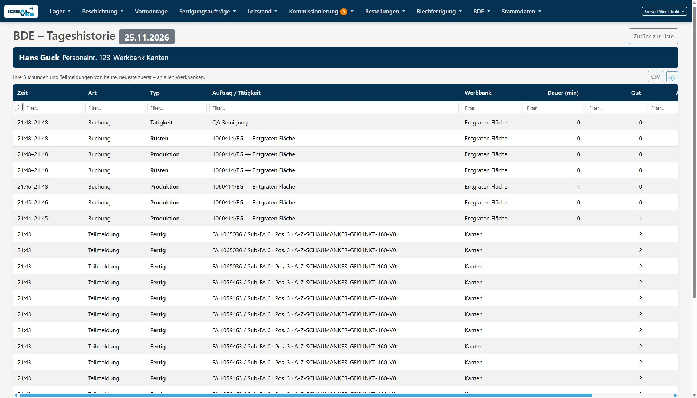

# 11 – BDE: Arbeitsgänge buchen

Stand: Version 1.99.78 (Terminal-Seite abgelöst, Kapitel umgeschrieben, Tageshistorie neu; Fotos 11-01, 11-04 und 11-07 folgen), 1.99.77
(Meine Buchungen, Scan, Tätigkeit; Foto 11-06 folgt), 1.99.76 (FA-Sicht; Foto 11-05 folgt) · Standorte AKE und IDEAL · Bilder aus dem IDEAL-Testsystem

## Zweck

Auf der **BDE-Seite** (Betriebsdatenerfassung) melden Werker in der Fertigung, woran sie arbeiten: Rüsten, Produktion, Pause, Teil- und
Fertigmeldung mit Gut- und Ausschussmenge, dazu ungeplante Tätigkeiten wie Wartung oder Reinigung. Daraus entstehen die Buchungen, die der
Schichtleiter im Cockpit und in der Buchungsliste sieht, und der Status der Arbeitsgänge in der FA-Struktur.

Seit Version 1.99.78 gibt es die frühere Terminal-Seite (Karten „1. Operator“ und „2. Arbeitsgang wählen“) nicht mehr. **BDE → Terminal**, die
Kachel auf der Startseite und alte Lesezeichen öffnen an beiden Standorten die BDE-Seite der Terminal-Werkbank.

## Wer darf

| Aufgabe | Rolle (wie unter *Stammdaten → Rollen*) |
|---|---|
| BDE-Seite bedienen (anmelden, starten, pausieren, melden, Tageshistorie) | **BDE-Mitarbeiter** |
| zusätzlich Cockpit, Buchungsliste, BDE-Stammdaten pflegen | **BDE-Schichtleiter** |
| zusätzlich Buchungen korrigieren und stornieren, Terminals einrichten | **BDE-Admin** |
| alles | **Administrator** |

**Voraussetzungen** (richtet die WMS-Betreuung bzw. der BDE-Admin ein):

- *Stammdaten → Einstellungen*: **BDE (Betriebsdatenerfassung)** an. Sonst fehlt das Menü **BDE**.
- Für den angemeldeten WMS-Benutzer (meist ein Terminal-Benutzer je Arbeitsplatz, am Handy ein eigenes WMS-Konto je Gerät) ist unter
  *BDE → Stammdaten → Terminals* ein **Terminal** mit Werkbank angelegt. Sonst kommt „Für diesen Benutzer ist kein Terminal konfiguriert.
  Bitte an den BDE-Admin wenden.“
- Die Werkbank ist unter *Stammdaten → Werkbänke* auf **BDE aktiv** geschaltet. Sonst zeigt die Seite „Werkbank ist nicht BDE-aktiv“ mit
  einer Auswahl der BDE-aktiven Werkbänke.
- Jeder Werker ist unter *BDE → Stammdaten → Operatoren* mit seiner **Personalnummer** angelegt.

## Schritt für Schritt

### 1. Öffnen und anmelden

Menü **BDE → Terminal**.

1. Die Seite öffnet die **Werkbank des Terminals**. Oben rechts lässt sich eine andere BDE-aktive Werkbank wählen.
2. **Personalnummer** scannen (Ausweis, auch mit dem Handscanner ohne Antippen) oder eintippen und **Anmelden** drücken.
3. Der Werker-Balken zeigt Name und Personalnummer, rechts **Tageshistorie** (Abschnitt 4) und **Werker wechseln** (meldet ab, der nächste
   meldet sich an).
4. Welche Ansicht kommt, legt die Werkbank fest (*BDE-Standardsicht*): an IDEAL-Werkbänken mit BDE-Teileliste die Reiter **Teile Einzeln** /
   **Teile Summiert** (Abschnitt 5), sonst der Reiter **FA** (Abschnitt 2). An AKE gibt es nur den Reiter **FA**.

### 2. Reiter FA: Arbeitsgänge als Tabelle (seit Version 1.99.76)

1. **Spalten:** Haupt-FA, Sub-FA, Arbeitsgang, **AG-Status** (alle Arbeitsgänge des Auftrags als Zeichen wie in der FA-Struktur, der Arbeitsgang
   der Zeile ist **umrahmt**), Bezeichnung, Artikelnummer, Matchcode, Sollmenge, FE-Termin, Soll-Termin AG, Prio, Kunde, Abteilung, Status.
   Weitere (Material, Arbeitsschritte, Bemerkung PN, Sage-Status …) über das **Zahnrad**. Jede Spalte hat einen **Spaltenfilter**; lange Listen
   werden **geblättert**. Reihenfolge: Priorität, dann früherer Fertigungstermin.
2. **Status:** *offen*, *überfällig*, *läuft* (ein anderer Werker arbeitet daran) oder **läuft bei Ihnen** (eigener laufender Arbeitsgang) –
   immer als Text, nicht nur als Farbe.
3. **Anstempeln:** in der Zeile **Rüsten** oder **Produktion** antippen. Danach grüne Meldung „Produktion gestartet.“ bzw. „Rüsten gestartet.“.
   Läuft der Arbeitsgang schon bei einem anderen Werker, öffnet sich das Fenster **„Arbeitsgang bereits in Arbeit“** mit
   „AG ist bereits in Arbeit durch <Name> an <Werkbank> seit hh:mm.“ – **OK** schliesst, gebucht wird nichts.
4. **Werkbank „nur AG-Fertigmeldung“** (z. B. Entgraten): je Zeile nur der Knopf **Fertig melden**. Das Fenster „Mengen melden“ ist mit der
   **Sollmenge** vorbelegt, Ausschuss 0. Liegt die Gutmenge unter der Sollmenge, fragt ein Fenster nach. Gespeichert werden Werker, Werkbank,
   Zeitpunkt und Menge, aber keine Arbeitszeit. Ein zweites Melden lehnt das WMS ab: „Arbeitsgang ist bereits fertig gemeldet.“

Mengen gibt man im Fenster **Mengen melden** ein:

**Bestätigen** einmal antippen und warten, bis das Fenster zu ist und oben die grüne Bestätigung erscheint.

### 3. Meine Buchungen, Scan und Tätigkeit (seit Version 1.99.77)

1. **Meine Buchungen** (unter dem Werker-Namen): alle **laufenden** und **pausierten** Buchungen des Werkers – laufende mit
   durchgezogenem Balken und „… läuft“, pausierte mit gestricheltem Balken und „… pausiert“. Die Knöpfe je Zeile:
   - Rüsten läuft: **Pause**, **Rüsten fertig**, **Produktion** (Wechsel vom Rüsten in die Produktion),
   - Produktion läuft: **Pause**, **Teilfertig**, **Fertig** (jeweils mit dem Fenster „Mengen melden“; bei Fertig unter Sollmenge kommt eine Rückfrage),
   - Tätigkeit läuft: **Beenden**,
   - pausiert: **Fortsetzen** (setzt als Produktion fort).
   Nach jeder Buchung lädt die Seite neu und zeigt oben eine grüne Meldung.
2. **Zeiten und Details** (Schalter rechts): blendet je Buchung Startzeit, Laufzeit, Werkbank, Terminal und Personalnummer ein. Die Wahl
   merkt sich der Browser **je Werker**; sie ändert nur die Anzeige.
3. **Fertig mit weiteren Werkern:** Arbeiten andere noch auf demselben Arbeitsgang (Einstellung Mehrfachbuchung je Arbeitsgang), fragt das
   Fenster **„Weitere aktive Buchungen“**: **Ja, alle beenden** beendet sie („<n> weitere Buchungen beendet.“), **Nein, nur meine** lässt sie laufen.
4. **Mehrere Produktionen gleichzeitig** (Einstellung gleichzeitiger Abschluss): **Fertig** öffnet **„Alle Produktionsaufträge abschliessen“**
   mit FA/AG, Sollmenge, Gut, Ausschuss und Haken *Abschl.*; **Alle fertig melden** bucht alle („<n> Buchungen fertig gemeldet.“),
   **Abbrechen** bucht nichts.
5. **FA scannen** (Feld über der Tabelle, auch mit dem Handscanner ohne Antippen): `FA` oder `FA/AG` (bzw. `FA,AG`). Eindeutig: die Zeile wird
   **markiert** (Rahmen und Balken), die Seite blättert zu ihr und der Knopf **Rüsten** bzw. **Fertig melden** ist gewählt. Mehrere offene
   Arbeitsgänge: Fenster **„Arbeitsgang wählen“**. Unbekannt oder an dieser Werkbank nicht offen: gelbe Meldung. Ist die Zeile durch einen
   Spaltenfilter ausgeblendet, sagt das eine Meldung – Spaltenfilter zurücksetzen.
6. **Tätigkeit starten** (Knopf rechts oben): Auswahl der ungeplanten Tätigkeiten (z. B. Reinigung); die Tätigkeit erscheint dann unter
   „Meine Buchungen“ mit **Beenden**.
7. Jeder Knopf bucht **einmal** – ein zweites Tippen während der Buchung wird ignoriert.

### 4. Tageshistorie (seit Version 1.99.78)

Knopf **Tageshistorie** im Werker-Balken oder Menü **BDE → Tageshistorie**.

1. Die Seite zeigt **Ihre Buchungen und Teilmeldungen von heute**, neueste zuerst, an allen Werkbänken.
2. **Art** *Buchung*: Typ Rüsten, Produktion oder Tätigkeit, Zeit von–bis, Dauer in Minuten, Gut und Ausschuss, Status *läuft*, *pausiert*,
   *fortgesetzt* oder *beendet*. Stornierte Buchungen fehlen.
3. **Art** *Teilmeldung* (Teileliste, IDEAL): Typ **Teilfertig** oder **Fertig**, Auftrag als „FA … / Sub-FA … · Pos. … · Matchcode“, Gut und
   Ausschuss. Meldungen auf Lagerbestell-Zeilen beginnen mit „Lagerbestellung · “. Die Fertigmeldung einer Baugruppe steht nur einmal da.
4. Jede Spalte hat einen **Spaltenfilter**, lange Listen werden geblättert. **Spaltenfilter zurücksetzen** hebt alle Filter auf.
5. **Zurück zur Liste** führt auf die BDE-Seite der Werkbank.
6. Über den Menüpunkt ohne angemeldeten Werker kommt zuerst die Anmeldung; danach den Knopf **Tageshistorie** antippen.

### 5. Werkbank mit BDE-Teileliste (IDEAL, seit Version 1.99.32)

Ist an der Werkbank **BDE-Teileliste (vereinfacht)** an (z. B. *Kanten*), zeigt die Seite die Reiter **Teile Einzeln** und **Teile Summiert**:
Teile und Baugruppen nach Matchcode, teilfertig oder fertig melden, einzeln oder als Block. Anleitung: [Kapitel 17](17-bde-teileliste-werkbank.md).

## Unterschiede AKE und IDEAL

| | AKE | IDEAL |
|---|---|---|
| Reiter | nur **FA**; Spalten Sub-FA, Abteilung, Material leer | **FA** neben **Teile Einzeln** / **Teile Summiert**; Startreiter je Werkbank (BDE-Standardsicht) |
| Fertigungstermin | Termin des Auftrags | FE-Termin der Struktur |
| Werkbänke mit Kürzel (z. B. EG) | keine | mehrere Werkbänke mit demselben Kürzel sehen und buchen dieselben Arbeitsgänge |
| BDE-Teileliste (vereinfachte Fertigmeldung) | – | je Werkbank einschaltbar, siehe [Kapitel 17](17-bde-teileliste-werkbank.md) |
| Tageshistorie | nur Buchungen | Buchungen und Teilmeldungen |

## Hinweise und Stolperfallen

- **Doppelte Fertigmeldung** ist seit Version 1.99.23 ausgeschlossen (auch bei zwei Geräten gleichzeitig). Jeder Knopf bucht einmal; ist trotzdem
  etwas doppelt: dem Schichtleiter melden, er storniert die zweite Buchung unter *BDE → Buchungen*.
- **Doppelte Buchungen schwer zu erkennen (IDEAL).** In *BDE → Buchungen* zeigt die Spalte „Ziel“ nur Haupt-FA und Arbeitsgang (z. B.
  `1059463/EG`), nicht die Sub-FA. Zur Prüfung Zeit und Werker vergleichen.
- **Erst den Werker anmelden, dann scannen.** Vor der Anmeldung landet ein Scan im Feld „Personalnummer“, danach im Feld „FA scannen“.
- „FA … ist bereits verpackt/abgeholt — keine BDE-Buchung mehr möglich.“: Der Auftrag ist in Sage abgeschlossen; nur noch laufende Buchungen beenden.
- Mengen dürfen nicht negativ sein; Gut- oder Ausschussmenge muss angegeben werden.
- Ist der Schichtkalender eingeschaltet, pausiert das WMS laufende Buchungen am Schichtende selbst („auto-pausiert“); am nächsten Tag
  **Fortsetzen** unter „Meine Buchungen“.
- **Handy (Android):** eigenes lokales WMS-Konto je Gerät mit Formular-Login und eine Terminal-Zuordnung – richtet die WMS-Betreuung ein. Auf
  schmalen Bildschirmen erscheinen die Tabellen als Karten.

## Häufige Fragen

**Ich sehe meinen Arbeitsgang nicht.**
Richtige Werkbank gewählt (oben rechts)? Spaltenfilter zurücksetzen oder den FA scannen. Erledigte Arbeitsgänge stehen nicht mehr in der Liste.

**Wie korrigiere ich eine falsche Menge?**
Auf der BDE-Seite nicht. Der BDE-Admin korrigiert oder storniert die Buchung unter *BDE → Buchungen*; Teilmeldungen siehe Kapitel 17.

**Ich habe vergessen, auf Pause zu drücken.**
Dem Schichtleiter melden; vergessene Buchungen kann ein Admin in der Buchungsliste schließen.

**Was heißt das rote Warndreieck?**
Der Arbeitsgang ist überfällig: Der Fertigungstermin plus der für den Arbeitsgang eingestellte Versatz in Arbeitstagen (*BDE → Stammdaten → Arbeitsgänge*) liegt vor heute.
