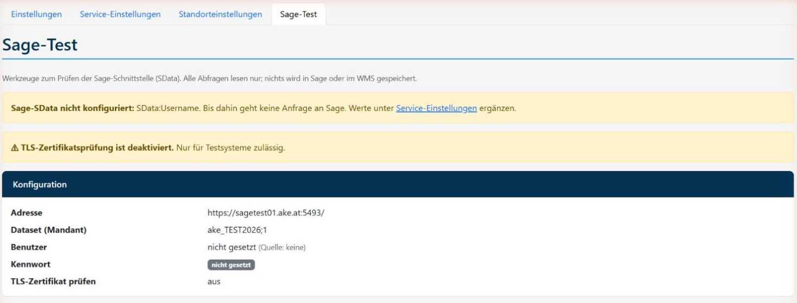
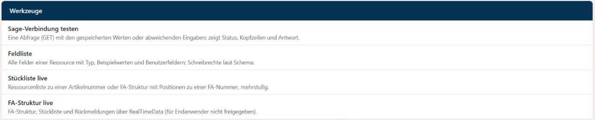
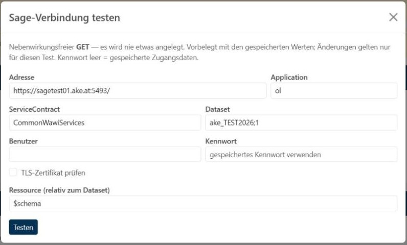
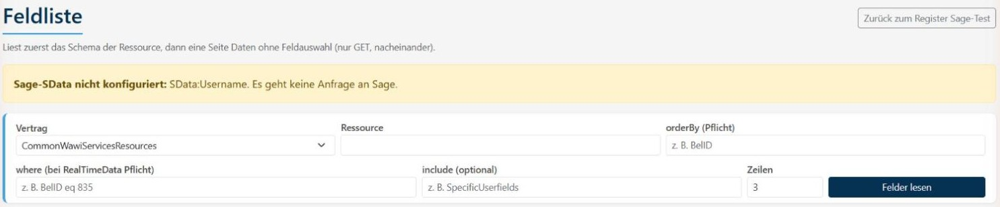
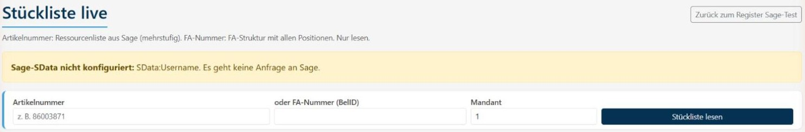

# 12 – Register Sage-Test (Administration)

Stand: Version 1.99.22 · Standorte AKE und IDEAL · Bilder aus dem AKE-Testsystem

## Zweck

Das Register **Sage-Test** ist ein Prüfwerkzeug für die Administration. Damit sieht man, ob das WMS die Sage-Schnittstelle (SData) erreicht und
was Sage liefert – ohne dafür in Sage selbst nachzusehen:

| Werkzeug | wofür |
|---|---|
| **Sage-Verbindung testen** | Erreicht das WMS Sage? Stimmen Adresse, Zertifikat und Anmeldung? |
| **Feldliste** | Welche Felder (auch Benutzerfelder `USER_…`) hat eine Sage-Ressource, mit Typ und Beispielwerten? |
| **Stückliste live** | Stückliste eines Artikels bzw. FA-Struktur mit allen Positionen direkt aus Sage |
| **FA-Struktur live** | FA-Struktur, Stückliste und Rückmeldungen eines FA direkt aus Sage |

**Alle Werkzeuge lesen nur.** Es wird nichts in Sage und nichts im WMS gespeichert. Für Lager und Produktion ist das Register nicht gedacht.

## Wer darf

| Aufgabe | Rolle (wie unter *Stammdaten → Rollen*) |
|---|---|
| Register Sage-Test und alle Werkzeuge | nur **Administrator** |

Es gibt **keinen Menüpunkt**. Das Register erreicht man über *Stammdaten → Einstellungen* und dort die Reiterleiste
**Einstellungen | Service-Einstellungen | Standorteinstellungen | Sage-Test**, oder in den Service-Einstellungen über den Link
„Sage-Verbindung testen“. Andere Benutzer erhalten „Zugriff verweigert“.

**Voraussetzungen** (*Service-Einstellungen*): Sage-Adresse (`SData:BaseUrl`), Dataset (Mandant), **SData: Benutzer** und **SData: Kennwort**.
Das Kennwort wird verschlüsselt gespeichert und nie angezeigt (Status „gesetzt“ / „nicht gesetzt“ / „nicht entschlüsselbar – neu eingeben“).

## Schritt für Schritt

### 1. Register öffnen und Konfiguration lesen

Die Karte **Konfiguration** zeigt, womit das WMS Sage anspricht: Adresse, Dataset (Mandant), Benutzer (mit Quelle), Status des Kennworts und ob
das TLS-Zertifikat geprüft wird.

Gelbe Hinweise oben:

- **„Sage-SData nicht konfiguriert: …“** nennt, was fehlt (im Bild: der Benutzer). Bis das ergänzt ist, geht **keine** Anfrage an Sage; die
  Werkzeuge zeigen dann nur diesen Hinweis.
- **„TLS-Zertifikatsprüfung ist deaktiviert.“** – nur für Testsysteme zulässig.
- Ein Hinweis zur Quelle „aus appsettings“: Die Zugangsdaten kommen noch aus der Konfigurationsdatei und sollten in die Service-Einstellungen
  übernommen werden.

Darunter die **Werkzeuge**:

### 2. Sage-Verbindung testen

**Sage-Verbindung testen** öffnet ein Fenster, vorbelegt mit den gespeicherten Werten.

1. Werte **nicht ändern**, Kennwort **leer lassen** – dann nimmt das WMS die gespeicherten Zugangsdaten.
2. **Ressource** bleibt `$schema` (eine kleine, nebenwirkungsfreie Abfrage).
3. **Testen**. Angezeigt werden Status (z. B. „HTTP 200“ mit dem Zusatz „Zugangsdaten: gespeichert (Service-Einstellungen)“), die angeforderte
   Adresse, die Kopfzeilen und die Antwort.

Typische Ergebnisse: „HTTP 401“ bzw. „403“ = Benutzer oder Kennwort falsch bzw. ohne Recht; „Verbindungsfehler …“ = Sage nicht erreichbar
(Adresse, Port, Firewall). Es wird nie etwas in Sage angelegt.

### 3. Feldliste

1. **Vertrag** wählen (z. B. `CommonWawiServicesResources`, `CommonWawiServicesResourcesSpecific` oder `RealTimeData`).
2. **Ressource** eintragen, z. B. `PpsFaBelegeInfo`.
3. **orderBy** ist Pflicht, z. B. `BelID`. **where** ist bei `RealTimeData` Pflicht, z. B. `BelID eq 835`. **include** optional, z. B.
   `SpecificUserfields`.
4. **Zeilen**: 1 bis 5 Beispielzeilen.
5. **Felder lesen**.

Ergebnis: Rechte laut Schema (Lesen/Anlegen/Ändern/Löschen – das sind die Rechte der Schnittstelle, nicht die des Benutzers), Anzahl Felder und
Benutzerfelder, dann je Feld Typ/Länge, „im Schema“, „in den Daten“, Art (**Benutzerfeld** oder **Standard**) und die Beispielwerte. Über den
Spaltenfilter „Art“ = `Benutzerfeld` sieht man nur die Benutzerfelder.

Abgewiesen (ohne Anfrage an Sage) werden: fehlendes orderBy, Zeilen außerhalb 1–5, ein Vertrag, der nicht in der Liste steht, und Ressourcen mit
`/`, `?`, `&` oder `#`.

### 4. Stückliste live

- **Artikelnummer** (z. B. `86003871`) → die Ressourcenliste des Artikels aus Sage, mehrstufig: Positionen mit Ebene, Ressourcetyp,
  Ressourcenummer, Bezeichnung/Matchcode, Menge, Arbeitsgang, ArtikelnummerUBG und Platz; je Zeile „N Felder, davon … Benutzerfelder“ zum Aufklappen.
- **oder FA-Nummer (BelID)** (z. B. `835`) → die ganze FA-Struktur mit allen Positionen, BelPosID, Soll- und Istmenge; Sub-FAs eingerückt unter
  der Position, die sie liefert. Eine Sub-FA-Nummer zeigt ebenfalls die ganze Struktur.
- **Mandant** ist vorbelegt (1).

Nur eines der beiden Felder ausfüllen („Entweder Artikelnummer oder FA-Nummer, nicht beides.“). Nichts davon wird ins WMS übernommen.

### 5. FA-Struktur live

**FA-Nummer (Sage-BelID)** eingeben (Haupt- oder Sub-FA) und **Aus Sage laden**. Angezeigt werden die ganze Struktur als Karten (Haupt-FA und
Sub-FAs mit Status, Positionen, Rückmeldungen und Fertigmeldungen) und unten eine **Diagnose** mit jedem Sage-Aufruf (Status, Dauer, Zeilen,
Adresse ohne Zugangsdaten). Die Ansicht ist ein Werkzeug für Vergleiche mit der FA-Struktur des WMS und für Endanwender nicht freigegeben.

## Unterschiede AKE und IDEAL

Das Register gibt es an beiden Standorten. Lesen gegen Sage geht nur dort, wo eine SData-Schnittstelle eingerichtet ist – derzeit nur am
AKE-Testsystem. Bei IDEAL zeigt das Register „Sage-SData nicht konfiguriert …“, bis dort die Schnittstelle läuft.

## Hinweise und Stolperfallen

**Bekannte Fehler und offene Punkte (Stand 14.11.2026):**

- **Verbindungstest nur mit der hinterlegten Sage-Adresse benutzen.** Wer im Fenster eine andere Adresse einträgt und das Kennwort leer lässt,
  schickt die gespeicherten Sage-Zugangsdaten an diese Adresse – auch unverschlüsselt über `http://`. Deshalb die Adresse im Testfenster nie
  ändern. Für einen Test gegen ein anderes System Benutzer und Kennwort dort ausdrücklich eingeben. Behebung ist geplant.
- **IDEAL-Testsystem zeigt auf den AKE-Test.** Im IDEAL-Testsystem steht als Sage-Adresse derzeit der AKE-Testserver mit dem AKE-Testmandanten.
  Solange dort keine Zugangsdaten eingetragen sind, passiert nichts; bitte dort keine eintragen, bis die Adresse korrigiert ist.
- Im Bild sind keine Zugangsdaten gespeichert – deshalb steht oben „nicht konfiguriert“. Mit gespeicherten Zugangsdaten verschwindet der Hinweis.

**Allgemein:**

- **Nie Kennwörter in Bildschirmfotos.** Das Kennwort steht nirgends im Klartext; das Kennwortfeld im Testfenster bleibt leer. Für Fehlermeldungen
  an die IT genügt ein Foto des Status und der Diagnose.
- Kennwort ändern nur unter *Service-Einstellungen → Sage-Lagerbuchung → SData: Kennwort*. Leer speichern = unverändert.
- Nach einer Datenbank-Kopie auf ein anderes System ist das Kennwort „nicht entschlüsselbar“ – dann neu eingeben; bis dahin sendet der Dienst
  nichts an Sage.

## Häufige Fragen

**Ich finde „Sage-Test“ nicht im Menü.**
Es gibt keinen Menüpunkt. *Stammdaten → Einstellungen* öffnen und oben den Reiter **Sage-Test** wählen (nur Administratoren).

**Schreibt der Test etwas nach Sage?**
Nein. Alle Werkzeuge stellen nur Leseabfragen (GET).

**Der Test meldet 401.**
Benutzer oder Kennwort stimmen nicht oder der SData-Benutzer hat kein Recht auf den Mandanten. In den Service-Einstellungen das Kennwort neu eingeben
und erneut testen.

**Warum sieht die Stückliste live anders aus als die Stückliste im WMS?**
Das Register zeigt den Stand in Sage in diesem Moment. Das WMS arbeitet mit dem zuletzt abgeglichenen Stand. Unterschiede bitte an die
WMS-Betreuung melden.
