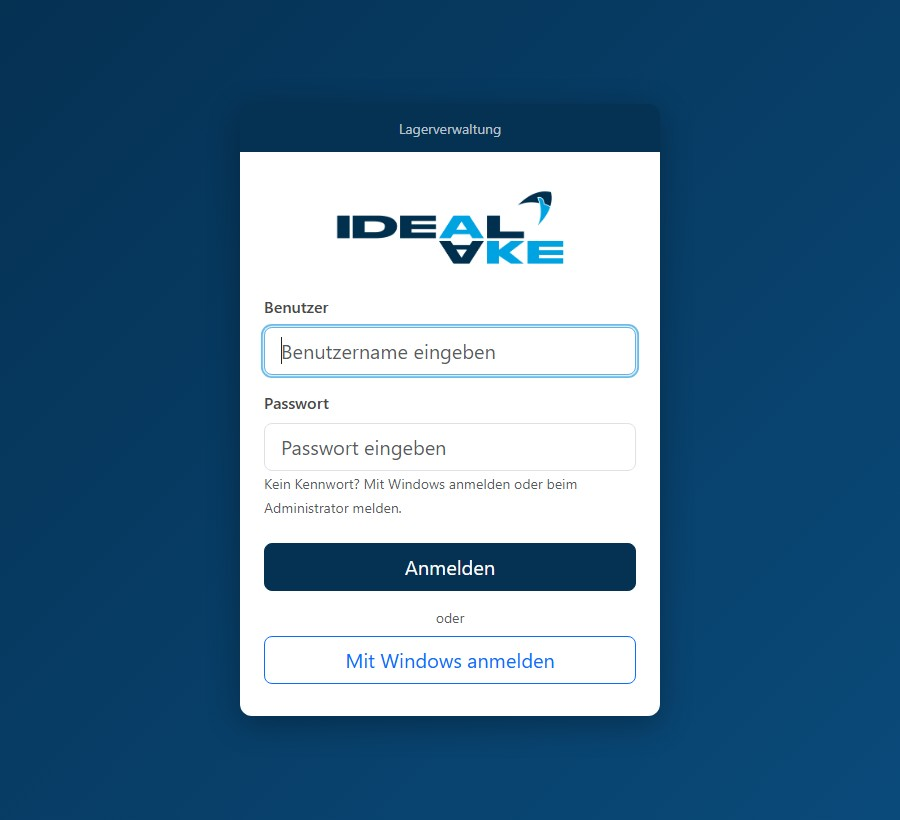
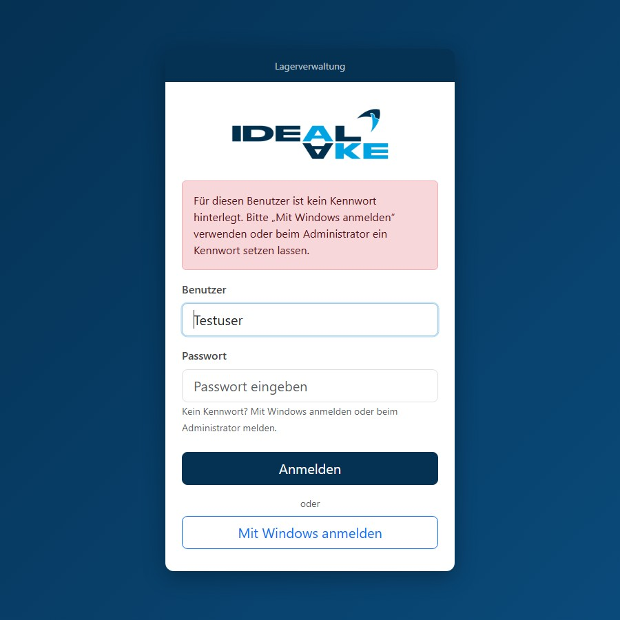
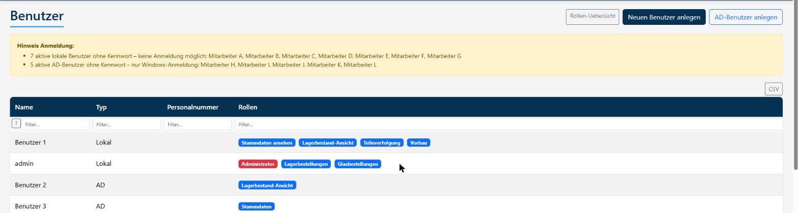
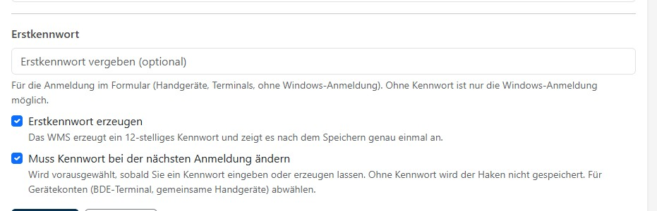

# 13 – Anmeldung und Benutzer (Erstkennwort mit Pflichtwechsel)

Stand: Version 1.99.29 · Standorte AKE und IDEAL · Bilder aus den Testsystemen AKE und IDEAL

## Zweck

Seit Version 1.99.28 gilt bei der Anmeldung eine klare Regel:

- **Mit Windows anmelden** (Knopf auf der Anmeldeseite oder automatisch am Firmen-PC) funktioniert wie bisher – ohne WMS-Kennwort.
- **Benutzer + Passwort** (Anmeldeformular, z. B. am Handgerät oder BDE-Terminal) funktioniert **nur noch mit einem gespeicherten
  Kennwort**. Wer kein Kennwort hat, kommt über das Formular nicht hinein.

Ein Kennwort vergibt der Administrator als **Erstkennwort**. Der Benutzer legt bei der ersten Anmeldung sofort ein eigenes fest
(**Pflichtwechsel**). Niemand kann sich selbst ein Kennwort geben, nur weil er einen Benutzernamen kennt.

Diese Anleitung erklärt den Ablauf aus Sicht des **Werkers** (Abschnitt 1–3) und des **Administrators** (Abschnitt 4–7).

## Wer darf

| Aufgabe | Rolle (wie unter *Stammdaten → Rollen*) |
|---|---|
| Anmelden, eigenes Kennwort ändern (*Mein Profil*) | jeder Benutzer |
| Benutzer anlegen/bearbeiten, Erstkennwort vergeben (*Stammdaten → Benutzer*) | nur **Administrator** |

Ob der Knopf **Mit Windows anmelden** erscheint, steuert die Einstellung **Windows-Anmeldung aktiv** (`WindowsAuthAktiv`, *Stammdaten →
Einstellungen*).

## Schritt für Schritt – Werker

### 1. Anmelden

- **Am Büro-PC:** **Mit Windows anmelden** klicken (oder die Seite meldet automatisch an). Kein Kennwort nötig.
- **Am Handgerät / Terminal:** Benutzername und Passwort eingeben, **Anmelden**.

Erscheint **„Für diesen Benutzer ist kein Kennwort hinterlegt.“**, hat der Benutzer kein WMS-Kennwort. Die Meldung sagt, was zu tun ist:
mit **Mit Windows anmelden** weiter (wenn der Knopf da ist) oder beim Administrator ein Kennwort setzen lassen. Ein leeres Passwortfeld
hilft nicht mehr – das war vor Version 1.99.28 möglich und ist bewusst abgeschaltet.

„**Falsches Passwort.**“ heißt: Benutzer gefunden, Kennwort stimmt nicht.

### 2. Erste Anmeldung mit Erstkennwort – neues Kennwort festlegen

Hat der Administrator ein Erstkennwort vergeben (auf Zettel oder mündlich), meldet man sich damit ganz normal an. Statt der Startseite
erscheint dann **„Neues Kennwort festlegen“**:

1. **Bisheriges Kennwort** – das Erstkennwort noch einmal eingeben.
2. **Neues Kennwort** – ein eigenes Kennwort.
3. **Neues Kennwort wiederholen** – dasselbe noch einmal.
4. **Kennwort ändern und anmelden**. Oben erscheint „Kennwort geändert.“, man ist angemeldet.

Abgelehnt wird (rote Meldung, man bleibt im Schritt):

| Meldung | Grund |
|---|---|
| „Bitte ein neues Kennwort eingeben.“ | Feld „Neues Kennwort“ leer |
| „Die Wiederholung stimmt nicht mit dem neuen Kennwort überein.“ | Tippfehler in der Wiederholung |
| „Das neue Kennwort muss sich vom bisherigen unterscheiden.“ | Erstkennwort noch einmal verwendet |
| „Falsches Passwort.“ | bisheriges Kennwort falsch eingegeben |

**Abbrechen** führt zurück zur Anmeldeseite – **ohne** Anmeldung. Beim nächsten Versuch kommt der Schritt wieder, bis ein eigenes
Kennwort festgelegt ist.

> Ein Bild des Schritts „Neues Kennwort festlegen“ fehlt bewusst: Dafür müsste auf dem Testsystem ein Erstkennwort gespeichert und damit
> angemeldet werden (diese Doku-Runde hat nichts gespeichert). Der Schritt hat dieselbe Gestaltung wie die Anmeldeseite oben, nur mit drei Kennwortfeldern.

### 3. Eigenes Kennwort später ändern

Oben rechts auf den eigenen Namen → **Mein Profil** → Feld **Neues Passwort** ausfüllen → speichern. Leer = Kennwort bleibt unverändert.
Ein hier gesetztes Kennwort beendet auch einen noch offenen Pflichtwechsel.

## Schritt für Schritt – Administrator

### 4. Benutzerliste: Hinweis „Anmeldung“

*Stammdaten → Benutzer*. Über der Liste steht – wenn zutreffend – ein gelber Kasten **Hinweis Anmeldung**:

| Zeile | Bedeutung | Was tun |
|---|---|---|
| „… aktive lokale Benutzer ohne Kennwort – keine Anmeldung möglich: …“ | lokale Benutzer ohne Kennwort kommen nirgends hinein | Erstkennwort vergeben (Abschnitt 5) oder Benutzer deaktivieren |
| „… aktive AD-Benutzer ohne Kennwort – nur Windows-Anmeldung: …“ | normal für Büro-Benutzer | nichts – nur wenn der Benutzer auch am Handgerät/Terminal arbeitet, ein Erstkennwort vergeben |
| „… Benutzer mit offenem Erstkennwort (Pflichtwechsel ausstehend): …“ | Erstkennwort vergeben, aber der Benutzer hat sich noch nicht angemeldet | Benutzer erinnern; gezählt werden nur Benutzer, die wirklich ein Kennwort haben |

### 5. Erstkennwort vergeben (Anlegen oder Bearbeiten)

*Benutzer → Neuen Benutzer anlegen* bzw. **Bearbeiten**. Im Bereich **Erstkennwort**:

1. **Kennwort eintragen** oder **Erstkennwort erzeugen** anhaken (das WMS erzeugt ein 12-stelliges Kennwort). „Erzeugen“ hat Vorrang vor
   einem eingetragenen Kennwort.
2. Der Haken **„Muss Kennwort bei der nächsten Anmeldung ändern“** wird **automatisch gesetzt**, sobald ein Kennwort eingetragen oder
   „Erzeugen“ angehakt ist. Beim Öffnen der Seite ist er **nicht** gesetzt.
3. **Speichern**. Bei „Erzeugen“ steht das Kennwort in der grünen Erfolgsmeldung: „Erstkennwort: … – jetzt notieren und dem Benutzer
   geben; es wird nicht noch einmal angezeigt.“ Es wird **nur dieses eine Mal** angezeigt und nirgends gespeichert oder protokolliert.
4. Kennwort dem Benutzer geben. Er legt bei der ersten Anmeldung ein eigenes fest (Abschnitt 2).

Beim **Bearbeiten** steht unter dem Feld „Gespeichertes Kennwort: **ja** / **nein**“. Feld leer lassen = Kennwort bleibt unverändert.

**Haken ohne Kennwort:** Setzt man den Haken bei einem Benutzer **ohne** Kennwort, wird er nicht gespeichert. Die Erfolgsmeldung sagt dann
„Hinweis: ohne Kennwort wird ‚Kennwort bei der nächsten Anmeldung ändern' nicht gespeichert“ – mit dem Zusatz „der Benutzer meldet sich per
Windows an“ (AD-Benutzer) bzw. „ohne Kennwort ist keine Formular-Anmeldung möglich“ (lokaler Benutzer).

### 6. Gerätekonten (BDE-Terminal, gemeinsame Handgeräte)

Ein Konto, das sich mehrere Personen teilen oder das fest an einem Terminal angemeldet wird, soll **kein** Pflichtwechsel-Kennwort haben –
sonst legt der erste Benutzer ein Kennwort fest, das die anderen nicht kennen.

Darum: Kennwort eintragen und den Haken **„Muss Kennwort bei der nächsten Anmeldung ändern“ wieder abwählen**, dann speichern. Das Konto
meldet sich dann direkt mit diesem Kennwort an.

### 7. AD-Benutzer

AD-Benutzer (*Benutzer → AD-Benutzer anlegen*) werden **ohne** Kennwort angelegt und melden sich **nur mit Windows** an. Das ist der
Normalfall. Ein Erstkennwort braucht ein AD-Benutzer nur, wenn er auch an einem Gerät ohne Windows-Anmeldung arbeitet (Handgerät,
Terminal) – dann wie in Abschnitt 5 vergeben. Die Windows-Anmeldung bleibt davon unberührt.

## Unterschiede AKE und IDEAL

Keine. Ablauf, Meldungen und Hinweise sind an beiden Standorten gleich. Ob der Knopf **Mit Windows anmelden** erscheint, hängt nur an der
Einstellung **Windows-Anmeldung aktiv** des jeweiligen Systems.

## Hinweise und Stolperfallen

- **Kennwörter nie in Bildschirmfotos, Tickets oder Mails.** Ein erzeugtes Erstkennwort nur dem Benutzer selbst geben.
- **Erzeugtes Kennwort verpasst?** Es lässt sich nicht noch einmal anzeigen. Einfach erneut **Erstkennwort erzeugen** und speichern – das
  alte gilt dann nicht mehr.
- **Pflichtwechsel am Handgerät:** Der Schritt „Neues Kennwort festlegen“ hat drei Felder. Wer an einem Handgerät mit kleiner Tastatur
  arbeitet, legt das eigene Kennwort am besten einmal am PC fest (Anmeldeformular dort benutzen, nicht „Mit Windows anmelden“).
- **admin nach einer Neuinstallation:** Der Benutzer `admin` startet mit einem Standard-Erstkennwort (steht im Betriebshandbuch, Kapitel 09)
  und muss es bei der ersten Anmeldung ändern. Sofort nach der Installation anmelden.
- Benutzer, die vor Version 1.99.28 ohne Kennwort über das Formular hineinkamen, kommen jetzt nicht mehr hinein – siehe Hinweis-Kasten in der
  Benutzerliste.

## Häufige Fragen

**Ich habe kein Kennwort und am Handgerät gibt es keinen Windows-Knopf.**
Beim Administrator ein Erstkennwort vergeben lassen. Danach bei der ersten Anmeldung ein eigenes festlegen.

**Ich habe das Erstkennwort, aber nach „Anmelden“ will das WMS ein neues.**
Das ist so gewollt (Pflichtwechsel). Erstkennwort noch einmal, dann zweimal das eigene neue Kennwort eingeben.

**Ich habe mein Kennwort vergessen.**
Der Administrator vergibt ein neues Erstkennwort (Abschnitt 5). Am PC geht weiterhin **Mit Windows anmelden**, falls man ein AD-Benutzer ist.

**Muss ich als Büro-Benutzer jetzt ein Kennwort haben?**
Nein. Mit Windows anmelden funktioniert wie bisher.
