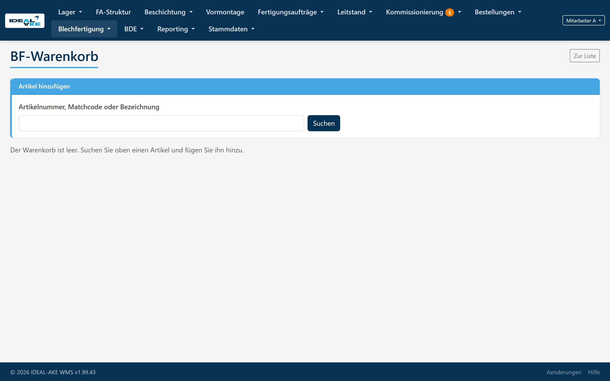

# 14 Blechfertigung – BF-Aufträge (IDEAL)

## Zweck

Mit BF-Aufträgen bestellt die Produktion Blechteile in der eigenen Blechfertigung. Der Schachtler prüft die Bestellung, gibt sie frei,
und das WMS legt sie als Datei in den WiCAM-Auftragspool. WiCAM macht daraus einen Auftrag. Wenn die Teile gefertigt sind, meldet der
Schachtler den Auftrag fertig.

In dieser ersten Stufe schreibt das WMS **nichts an Sage** und bucht **nichts ein**. Die Teile werden wie bisher eingebucht.

## Wer darf

| Was | Rolle (*Stammdaten → Rollen*) | Einstellung |
|---|---|---|
| Warenkorb füllen, abschicken, eigenen Auftrag bis zur Freigabe stornieren | Lagerbestellung (wer Lagerbestellungen anlegen darf) **oder** `schachtler` | *Blechfertigung aktiv* an |
| Alle Aufträge sehen, Menge und Lagerplatz ändern, Positionen streichen, freigeben, fertig melden, bis zur Fertigmeldung stornieren, „CSV erneut schreiben“, „Test-CSV herunterladen“ | `schachtler` „Schachtler (Blechfertigung)“ | wie oben |

Ohne *Blechfertigung aktiv* fehlt das Menü, auch für Administratoren. Abschicken geht erst, wenn unter *Einstellungen → Blechfertigung* eine
**Empfängergruppe BF-Aufträge** gewählt ist. Sonst steht im Warenkorb „Abschicken gesperrt: keine gültige Empfängergruppe für BF-Aufträge
eingestellt (Einstellungen > Blechfertigung).“ Die gewählte Gruppe steht im Auftrag unter **Empfängergruppe**.

**Kürzel des Bestellers:** Jeder Besteller braucht unter *Stammdaten → Benutzer* ein **Kürzel** (z. B. *WAK*), siehe
[Kapitel 13](13-anmeldung-und-benutzer.md). Ohne Kürzel kann der Schachtler den Auftrag nicht freigeben. Im Auftrag steht der Besteller als
„Name (Kürzel)“.

## Schritt für Schritt

### 1. Bestellen (Besteller)

1. Menü **Blechfertigung → BF-Warenkorb**.

   

2. Im Suchfeld **Artikelnummer, Matchcode oder Bezeichnung** einen Begriff eingeben, **Suchen**. Gefunden werden nur Sage-Lagerartikel mit
   Artikeltyp **BG** (Baugruppe) oder **FT** (Fertigteil).
3. In der Trefferzeile **Menge** eingeben, wenn nötig einen **Status** (z. B. *EILT*) und einen anderen **Hauptlagerplatz** wählen,
   **Hinzufügen**.
   - Hat der Artikel in Sage eine **Bestellmenge** und dieselbe Einheit, muss die Menge ein ganzes Vielfaches davon sein
     (Bestellmenge 5: 5, 10, 15 …). Bestellmenge 0 oder leer = frei.
   - Fehlt die **Materialnummer** (Sage-Feld *Materialnummer PN*), erscheint ein Hinweis: Die Position wird **nicht an WiCAM übergeben**.
     Bitte die Materialnummer in Sage nachtragen lassen.
4. Positionen können bis zum Abschicken geändert oder entfernt werden.
5. **Abschicken**. Der Auftrag bekommt eine Nummer wie **BF00000042**, und die Empfängergruppe erhält eine Mail.

### 2. Prüfen und freigeben (Schachtler)

1. Menü **Blechfertigung → BF-Aufträge**, Status *bestellt* filtern, Auftrag öffnen.
2. Menge oder Hauptlagerplatz ändern bzw. Positionen **Streichen** (gestrichene bleiben sichtbar, gehen aber nicht an WiCAM).
3. Steht über dem Knopf **Freigabe noch nicht möglich**, nennt die Liste Position und Grund, z. B. „Pos 3: Menge muss ein ganzes Vielfaches
   der Bestellmenge 5 sein“. Erst korrigieren (bzw. in Sage pflegen), dann freigeben. Weitere Sperren seit Version 1.99.42:
   - „Pos 3: Materialnummer „…“ ist nicht ganzzahlig“ – die Materialnummer in Sage muss eine ganze Zahl sein.
   - „Besteller … hat kein Kürzel – unter Stammdaten › Benutzer eintragen (geht als ORDER_REMARK_4 in die CSV)“ – Kürzel nachtragen
     lassen, dann noch einmal **Freigeben**. Das Kürzel wird bei der Freigabe aktuell gelesen und festgeschrieben.
   - „keine Position wird an WiCAM übergeben (alle gestrichen oder ohne Materialnummer)“.
   - Unerlaubte Zeichen, z. B. „Pos 2 Matchcode: …“: Semikolon `;`, Anführungszeichen `"`, Zeilenumbruch oder ein Zeichen, das es in
     der WiCAM-Datei (Windows-1252) nicht gibt. Ausnahme: Im **Lagerplatz** ist `;` erlaubt, es wird in der Datei zu `,`.
4. **Freigeben**. Das WMS rechnet ab heute:
   - **Schachteltermin** = heute + 1 Arbeitstag,
   - **FE-Termin** = heute + 10 Arbeitstage,
   jeweils ohne Wochenenden und Feiertage. Die **Bemerkung** jeder Position wird festgeschrieben:
   `[Status - ][Fertigungsinfo PN - ]TT.MM[ - Position]` (die Position nur bei Baugruppen), z. B. `EILT - Laser - 17.11 - 4`.
5. Die Meldung nennt Positionen ohne Materialnummer, die nicht übergeben werden.

### 3. Datei an WiCAM

Der Dienst schreibt die Datei **BF00000042.csv** innerhalb weniger Minuten in den WiCAM-Pool. In der Liste zeigt die Spalte **CSV**:
*offen*, *geschrieben* oder *Fehler* (Mauszeiger auf die Zelle zeigt den Fehlertext).

Aufbau der Datei (seit Version 1.99.42 genau nach der WiCAM-Vorlage *BF00000002.csv*): oben Kopfzeilen, in Zeile 13 deutsche
Spaltenüberschriften (Matchcode, Mat.Nr., Menge, Bemerkung, Lagerplatz, Hauptlagerplatz, Besteller, Schachteltermin, FE-Termin,
Arbeitsschritte), ab Zeile 14 eine Zeile je Position. *Lagerplatz* ist der volle Sage-Lagerplatz (`K-02;0;0;0` wird `K-02,0,0,0`),
*Hauptlagerplatz* der Teil davor (`K-02`), *Besteller* das Kürzel.

**Test-CSV herunterladen** (nur Schachtler, sobald der Auftrag eine BF-Nummer hat): lädt dieselbe Datei herunter, die der Dienst in den
Pool schreibt – ohne Statuswechsel und ohne Datei im Pool. Vor der Freigabe fehlen darin noch Termine und Bemerkung.

Bei **„Datei existiert bereits im Pool – nicht überschrieben.“** wiederholt das WMS nicht von selbst. In WiCAM prüfen, ob der Auftrag
schon angelegt ist; wenn nicht, die Datei im Pool löschen und im Auftrag **CSV erneut schreiben** drücken.

### 4. Fertig melden (Schachtler)

- In der Liste die Aufträge anhaken (nur freigegebene mit geschriebener CSV haben ein Kästchen) und **Auswahl fertig melden**, oder
- im Auftrag **Fertig melden**.

Das setzt nur den Status. Es wird nichts eingebucht.

### 5. Stornieren

Im Auftrag unten **Auftrag stornieren** aufklappen, optional einen Grund eingeben, **Stornieren**.

- Der Besteller kann seinen Auftrag stornieren, solange er *bestellt* ist.
- Der Schachtler kann bis zur Fertigmeldung stornieren. Ist der Auftrag schon freigegeben, liegt die Datei ggf. im WiCAM-Pool. Die Meldung
  sagt dann „Die CSV liegt bereits im Pool … – den Auftrag in WiCAM löschen.“ Das WMS löscht nichts in WiCAM.

Den Warenkorb storniert man nicht – Positionen einfach entfernen.

## Hinweise und Stolperfallen

- **Dateiformat:** Seit Version 1.99.42 entspricht die Datei der Musterdatei *BF00000002.csv* aus dem WiCAM-Pool (vorher Platzhalter-Format).
- Zeichen wie `;` oder `"` in Matchcode, Materialnummer, Status, Fertigungsinfo oder Arbeitsschritten sperren die Freigabe, weil WiCAM die
  Datei sonst falsch liest. Im Lagerplatz ist `;` erlaubt (wird zu `,`).
- Steht im Auftrag gelb „Sage-Benutzerfelder nicht konfiguriert: …“, fehlt eine Einstellung beim Administrator (*Service-Einstellungen*,
  Kategorie „Sage-Benutzerfelder: Blechfertigung“). Ohne „Ist Lagerartikel“ und „Artikeltyp“ findet die Artikelsuche nichts.
- Der Bezugstag der Termine ist der **Freigabetag**, nicht der Bestelltag.
- Feiertage kommen aus *Stammdaten → Feiertage*. Fehlen sie für das Jahr, rechnen die Termine nur ohne Wochenenden.

## Häufige Fragen

**Warum finde ich meinen Artikel nicht?** Nur Sage-Lagerartikel mit Artikeltyp BG oder FT werden angeboten.

**Warum bekommt der Besteller keine Mail bei Freigabe?** Gewollt: Mail gibt es nur beim Abschicken an die Empfängergruppe.

**Der Besteller hat jetzt ein Kürzel – muss er neu bestellen?** Nein. Der Schachtler drückt einfach noch einmal **Freigeben**; das
Kürzel wird dabei frisch gelesen.

**Kann ich eine Liste exportieren?** Ja, über das Zahnrad bzw. den CSV-Knopf über der Tabelle (Liste und Positionen im Auftrag).

## Unterschiede AKE und IDEAL

BF-Aufträge gibt es nur bei **IDEAL** (Einstellung *Blechfertigung aktiv*). Bei AKE ist das Menü **Blechfertigung** ausgeblendet.
