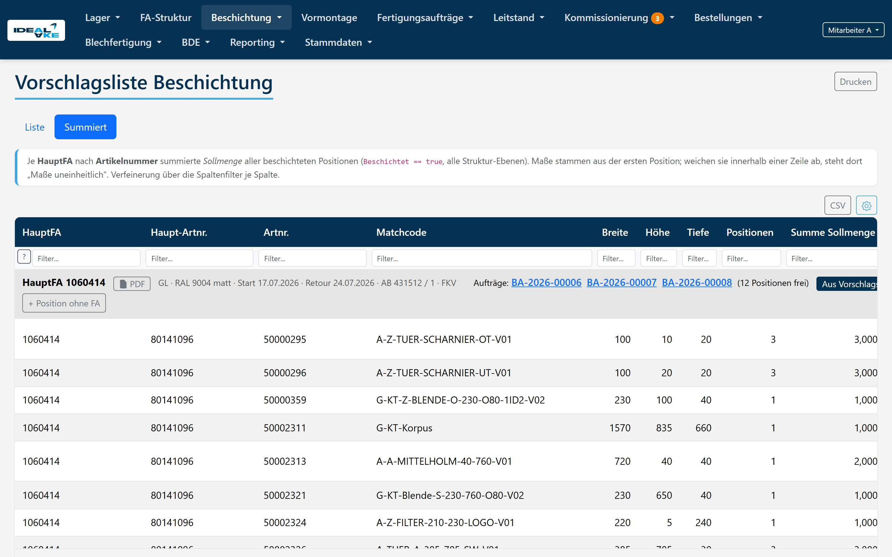
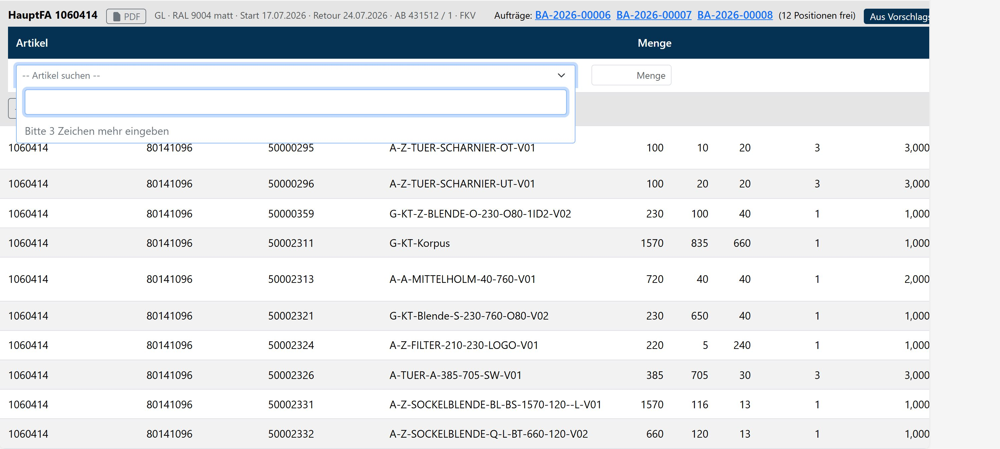
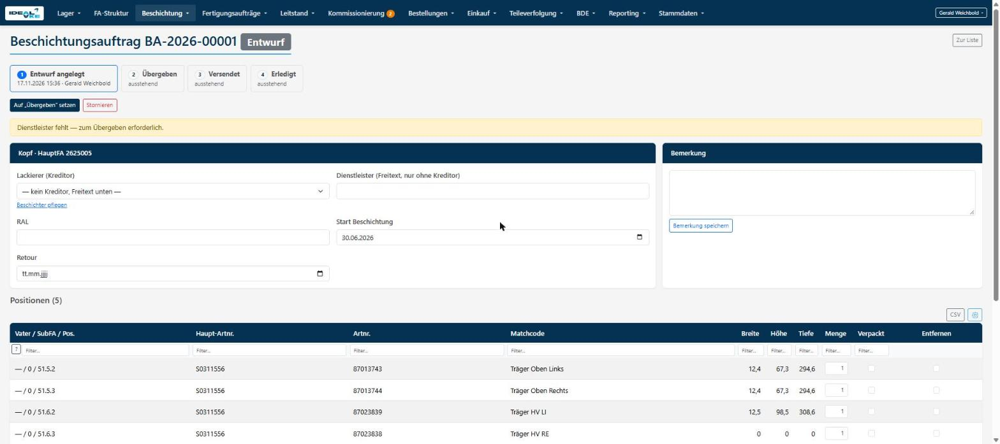
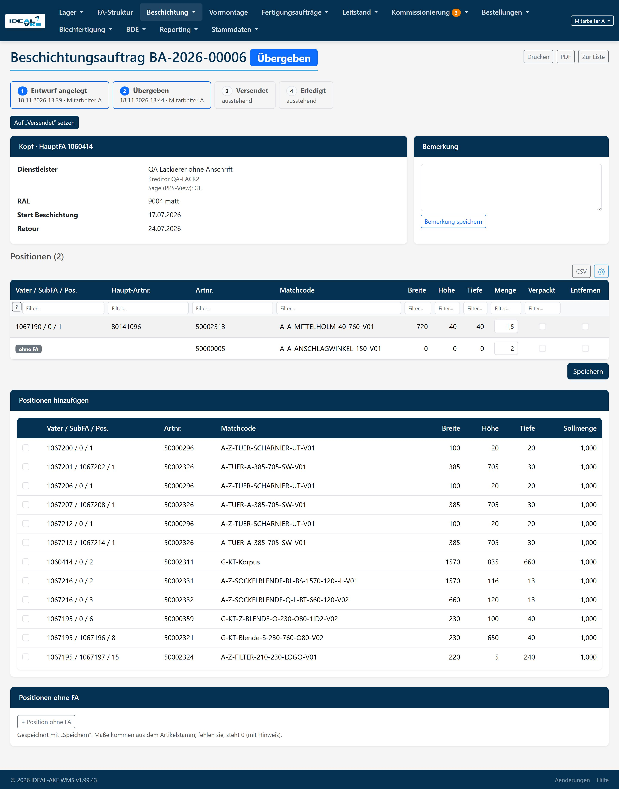
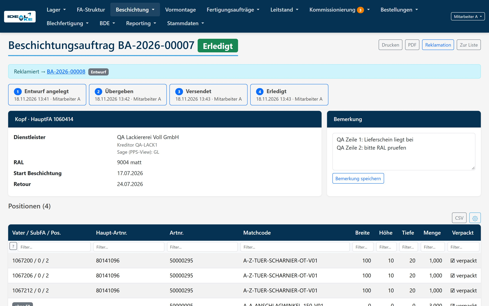
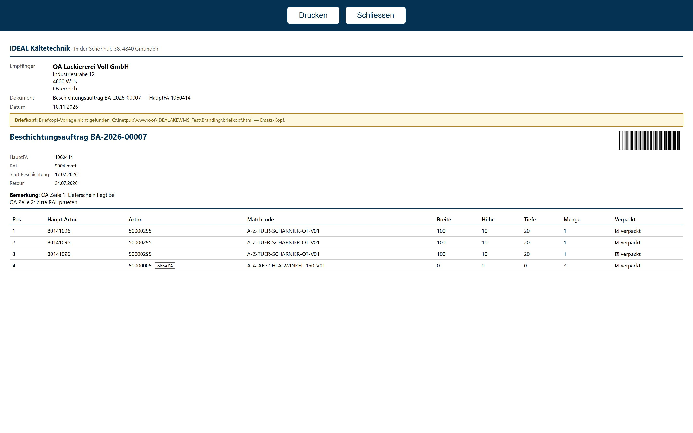
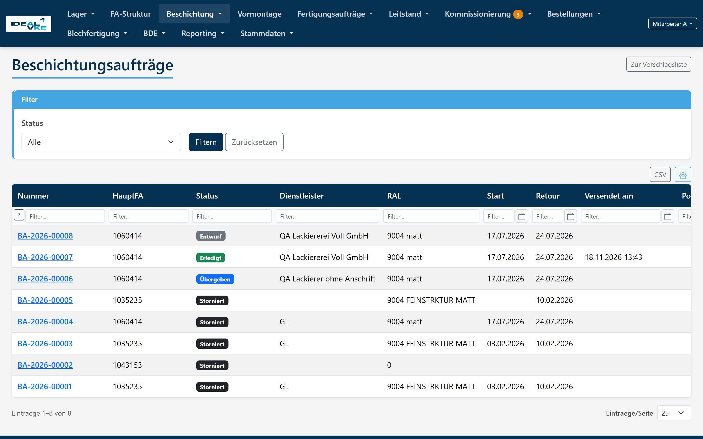

# 15 Beschichtung – Vorschlagsliste und Beschichtungsauftrag

Stand: Version 1.99.67 · Standorte AKE und IDEAL · Bilder aus dem IDEAL-Testsystem

## Zweck

Teile, die beschichtet (lackiert, pulverbeschichtet) werden, gehen zu einem Lackierer. Das WMS zeigt in der **Vorschlagsliste**, welche Teile
eines Auftrags beschichtet werden müssen. Daraus legt man einen **Beschichtungsauftrag** an (Nummer wie *BA-2026-00007*). Der Auftrag wird
gedruckt und geht mit den Teilen zum Lackierer. Am Auftrag sieht man jederzeit, wo er steht: **Entwurf → Übergeben → Versendet → Erledigt**.

## Wer darf

| Was | Rolle (*Stammdaten → Rollen*) | Einstellung |
|---|---|---|
| Vorschlagsliste und Aufträge ansehen, drucken, PDF | „Beschichtungsauftrag“ (Schlüssel `beschichtungsauftrag`) | **Beschichtungsauftrag aktiv** |
| Zusätzlich Aufträge anlegen, bearbeiten, Status setzen, stornieren, Reklamation | „Beschichtungsaufträge (Schreibrecht)“ (Schlüssel `beschichtungsauftrag_schreiben`) | wie oben |
| Lackierer als „Beschichter“ kennzeichnen (*Stammdaten → Kreditoren*) | Stammdaten | – |

Administratoren dürfen alles. Ohne die Einstellung **Beschichtungsauftrag aktiv** fehlt das Menü **Beschichtung** für alle.

## Schritt für Schritt

### 1. Vorschlagsliste öffnen

Menü **Beschichtung → Vorschlagsliste**. Die Seite öffnet in der Ansicht **Summiert**: je Auftrag (HauptFA) eine Zeile pro Artikel mit
der Summe der Sollmenge und der Zahl der Positionen. Der Umschalter **Liste** zeigt jede Position einzeln.

Im grauen Gruppenkopf stehen je Auftrag: Dienstleister, RAL, Start, Retour, AB-Nummer und Abteilung, rechts die schon angelegten
Aufträge (z. B. **Aufträge: BA-2026-00006**, als Link) und wie viele Positionen noch frei sind („(12 Positionen frei)“).

Den Auftrag findet man am schnellsten über den Spaltenfilter **HauptFA**.

### 2. Teile anhaken – Spalte „Verpackt“

In der letzten Spalte **Verpackt** die Teile anhaken, die jetzt zum Lackierer gehen. Das ist freiwillig (seit 1.99.65): Ohne Haken
kommen alle freien Teile in den Entwurf, und abgehakt wird dort beim Packen (siehe Schritt 4).

- Ein Haken in der Ansicht *Summiert* nimmt **alle freien** Positionen dieses Artikels im Auftrag.
- „vergeben“ und kein Kästchen: Die Teile stecken schon in einem Beschichtungsauftrag.
- „2 von 3 frei“: Ein Teil ist vergeben, der Rest ist noch frei.
- Der Haken in der Vorschlagsliste wird **nicht gespeichert**. Neu laden setzt ihn zurück.

### 3. Teile ohne Fertigungsauftrag dazunehmen

Im Gruppenkopf **+ Position ohne FA** klicken. Es erscheint eine Zeile mit **Artikel suchen** (mindestens 3 Zeichen) und **Menge**.

### 4. Auftrag anlegen

Im Gruppenkopf **Aus Vorschlagsliste erstellen** klicken. Der neue Auftrag öffnet sich als **Entwurf**:

- **Mit Haken:** genau die angehakten Positionen, alle als *verpackt* markiert. Was nicht angehakt war, bleibt in der Vorschlagsliste frei.
- **Ohne Haken** (seit 1.99.65): alle freien Positionen dieses Auftrags, alle *offen* (☐). Der Entwurf ist dann die Packliste: beim Packen
  **Verpackt** anhaken, Teile, die nicht mitgehen, **Entfernen**. Sind schon Teile in einem anderen Auftrag, nennt ein gelber Hinweis sie.
- Den Knopf sieht nur, wer Schreibrecht hat, und nur solange noch Positionen frei sind.

### 5. Entwurf ausfüllen

Im Auftrag oben links den **Kopf** ausfüllen:

- **Lackierer (Kreditor)**: aus der Liste wählen. Dort stehen die Kreditoren mit dem Kennzeichen *Beschichter* („Kurzname — Name, Ort“).
  Der gewählte Kreditor ist später die **Anschrift auf Druck und PDF**. Fehlt der Lackierer in der Liste, über den Link
  **Beschichter pflegen** (Stammdatenrecht) nachtragen.
- Kein Kreditor? **— kein Kreditor, Freitext unten —** wählen und **Dienstleister (Freitext, nur ohne Kreditor)** ausfüllen.
- **RAL**, **Start Beschichtung**, **Retour** prüfen.
- Mengen, Haken **Verpackt** und **Entfernen** in der Positionstabelle anpassen, dann **Speichern**. Je Zeile gilt **Verpackt oder
  Entfernen** (seit 1.99.65): Wer *Entfernen* anhakt, sieht *Verpackt* derselben Zeile abgehakt und gesperrt; *Entfernen* lösen gibt
  es wieder frei.
- Unter **Positionen hinzufügen** stehen die noch freien Positionen dieses Auftrags, darunter **Positionen ohne FA**.

Die **Bemerkung** rechts hat einen eigenen Knopf **Bemerkung speichern**. Ist sie geändert, aber nicht gespeichert, steht
„⚠ nicht gespeichert“ daneben. Drucken, PDF, Speichern und die Statusknöpfe fragen dann: „Bemerkung ist nicht gespeichert — trotzdem
fortfahren?“

Seit 1.99.56 **speichern die Statusknöpfe** (außer Stornieren) geänderte Mengen und Haken **mit**, bevor sie den Status setzen – ein
eigenes **Speichern** davor ist nicht mehr nötig. Lehnt der Status ab (z. B. Dienstleister fehlt), ist trotzdem gespeichert:
Meldung „Gespeichert.“ plus gelbe Warnung. **Drucken** und **PDF** fragen bei ungespeicherten Positionen nach, weil der Druck den
gespeicherten Stand zeigt.

### 6. Übergeben, drucken, versenden, erledigen

Oben im Auftrag zeigt der **Statusverlauf** jeden Schritt mit Zeit und Benutzer. Darunter steht der Knopf für den nächsten Schritt.

1. **Auf „Übergeben“ setzen** – geht nur mit Dienstleister (Kreditor oder Freitext). Sonst: „Dienstleister fehlt — zum Übergeben
   erforderlich.“ Sind noch Positionen ohne Haken *Verpackt*, fragt ein Fenster „Nicht alle Positionen verpackt“ und listet sie
   (seit 1.99.65):
   - **Positionen ohne Verpackt-Kennzeichen entfernen und übergeben** – die offenen Teile kommen aus dem Auftrag und sind in der
     Vorschlagsliste wieder frei.
   - **Nicht verpackt beibehalten und übergeben** – die offenen Teile bleiben im Auftrag; vor *Versendet* müssen sie angehakt werden.
   - **Abbrechen** – nichts passiert, der Auftrag bleibt im Entwurf.

   Ist **keine** Position verpackt, steht statt „entfernen und übergeben“ der Knopf **Entwurf stornieren** im Fenster (seit 1.99.67):
   Ein Auftrag ohne Positionen lässt sich nicht übergeben – das WMS lehnt es ab und speichert nichts. Stornieren gibt alle Positionen
   in der Vorschlagsliste wieder frei. Das Fenster nennt jede Position mit Artikelnummer, Position und VaterFA, z. B.
   „50002326 (Pos. 1, VaterFA 4711)“; so heißen die Positionen auch in den Meldungen.

   Ab jetzt ist der Kopf fest. Menge, Haken und Hinzufügen lassen sich noch ändern. **Entfernen** geht nur noch bei Positionen
   **ohne** Haken *Verpackt*; verpackte zeigen „nicht entfernbar“.
2. **Drucken** oder **PDF** – das Blatt geht mit den Teilen zum Lackierer (siehe Abschnitt 7).
3. **Auf „Versendet“ setzen** – geht nur, wenn **alle** Positionen verpackt sind. Sonst nennt die Meldung die offenen Positionen
   („Versendet nur, wenn alle Positionen verpackt sind — nicht verpackt (2): …“). Haken setzen, **Speichern**, erneut versenden.
   Ab jetzt sind nur noch Status und Bemerkung änderbar.
4. Sind die Teile zurück: **Auf „Erledigt“ setzen**.

**Stornieren** geht nur im Entwurf. Die Positionen sind danach in der Vorschlagsliste wieder frei.

**Reklamation:** An einem erledigten Auftrag **Reklamation** klicken und die betroffenen Teile wählen. Es entsteht ein neuer Entwurf mit
denselben Kopfdaten. Der alte Auftrag zeigt „Reklamiert → BA-…“.

### 7. Druck und PDF

Drucken und PDF gehen ab **Übergeben**. Das Blatt enthält:

- oben den Briefkopf, darunter den **Empfänger** als Brief-Anschrift aus dem gewählten Kreditor (beim Drucken frisch gelesen); ohne Kreditor
  den Dienstleister-Text,
- Auftragsnummer als Barcode rechts neben dem Titel, HauptFA, RAL, Start und Retour, die Bemerkung,
- seit Version 1.99.87 **eine Zeile je Artikel** mit der Gesamtmenge aller Positionen dieses Artikels (bis 1.99.86: eine Zeile je Position).
  *Pos.* zählt die gedruckten Zeilen laufend 1, 2, 3 …; Menge ohne unnötige Nachkommastellen (*5* statt *5,000*). Freie Positionen
  (ohne FA) und Positionen ohne Artikelnummer werden nicht mit anderen zusammengefasst. Letzte Spalte **Verpackt**: ☑ verpackt,
  ☐ offen oder ◩ *2 von 3 verpackt*; weichen die Maße eines Artikels ab, steht dort zusätzlich *Maße uneinheitlich*
  (gedruckt werden die Maße der ersten Position),
- am Tabellenende die Zeile **Summe Teile im Auftrag** mit der Summe aller Mengen und der Anzahl Positionen, z. B. *11 (4 Positionen)*,
- unten rechts „Seite x von y“.

Spalten, die man über das Zahnrad ausblendet, fehlen auch im Druck.

Der gelbe Kasten „Briefkopf: …“ im Bild ist ein Hinweis aus dem Testsystem (Vorlage fehlt dort) und erscheint nur am Bildschirm.

### 8. Auftragsliste

Menü **Beschichtung → Aufträge** zeigt alle Beschichtungsaufträge mit Status-Filter (Alle, Entwurf, Übergeben, Versendet, Erledigt,
Storniert) und der Spalte **Versendet am**. **Zur Vorschlagsliste** führt zurück.

## Hinweise und Stolperfallen

- **Ältere Aufträge ohne Kreditor:** Ist ein Auftrag schon *Übergeben*, hat aber keinen Kreditor, steht im Kopf
  **Lackierer (Kreditor) nachtragen** („Für Anschrift auf Druck und PDF. Danach nicht mehr änderbar.“). Einmal wählen und speichern.
- **Lackierer-Liste leer:** Kein aktiver Kreditor ist als *Beschichter* gekennzeichnet – über **Beschichter pflegen** nachtragen lassen.
- **Gelber Hinweis „Anschrift: …“ im Druck:** Kein Kreditor gewählt, oder am Kreditor fehlen Straße, PLZ oder Ort. Der Hinweis steht nur
  am Bildschirm.
- **„Im Entwurf nicht druckbar — erst übergeben.“** – zuerst auf *Übergeben* setzen.
- **Übergeben → Erledigt direkt geht nicht mehr** (seit Version 1.99.41). Erlaubt ist nur Entwurf → Übergeben → Versendet → Erledigt
  sowie Entwurf → Storniert.
- **„… wurde inzwischen von jemand anderem geändert — bitte neu laden“:** Nichts wurde gespeichert. Seite neu laden und wiederholen.
- **Positionen ohne FA** zählen nie als „vergeben“ – derselbe Artikel darf in mehreren Aufträgen stehen.
- **„in Sage beendet“ / „inaktiv“ / „ungeklärt“** an einer Zeile (seit Version 1.99.37): Die Position ist in Sage nicht mehr aktiv. Bitte
  mit der Arbeitsvorbereitung klären.
- **Kein PDF-Knopf:** Auf dem Server fehlt die PDF-Erzeugung – den Bildschirmdruck nutzen.

## Häufige Fragen

**Ich habe einen Teil vergessen. Muss ich einen neuen Auftrag anlegen?** Nein, solange der Auftrag *Entwurf* oder *Übergeben* ist: unten
unter **Positionen hinzufügen** anhaken und **Speichern**. Die neue Position ist *offen*; vor *Versendet* anhaken.

**Ein Teil geht doch nicht mit, der Auftrag ist schon übergeben.** Ist die Position noch nicht verpackt: **Entfernen** anhaken und
**Speichern**. Eine verpackte Position bleibt im übergebenen Auftrag (seit 1.99.65).

**Kann ich „Aus Vorschlagsliste erstellen“ ohne Haken klicken?** Ja (seit 1.99.65). Dann stehen alle freien Positionen offen im Entwurf.

**Es geht doch nichts zum Lackierer. Kann ich den Entwurf leer übergeben?** Nein (seit 1.99.67). Den Entwurf **stornieren** – das
Fenster beim Übergeben bietet es an, wenn keine Position verpackt ist. Die Positionen sind danach wieder frei.

**Mein Entwurf hat keine Positionen mehr. Kann ich wieder welche hinzufügen?** Ja: Kandidaten unten anhaken und **Speichern**. Bis 1.99.68
endete das mit „Eingabe nicht gespeichert: ungültiger Wert in .“; seit 1.99.69 geht es.

**Warum lässt sich der Auftrag nicht auf „Versendet“ setzen?** Mindestens eine Position hat keinen Haken *Verpackt*. Die Meldung nennt sie.

**Welche Anschrift steht auf dem Blatt?** Die des gewählten Kreditors, so wie sie beim Drucken in den Stammdaten steht.

**Kann ich einen erledigten Auftrag wieder öffnen?** Nein. Für Nacharbeit gibt es die **Reklamation**.

## Unterschiede AKE und IDEAL

| Thema | AKE | IDEAL |
|---|---|---|
| Woher kommen die Positionen? | Aus der **Stückliste des WA**: alle Zeilen der Artikelkategorie *Lackierteil*, für jeden offenen WA mit Beschichtungskennzeichen. HauptFA = WA-Nummer. | Aus der **FA-Struktur**: alle Positionen mit *Beschichtet*, alle Ebenen. |
| Kommissionierte Aufträge | ausgeblendet; Schalter **auch kommissionierte zeigen** holt sie zurück | – |
| Maße (Breite, Höhe, Tiefe) | aus dem Sage-Artikel (mm) | aus der FA-Struktur; bei **Position ohne FA** steht 0 |
| Lackierer vorbelegt | nein | ja, wenn der Dienstleister aus Sage genau dem Kurznamen eines aktiven Beschichters entspricht; sonst Hinweis „Kein Beschichter-Kreditor zu „…“ — Kreditor wählen oder Kurzname pflegen.“ |
| Kopf beim Anlegen | Start = berechneter Beschichtungstermin des WA; Dienstleister, RAL, Retour leer | Dienstleister, RAL, Start, Retour aus Sage |

Ablauf, Status, Druck und Rechte sind an beiden Standorten gleich.
