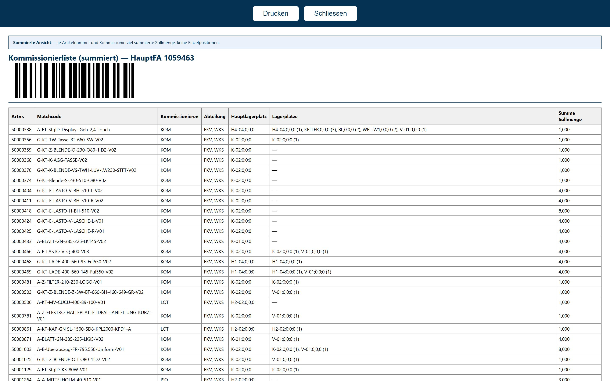

# 16 IDEAL-Kommissionierliste (Kommissionierlisten nach Ziel)

Stand: Version 1.99.44 · nur Standort IDEAL · Bilder aus dem IDEAL-Testsystem

## Zweck

Die Kommissionierliste zeigt dem Lager, **welche Teile für welche Aufträge an welches Kommissionier-Ziel** gebracht werden müssen
(z. B. K-01, K-02). Sie fasst die Sollmengen je Auftrag (HauptFA) und Artikel zusammen und nennt die Lagerplätze, auf denen das WMS
Bestand kennt. Ausgedruckt dient sie als Pickliste.

Sie ergänzt den Kommissionierauftrag aus [Kapitel 01](01-kommissionierung.md); sie bucht selbst **nichts**.

## Wer darf

| Was | Rolle (*Stammdaten → Rollen*) | Einstellung |
|---|---|---|
| Liste ansehen, drucken, PDF | „Lager“, „Lager Key-User“ oder Administrator | **Kommissionierlisten** an |
| Welche Aufträge erscheinen | – | **Kommissionierliste nur nach Leitstand-Freigabe** (Standard: an) |
| Welche Ziele vorgewählt sind | – | **Kommissionierliste: Standard-Ziele** (Standard: K-01, K-02; leer = alle) |

Die Einstellungen pflegt der Administrator unter *Einstellungen*.

## Schritt für Schritt

### 1. Liste öffnen

Menü **Kommissionierung → Kommissionierlisten**. Wer keinen Zugriff auf die Kommissionierung hat, sieht direkt den Menüpunkt
**Kommissionierlisten**. Die Seite heißt **Kommissionierlisten (IDEAL)** und öffnet in der Ansicht **Summiert** (seit Version 1.99.43
Standard). Der Umschalter **Liste** zeigt jede Position einzeln.

### 2. Nur freigegebene Aufträge

In der Liste stehen **nur Aufträge, die der Leitstand zur Kommissionierung freigegeben hat** (grüner Haken im Leitstand,
siehe [Kapitel 01, Schritt 1](01-kommissionierung.md#1-leitstand-fa-freigeben-einzeln)). Über der Tabelle steht ein blauer Hinweis, wie viele
Aufträge mit Positionen für die gewählten Ziele **noch nicht** freigegeben sind:

Fehlt ein Auftrag, den man erwartet: im Leitstand nachsehen, ob er freigegeben ist.

### 3. Ziele und Kalenderwoche wählen

In der Filterkarte:

- **Kalenderwoche von / bis** – optional. Schränkt auf Aufträge ein, deren Kommissioniertermin in diesen Wochen liegt. Leer = alle.
- **Kommissionier-Ziele** – ein Kästchen je Ziel. Vorgewählt sind die Standard-Ziele (normal **K-01** und **K-02**).
  **— alle Ziele —** oder gar kein Haken = alle Ziele.
- **Anwenden** übernimmt die Auswahl.

Die gewählten Ziele **merkt sich das WMS je Benutzer** – auch nach dem Abmelden. **Ziele auf Standard** löscht die eigene Auswahl und
nimmt wieder die Standard-Ziele aus den Einstellungen. **Zurücksetzen** (erscheint nur bei gesetzter Kalenderwoche oder Spaltenfilter) leert beides.

### 4. Ansicht „Summiert“ lesen

Je Auftrag und Artikel eine Zeile mit diesen Spalten:

| Spalte | Bedeutung |
|---|---|
| HauptFA, Artnr., Matchcode | Auftrag und Artikel |
| Kommissionieren | Kommissionier-Ziel (z. B. K-02) |
| **Abteilung** | Montage-Abteilung(en) des Auftrags, bei Kombigeräten mehrere, durch Komma getrennt (z. B. „FKV, WKS“) |
| Hauptlagerplatz | Hauptlagerplatz des Artikels |
| **Lagerplätze** | Lagerplätze mit WMS-Bestand und Menge in Klammern, z. B. „K-02 (12), H4-05 (3)“; ohne Kommissionierwagen. „—“ = kein Bestand im WMS bekannt |
| Summe Sollmenge | Summe aller Positionen dieses Artikels im Auftrag |

Die Ansicht **Liste** zeigt dieselben Angaben je Position, dazu Haupt-Artnr., Sollmenge, Arbeitsbereich, Artikeltyp, Beschichtet und
Material. Bei einem Kombigerät mit mehreren Abteilungen steht an der Gruppe „mehrdeutig (Kombigerät)“.

### 5. Drucken oder PDF

- **Drucken** (oben rechts) druckt alles, was gerade gefiltert ist – **ein Blatt je Auftrag** mit Barcode der HauptFA-Nummer.
- **PDF** am Gruppenkopf erzeugt die Liste eines einzelnen Auftrags.
- Gedruckt werden nur die Spalten, die am Bildschirm sichtbar sind (Zahnrad).

## Hinweise und Stolperfallen

- **Liste leer, obwohl Aufträge da sind?** Meist sind sie im Leitstand noch nicht freigegeben – der blaue Hinweis nennt die Anzahl. Oder die
  gewählten Ziele passen nicht: **— alle Ziele —** anhaken und **Anwenden**.
- **„Achtung: Leitstand ist ausgeschaltet – Freigaben sind nicht möglich, die Liste bleibt leer.“** Dann ist die Einstellung
  *Kommissionierliste nur nach Leitstand-Freigabe* an, aber der Leitstand aus. Den Administrator informieren.
- **„HauptFA … ist im Leitstand nicht zur Kommissionierung freigegeben.“** erscheint, wenn man das PDF eines nicht freigegebenen Auftrags
  direkt aufruft (z. B. über einen alten Link).
- **Lagerplätze** zeigen den Bestand, den das **WMS** kennt – nicht den Sage-Bestand. Kommissionierwagen sind bewusst nicht dabei.
- **„in Sage beendet“ / „inaktiv“ / „ungeklärt“** an einer Zeile (seit Version 1.99.37): Die Position ist in Sage nicht mehr aktiv. Bitte
  mit der Arbeitsvorbereitung klären, bevor man sie kommissioniert.

## Häufige Fragen

**Ich will kurz alle Ziele sehen, aber meine Auswahl behalten.** Das geht nicht getrennt: Jede Auswahl mit **Anwenden** wird gemerkt.
Danach die eigenen Ziele wieder anhaken oder **Ziele auf Standard**.

**Warum steht bei einem Auftrag „FKV, WKS“?** Der Auftrag ist ein Kombigerät; seine Teile gehen in zwei Abteilungen.

**Warum ist die Summe höher als eine einzelne Position?** In *Summiert* werden alle Positionen desselben Artikels im Auftrag addiert. Die
Einzelpositionen zeigt die Ansicht **Liste**.

## Unterschiede AKE und IDEAL

Die Kommissionierlisten gibt es nur bei **IDEAL** (hierarchische Aufträge mit HauptFA). Bei AKE ist der Menüpunkt nicht vorhanden; dort
arbeitet das Lager nur mit den Kommissionieraufträgen aus [Kapitel 01](01-kommissionierung.md).
