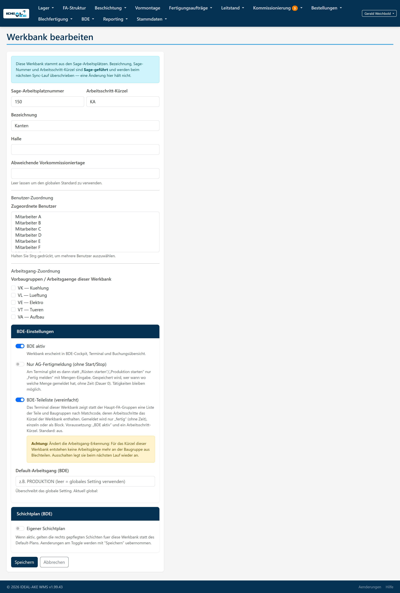
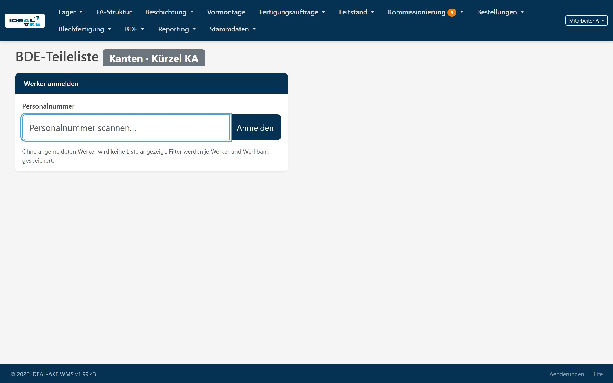
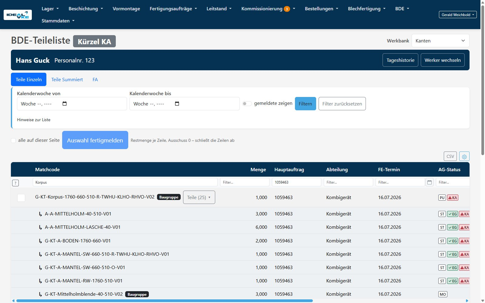
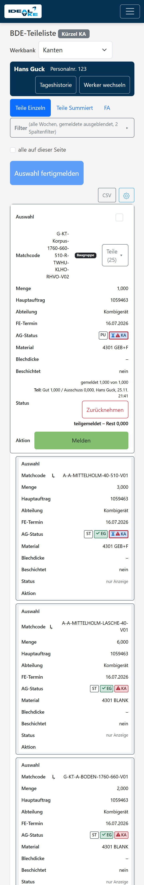
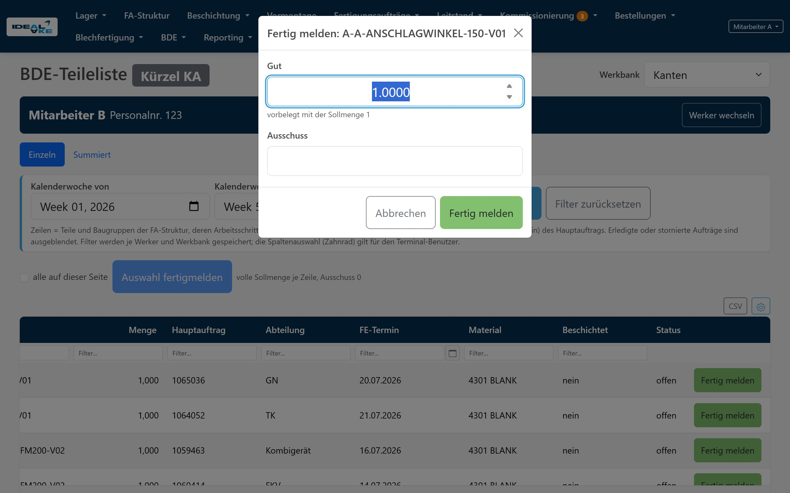
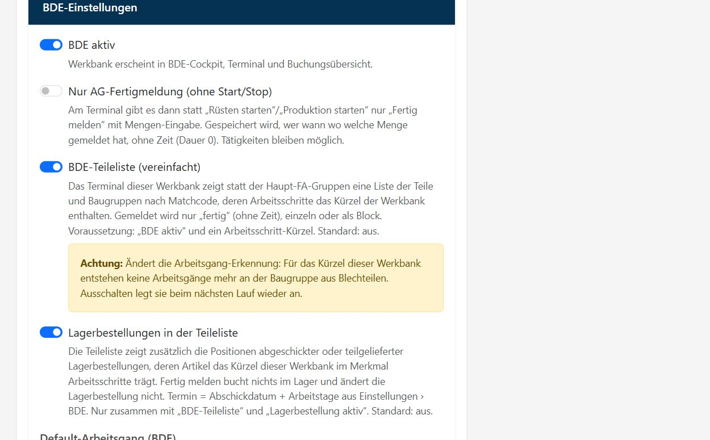
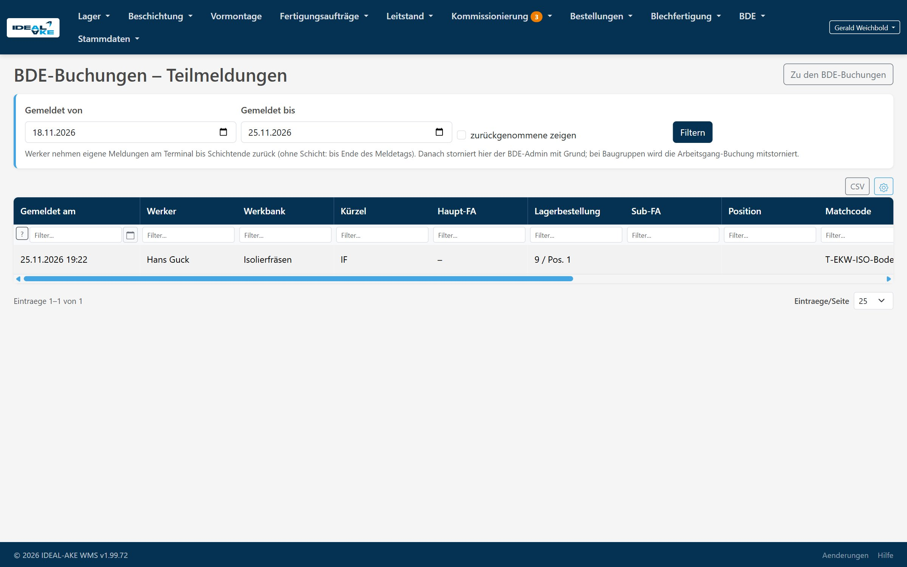
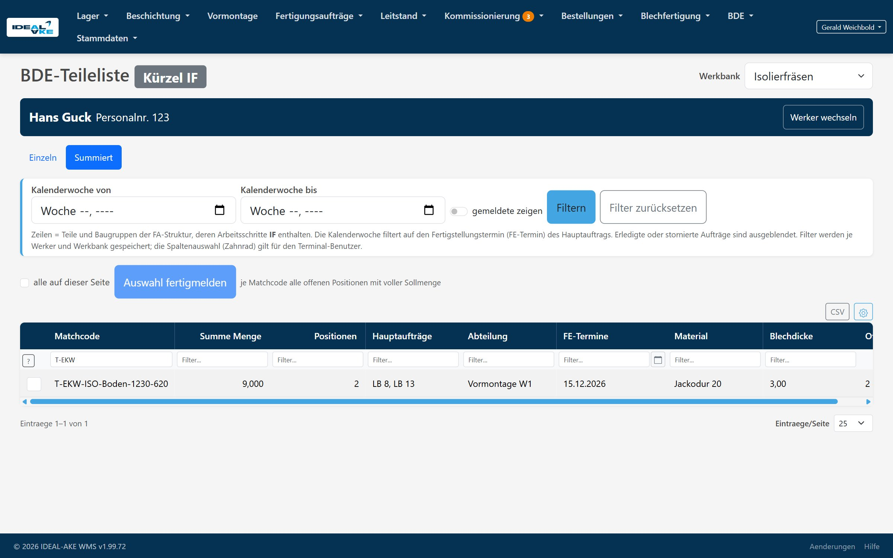
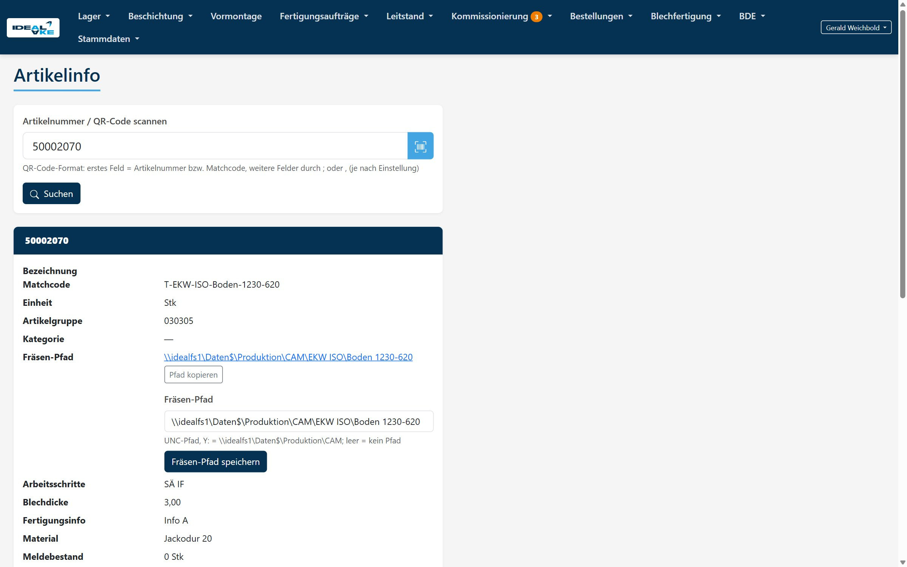

# 17 BDE-Teileliste an der Werkbank (vereinfachte Fertigmeldung)

Stand: Version 1.99.79 (Doku-Nachzug 1.99.80: Statustabelle repariert, Blechdicke „–“, Termin einstellbar; Summen-Haken kommt zurück, Text), 1.99.78 (Abschnitt 1 Verweise auf Kapitel 11, Tageshistorie, Text), 1.99.77 (Abschnitt 1 Reiter FA mit Buchungen, Text), 1.99.76 (Wer darf, Reiter, Abschnitt 1, Text), 1.99.73 (Abschnitt 2 und Handy, Text; Fotos 1.99.78), 1.99.72 (Abschnitte 8 und 9, Text; Fotos folgen) bzw. 1.99.43 · nur Standort IDEAL · Bilder aus dem IDEAL-Testsystem

## Zweck

An Werkbänken der Blechfertigung (z. B. **Kanten**) zeigt die BDE-Seite eine **Teileliste**: alle Teile und
Baugruppen, die an dieser Werkbank bearbeitet werden, sortiert nach **Matchcode**. Der Werker meldet nur **„fertig“** – ohne Rüsten,
ohne Start und Stopp, ohne Zeit. Er kann einzeln melden oder viele Zeilen auf einmal.

Rüsten, Produktion und Pause (Reiter **FA**) sowie die **Tageshistorie** beschreibt [Kapitel 11](11-bde-terminal.md).

## Wer darf

| Was | Rolle (*Stammdaten → Rollen*) |
|---|---|
| Teileliste bedienen, eigene Meldungen zurücknehmen | **BDE-Mitarbeiter** (auch BDE-Schichtleiter, BDE-Admin, Administrator) |
| Alle Teilmeldungen ansehen (*BDE → Buchungen → Teilmeldungen*) | **BDE-Schichtleiter** |
| Teilmeldungen stornieren | **BDE-Admin** |
| Werkbank auf Teileliste umstellen (*Stammdaten → Werkbänke*) | Stammdaten |

**Voraussetzungen** (richtet die WMS-Betreuung ein):

- *Einstellungen*: **BDE (Betriebsdatenerfassung)** an. Die Einstellung **BDE: nur FA-Meldung** wirkt seit 1.99.76 auf der BDE-Seite nicht mehr.
- *Stammdaten → Werkbänke → Bearbeiten*: Werkbank mit **BDE aktiv** und einem **Arbeitsschritt-Kürzel** (z. B. *KA*), Schalter
  **BDE-Teileliste (vereinfacht)** an (Standard: aus). Nur damit gibt es die Reiter **Teile Einzeln** und **Teile Summiert**.
- Seit 1.99.76 darunter die Auswahl **BDE-Standardsicht**: **Teile** oder **FA** – welcher Reiter beim Öffnen zuerst erscheint, solange der
  Werker keine Sicht gewählt hat. **Teile** lässt sich nur mit „BDE aktiv“, Kürzel und „BDE-Teileliste“ speichern, sonst kommt
  „Standardsicht „Teile“ braucht „BDE aktiv“, ein Arbeitsschritt-Kürzel und „BDE-Teileliste (vereinfacht)“ – sonst „FA“ wählen.“ Wer die
  Teileliste ausschalten will, stellt vorher die Standardsicht auf **FA**. Beim Update ist **Teile** dort vorbelegt, wo die Teileliste bisher
  wirkte. Die Werkbank-Liste zeigt dann das Kennzeichen **Standard Teile**. Nur Oberfläche, keine Wirkung auf die Arbeitsgang-Erkennung.
- Der Terminal-Benutzer hat ein Terminal (wie in Kapitel 11), jeder Werker eine **Personalnummer**.

> **Achtung beim Einschalten:** Der gelbe Hinweis an der Werkbank sagt: Für das Kürzel dieser Werkbank entstehen keine Arbeitsgänge mehr an
> der Baugruppe aus Blechteilen. Ausschalten legt sie beim nächsten Lauf wieder an. Nur nach Absprache mit der Arbeitsvorbereitung umstellen.

## Schritt für Schritt

### 1. BDE-Seite öffnen, Werker anmelden

Menü **BDE → Terminal**. Steht die Werkbank des Terminals auf **BDE-Standardsicht = Teile**, öffnet sich automatisch die **BDE-Teileliste**
(seit 1.99.76; vorher genügte der Schalter „BDE-Teileliste“). Oben steht z. B. **Kanten · Kürzel KA**.

Seit 1.99.76 hat die Seite drei Reiter: **Teile Einzeln**, **Teile Summiert** und **FA**. Der Reiter **FA** zeigt die offenen Arbeitsgänge der
Werkbank mit Anstempeln (Rüsten/Produktion), beschrieben in [Kapitel 11](11-bde-terminal.md), Abschnitt 2. Seit 1.99.77 stehen dort oben
unter **Meine Buchungen** die laufenden und pausierten Buchungen des Werkers (Pause, Teilfertig, Fertig, Fortsetzen), dazu **FA scannen** und
**Tätigkeit starten** ([Kapitel 11](11-bde-terminal.md), Abschnitt 3). Seit 1.99.78 öffnet der Knopf **Tageshistorie** im Werker-Balken die
Buchungen und Teilmeldungen des Werkers von heute ([Kapitel 11](11-bde-terminal.md), Abschnitt 4). Die Teile-Reiter zeigen „Meine Buchungen“ nicht. Die zuletzt gewählte Sicht merkt
sich das WMS je Werker und Werkbank. An Werkbänken ohne „BDE-Teileliste“ sind die Teile-Reiter ausgegraut, mit dem Hinweis „Teile-Reiter nur
an Werkbänken mit „BDE-Teileliste (vereinfacht)“ und Kürzel – diese Werkbank zeigt die FA-Sicht.“

1. Bei **Werker anmelden** die **Personalnummer** scannen oder eintippen, **Anmelden**.
2. Unbekannte Nummer: „Unbekannte oder inaktive Personalnummer: …“.
3. Ohne angemeldeten Werker wird keine Liste angezeigt.

**Werker wechseln** (rechts im dunklen Balken) meldet den Werker ab. Über **Werkbank** oben rechts lässt sich eine andere Werkbank wählen.

### 2. Liste lesen – Ansicht „Einzeln“

Jede Zeile ist ein Teil oder eine Baugruppe (Kennzeichen **Baugruppe**) aus der FA-Struktur, deren Arbeitsschritte das Kürzel der Werkbank
enthalten. Spalten: **Matchcode, Menge, Hauptauftrag, Abteilung, FE-Termin, AG-Status, Material, Blechdicke, Beschichtet, Status**. Über das Zahnrad lassen sich
weitere Spalten einblenden (z. B. Artikelnummer, Sub-FA, Position, Arbeitsschritte, Kunde, Bemerkung PN, Fertigungsinfo PN).

**Filter:**

- **Kalenderwoche von / bis** filtert auf den FE-Termin des Hauptauftrags.
- **gemeldete zeigen** blendet auch schon **fertig** gemeldete Zeilen ein. Teilgemeldete Zeilen (seit 1.99.75) sind immer sichtbar.
- **Filtern** übernimmt, **Filter zurücksetzen** stellt den Standard wieder her.
- Die Filter merkt sich das WMS **je Werker und Werkbank**. Erledigte oder stornierte Aufträge stehen nicht in der Liste.

**Status einer Zeile:**

| Status | Bedeutung |
|---|---|
| offen | noch nicht gemeldet |
| teilgemeldet – Rest … | mit **Teilfertig** gemeldet, Zeile bleibt offen (seit 1.99.75) |
| ✓ fertig gemeldet | mit **Fertig** abgeschlossen |
| ⚠ Strukturzeile nicht eindeutig – bitte AV | das WMS kann die Zeile nicht sicher zuordnen; nicht melden, Arbeitsvorbereitung informieren |
| kein WMS-Auftrag | zu diesem Hauptauftrag gibt es im WMS keinen offenen Auftrag |
| nicht meldbar | die Zeile ist in Sage nicht mehr vorhanden, beendet oder inaktiv |

Seit 1.99.75 steht über dem Status **gemeldet X von Soll** (Summe Gut aller Meldungen) und darunter jede Meldung einzeln:
**Teil** oder **Fertig**, Gut/Ausschuss, Werker, Datum Uhrzeit; bei eigenen Meldungen der Knopf **Zurücknehmen**.

**AG-Status (seit 1.99.73):** je Arbeitsschritt der Zeile ein Zeichen mit Kürzel, wie in der FA-Struktur:

| Zeichen | Bedeutung |
|---|---|
| Haken | erledigt – Arbeitsgang fertig gemeldet **oder** Teil an dieser Werkbank-Art mit **Fertig** gemeldet |
| Sanduhr | läuft gerade – auch: Teil nur mit **Teilfertig** gemeldet (seit 1.99.75) |
| Kreis | offen |
| Dreieck | überfällig (Soll-Termin aus FE-Termin und Vorlauf überschritten) |
| ohne Zeichen | kein BDE-Arbeitsgang für dieses Kürzel |

Den Namen und den Status zeigt der Mauszeiger bzw. liest der Screenreader vor. Der Spaltenfilter „AG-Status“ sucht im Text,
z. B. `erledigt`, `überfällig` oder ein Kürzel. Lagerbestell-Zeilen zeigen die Zeichen ohne Status.

**Baugruppen (seit 1.99.73):** Neben dem Matchcode steht **Teile (n) ▸**. Antippen klappt die Teile als eigene, eingerückte und grau
hinterlegte Zeilen (mit „↳“) auf – mit allen Spalten inkl. AG-Status, aber **nur zum Ansehen** (kein Haken, kein Melden). Beim Sortieren
bleiben die Teile unter ihrer Baugruppe; das Zahnrad blendet Spalten auch in den Teilen aus.
Trifft ein Spaltenfilter (z. B. Matchcode) nur ein Teil, erscheint die Baugruppe **aufgeklappt** und das Teil hat links einen dunklen Balken
und das Zeichen **◆ Treffer**.

**Am Handy (schmaler als 992 px, seit 1.99.73):**

- Die Filterkarte ist eingeklappt; der Knopf **Filter (…)** zeigt die Kurzfassung (Kalenderwochen, gemeldete sichtbar/ausgeblendet, Anzahl
  Spaltenfilter) und klappt sie auf.
- Die Liste erscheint als **Karten**: je Zeile Beschriftung links, Wert rechts; Haken oben, **Melden** unten.
- Spaltenfilter lassen sich dort nicht bedienen, wirken aber weiter – **Filter zurücksetzen** hebt sie auf.
- Die **Hinweise zur Liste** sind aufklappbar. Alle Knöpfe und Haken sind mindestens 44 px groß.

### 3. Einzeln melden: Teilfertig oder Fertig (seit 1.99.75)

1. In der Zeile **Melden** antippen.
2. Das Fenster zeigt **Soll**, **bereits gemeldet** und **Gut** (vorbelegt mit der **Restmenge** = Soll minus bereits gemeldet, mindestens 0)
   sowie **Ausschuss**. Mengen prüfen.
3. Einen der beiden Knöpfe einmal antippen:
   - **Teilfertig melden** – meldet die Menge, die **Zeile bleibt offen** (z. B. 3 von 10 fertig, der Rest folgt später). Gut muss größer 0 sein.
     Mehrere Teilmeldungen nacheinander sind möglich; die Zeile zeigt dann „gemeldet 7 von 10“.
   - **Fertig melden** – meldet die Menge und **schließt die Zeile ab**, auch wenn weniger als der Rest gemeldet wird.
4. **Abbrechen** schließt ohne Meldung.

Erreicht eine Teilmeldung die Sollmenge (oder mehr – Mehrmenge kommt vor), wird sie gespeichert, die Zeile bleibt aber offen und oben steht
**„Sollmenge erreicht – bitte Fertig melden“**. Danach **Melden → Fertig melden** (Vorgabe Gut 0) schließt die Zeile.

**Baugruppen:** **Teilfertig** bucht die Teilmenge am Arbeitsgang der Sub-FA, der Arbeitsgang bleibt offen; **Fertig** meldet ihn fertig.

### 4. Mehrere Zeilen auf einmal melden

1. Links die Kästchen der Zeilen anhaken – oder **alle auf dieser Seite**.
2. Der Knopf zeigt, was gemeldet wird: **Auswahl fertigmelden (2 Zeilen, Summe 2)**.
3. Antippen und im Fenster **Fertig melden** bestätigen. Jede Zeile wird mit ihrer **Restmenge, Ausschuss 0** fertig gemeldet und abgeschlossen
   (seit 1.99.75; vorher volle Sollmenge). Die Summe im Knopf ist die Summe der Restmengen.

Danach nennt die Meldung oben, was passiert ist, z. B. „Gemeldet: 2.“ War eine Zeile schon gemeldet (z. B. von einem Kollegen), steht
„Bereits gemeldet: … – nichts geändert“ mit Name und Uhrzeit. Nichts wird doppelt gemeldet.

### 5. Ansicht „Summiert“

Der Umschalter **Summiert** fasst gleiche Teile zusammen: je **Matchcode** eine Zeile mit **Summe Menge**, Anzahl **Positionen**,
**Hauptaufträge**, **Abteilung**, **FE-Termine**, **AG-Status** und **Offen**. Das ist praktisch, wenn ein Teil für mehrere Aufträge in
einem Durchgang gefertigt wird.

Seit 1.99.74:

- **Aufträge (n) ▸** neben dem Matchcode klappt die einzelnen Aufträge auf: eingerückte, grau hinterlegte Zeilen mit „↳“, sortiert nach
  **FE-Termin** (früheste zuerst, ohne Termin zuletzt). Jede Zeile hat Menge, Hauptauftrag, Abteilung, FE-Termin, AG-Status und Status wie in
  *Einzeln*. Nochmals antippen klappt zu (Zeichen ▾/▸).
- **Haken auf der Summenzeile** = alle offenen Aufträge darunter mit ihrer Restmenge fertig melden (seit 1.99.75; vorher volle Sollmenge). Er setzt auch die Haken aller Aufträge
  darunter.
- **Reicht die Menge nicht für alle**, nur einzelne Aufträge anhaken (z. B. die mit dem frühesten FE-Termin). Gemeldet werden nur diese, die
  übrigen bleiben offen. Nimmt man bei gesetztem Summen-Haken einen Auftrags-Haken weg, ist auch der Summen-Haken weg – die anderen Aufträge
  bleiben angehakt. Setzt man alle Auftrags-Haken wieder, ist auch der Summen-Haken wieder gesetzt (seit 1.99.79). Der Knopf „Auswahl fertigmelden (n Zeilen …)“ zählt jeden Auftrag nur einmal.
- Bereits gemeldete Aufträge (nur mit „gemeldete zeigen“ sichtbar) haben keinen Haken; ihre Statuszelle zeigt „✓ fertig gemeldet“ und, bei eigenen,
  „Zurücknehmen“.
- **AG-Status der Summenzeile** zeigt je Kürzel den **schlechtesten Stand** der Aufträge: erledigt (Haken) nur, wenn alle erledigt sind; ist
  einer überfällig, steht das Dreieck; läuft einer und ein anderer ist überfällig, stehen Sanduhr und Dreieck. Aufträge ohne BDE-Arbeitsgang
  für das Kürzel zählen nicht mit. Der Spaltenfilter AG-Status filtert die Aufträge (z. B. `überfällig` zeigt nur überfällige Aufträge).

### 6. Meldung zurücknehmen

Falsch gemeldet? In der Zeile bei der betreffenden Meldung **Zurücknehmen** antippen (abgeschlossene Zeilen nur mit **gemeldete zeigen**
sichtbar). Seit 1.99.75 hat jede Meldung ihren eigenen Knopf, und die Rückfrage erscheint in einem eigenen Fenster:

- bei einer **Fertig**-Meldung: „Fertigmeldung zurücknehmen? Die Zeile ist danach wieder offen.“
- bei einer **Teil**-Meldung: „Teilmeldung zurücknehmen? Die gemeldete Menge sinkt entsprechend.“

**Zurücknehmen** im Fenster bestätigt, **Abbrechen** lässt alles, wie es ist. Bei Baugruppen wird die zugehörige Arbeitsgang-Buchung storniert.

- Nur **eigene** Meldungen, und nur bis **Schichtende** (ohne Schichtkalender: bis Ende des Meldetags).
- Danach: „Frist abgelaufen (…) – Rücknahme nur noch über den BDE-Admin (BDE-Buchungen › Teilmeldungen).“

### 7. Für Schichtleiter und BDE-Admin: Teilmeldungen

Menü **BDE → Buchungen**, Knopf **Teilmeldungen (BDE-Teileliste)**. Die Seite **BDE-Buchungen – Teilmeldungen** zeigt alle Meldungen eines
Zeitraums (Standard: letzte 7 Tage) mit Werker, Werkbank, Kürzel, Haupt-FA, Sub-FA, Position, Matchcode und (seit 1.99.75) **Art**
(**Teil** oder **Fertig**, filterbar). **zurückgenommene zeigen**
blendet auch zurückgenommene ein. Der **BDE-Admin** kann eine Meldung mit Grund **stornieren**; bei Baugruppen wird die
Arbeitsgang-Buchung mitstorniert.

### 8. Lagerbestellungen an der Werkbank (seit 1.99.72)

An der Werkbank der Isolierungsfräse (Kürzel **IF**) zeigt die Teileliste auch **bestellte Isolierungen** aus Lagerbestellungen.
Voraussetzung (richtet die WMS-Betreuung ein): *Stammdaten → Werkbänke → Bearbeiten*, Schalter **Lagerbestellungen in der Teileliste** an
(geht nur zusammen mit **BDE-Teileliste**), Lagerbestellung eingeschaltet.

- Es erscheint jede Position einer **abgeschickten** oder **teilgelieferten** Lagerbestellung, deren Artikel das Kürzel der Werkbank in den
  Arbeitsschritten trägt. Entwürfe, abgeschlossene und stornierte Bestellungen erscheinen nicht.
- Kennzeichen in der Spalte Status: **Lagerbestellung <Nr>**, darunter klein der Kommentar der Bestellung.
- **Menge** = bestellte Menge, **Abteilung** = die bestellende Werkbank, **Hauptauftrag** leer.
- **FE-Termin** = Tag des Abschickens + **10 Arbeitstage** (ohne Wochenende und Feiertage; die Zahl stellt der Administrator in den
  Einstellungen ein, Standard 10). Die Kalenderwoche filtert auf diesen Termin.
- **Fertig melden** wie ein Teil (einzeln, als Block oder in *Summiert*, dort als „LB <Nr>“ bei den Hauptaufträgen). Es wird **nichts
  gebucht**: kein Lagerbestand, keine Änderung an der Lagerbestellung, nichts an Sage. Das Lager schließt die Bestellung wie gewohnt ab.
- Ist die Bestellung inzwischen abgeschlossen, oder trägt der Artikel das Kürzel nicht mehr, weist das WMS die Meldung mit Grund ab.
- Unter **Teilmeldungen** steht bei solchen Meldungen die Spalte **Lagerbestellung** (Nr. / Pos.), Hauptauftrag „–“.

### 9. Neue Spalten: Blechdicke und Fräsen-Pfad (seit 1.99.72)

- **Blechdicke** (aus Sage) ist sichtbar; der Spaltenfilter rechnet mit Zahlen (`3,00` trifft 3,00). Steht überall **„–“**, ist das
  Sage-Feld für die Blechdicke noch nicht eingerichtet (seit 1.99.79) – bitte der IT melden. *Summiert* zeigt jetzt auch
  **Material** und **Blechdicke**; Bemerkung PN und Fertigungsinfo PN lassen sich dort über das Zahnrad einblenden.
- **Fräsen-Pfad** (nur wenn eingeschaltet): über das **Zahnrad** einblenden – die Wahl bleibt für den Terminal-Benutzer gespeichert.
  Der Link öffnet den Ordner des Fräsprogramms. Öffnet er nicht: **Pfad kopieren**, im Explorer **Strg+L**, einfügen, **Enter**.
  In der Teileliste wird der Pfad nur angezeigt; gepflegt wird er in der *Artikelinfo* (Rolle **Fräsen-Pfad pflegen** mit eigenem Konto,
  zusätzlich **Stammdaten lesen**).
- Der Knopf **CSV** exportiert die sichtbaren Spalten und ändert die gemerkten Filter nicht mehr.

## Hinweise und Stolperfallen

- **Gelber Hinweis „… Meldung(en) ohne passende Strukturzeile – Sage hat Position oder Artikel geändert.“** Eine frühere Meldung passt nicht
  mehr zur Struktur. Der Schichtleiter prüft sie unter *Teilmeldungen*.
- **Baugruppe gemeldet:** Eine Baugruppe meldet auch ihren Arbeitsgang in der FA-Struktur fertig. Gibt es dort keinen Arbeitsgang mit dem
  Kürzel, wird nur die Teilmeldung gespeichert (Hinweis „Arbeitsgang … nicht vorhanden – nur die Teilmeldung gespeichert“).
- **Gut ist mit der Restmenge vorbelegt.** Vor dem Bestätigen prüfen, ob die Menge stimmt – und ob die Zeile offen bleiben (Teilfertig) oder
  abgeschlossen werden soll (Fertig).
- **Spaltenauswahl (Zahnrad)** gilt für den Terminal-Benutzer, nicht für den einzelnen Werker; die Filter dagegen je Werker.
- **Lesbarkeit:** Seit Version 1.99.36 steht auf grünen und grauen Knöpfen am Terminal dunkle Schrift (besser lesbar bei schlechtem Licht).

## Häufige Fragen

**Mein Teil fehlt in der Liste.** Kalenderwoche prüfen (FE-Termin des Hauptauftrags). Steht das Kürzel der Werkbank in den
Arbeitsschritten des Teils? Ist der Auftrag erledigt oder storniert, steht er nicht mehr in der Liste.

**Ein Kollege hat dieselbe Zeile gleichzeitig gemeldet.** Das WMS speichert nur die erste Meldung; die zweite bekommt „Bereits gemeldet …“.

**Kann ich eine Teilmenge melden?** Ja: **Melden → Teilfertig melden** – die Zeile bleibt offen, der Rest kann später folgen. Die
Block-Meldung und der Summen-Haken melden immer die Restmenge und schließen ab.

**Wo sehe ich die Zeit?** Gar nicht – die Teileliste speichert nur, wer wann was gemeldet hat, keine Arbeitszeit.

## Unterschiede AKE und IDEAL

Die BDE-Teileliste gibt es nur bei **IDEAL** (hierarchische FA-Struktur). Bei AKE erscheint der Schalter **BDE-Teileliste (vereinfacht)**
an der Werkbank nicht; das Terminal arbeitet wie in [Kapitel 11](11-bde-terminal.md).
