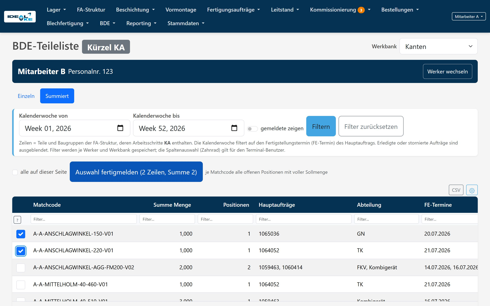
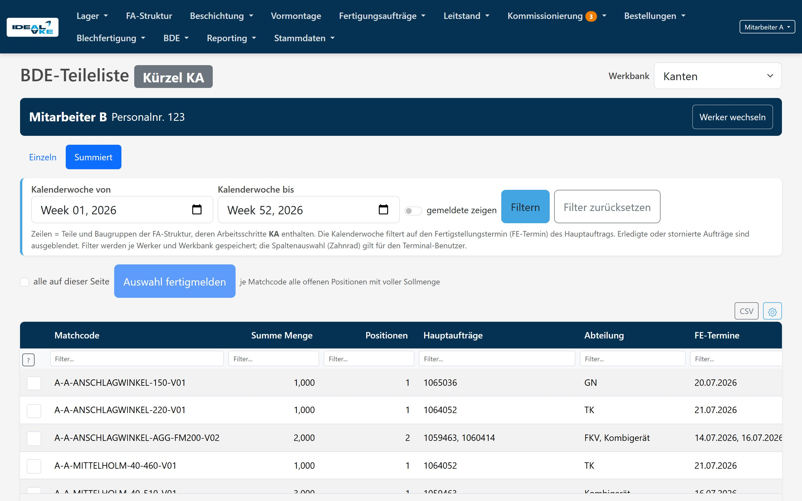
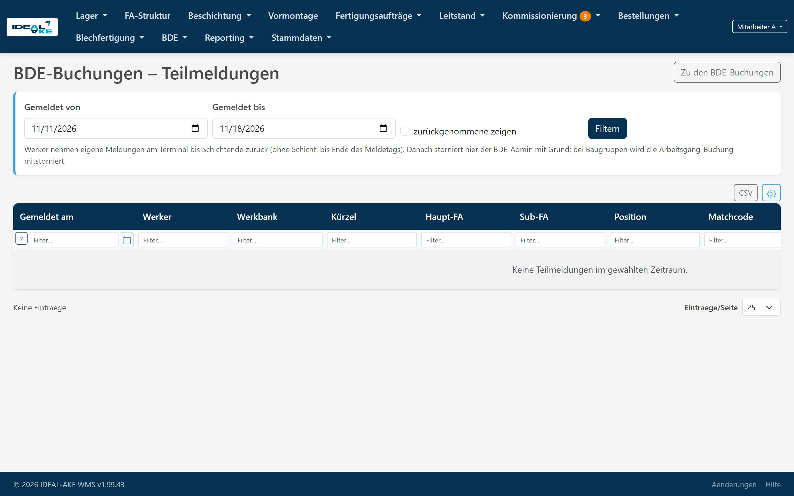
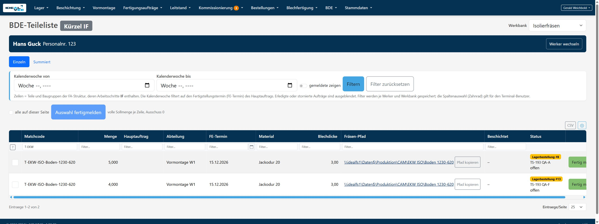

# 17 BDE-Teileliste an der Werkbank (vereinfachte Fertigmeldung)

Stand: Version 1.99.73 (Abschnitt 2 und Handy, Text; Fotos folgen), 1.99.72 (Abschnitte 8 und 9, Text; Fotos folgen) bzw. 1.99.43 · nur Standort IDEAL · Bilder aus dem IDEAL-Testsystem

## Zweck

An Werkbänken der Blechfertigung (z. B. **Kanten**) zeigt das BDE-Terminal statt der Auftragsgruppen eine **Teileliste**: alle Teile und
Baugruppen, die an dieser Werkbank bearbeitet werden, sortiert nach **Matchcode**. Der Werker meldet nur **„fertig“** – ohne Rüsten,
ohne Start und Stopp, ohne Zeit. Er kann einzeln melden oder viele Zeilen auf einmal.

Das normale BDE-Terminal mit Rüsten, Produktion und Pause beschreibt [Kapitel 11](11-bde-terminal.md).

## Wer darf

| Was | Rolle (*Stammdaten → Rollen*) |
|---|---|
| Teileliste bedienen, eigene Meldungen zurücknehmen | **BDE-Mitarbeiter** (auch BDE-Schichtleiter, BDE-Admin, Administrator) |
| Alle Teilmeldungen ansehen (*BDE → Buchungen → Teilmeldungen*) | **BDE-Schichtleiter** |
| Teilmeldungen stornieren | **BDE-Admin** |
| Werkbank auf Teileliste umstellen (*Stammdaten → Werkbänke*) | Stammdaten |

**Voraussetzungen** (richtet die WMS-Betreuung ein):

- *Einstellungen*: **BDE (Betriebsdatenerfassung)** an, **BDE: nur FA-Meldung** aus. Ist „nur FA-Meldung“ an, wirkt die Teileliste nicht.
- *Stammdaten → Werkbänke → Bearbeiten*: Werkbank mit **BDE aktiv** und einem **Arbeitsschritt-Kürzel** (z. B. *KA*), Schalter
  **BDE-Teileliste (vereinfacht)** an (Standard: aus).
- Der Terminal-Benutzer hat ein Terminal (wie in Kapitel 11), jeder Werker eine **Personalnummer**.

> **Achtung beim Einschalten:** Der gelbe Hinweis an der Werkbank sagt: Für das Kürzel dieser Werkbank entstehen keine Arbeitsgänge mehr an
> der Baugruppe aus Blechteilen. Ausschalten legt sie beim nächsten Lauf wieder an. Nur nach Absprache mit der Arbeitsvorbereitung umstellen.

## Schritt für Schritt

### 1. Terminal öffnen, Werker anmelden

Menü **BDE → Terminal**. Ist die Werkbank des Terminals auf Teileliste gestellt, öffnet sich automatisch die **BDE-Teileliste**. Oben steht
z. B. **Kanten · Kürzel KA**.

1. Bei **Werker anmelden** die **Personalnummer** scannen oder eintippen, **Anmelden**.
2. Unbekannte Nummer: „Unbekannte oder inaktive Personalnummer: …“.
3. Ohne angemeldeten Werker wird keine Liste angezeigt.

**Werker wechseln** (rechts im dunklen Balken) meldet den Werker ab. Über **Werkbank** oben rechts lässt sich eine andere Werkbank wählen.

### 2. Liste lesen – Ansicht „Einzeln“

Jede Zeile ist ein Teil oder eine Baugruppe (Kennzeichen **Baugruppe**) aus der FA-Struktur, deren Arbeitsschritte das Kürzel der Werkbank
enthalten. Spalten: **Matchcode, Menge, Hauptauftrag, Abteilung, FE-Termin, AG-Status, Material, Blechdicke, Beschichtet, Status**. Über das Zahnrad lassen sich
weitere Spalten einblenden (z. B. Artikelnummer, Sub-FA, Position, Arbeitsschritte, Kunde, Bemerkung PN, Fertigungsinfo PN).

**Filter:**

- **Kalenderwoche von / bis** filtert auf den FE-Termin des Hauptauftrags.
- **gemeldete zeigen** blendet auch schon gemeldete Zeilen ein.
- **Filtern** übernimmt, **Filter zurücksetzen** stellt den Standard wieder her.
- Die Filter merkt sich das WMS **je Werker und Werkbank**. Erledigte oder stornierte Aufträge stehen nicht in der Liste.

**Status einer Zeile:**

| Status | Bedeutung |
|---|---|
| offen | noch nicht gemeldet |
| ✓ gemeldet, von …, Datum Uhrzeit, Gut/Ausschuss | fertig gemeldet; daneben ggf. **Zurücknehmen** |
| ⚠ Strukturzeile nicht eindeutig – bitte AV | das WMS kann die Zeile nicht sicher zuordnen; nicht melden, Arbeitsvorbereitung informieren |
| kein WMS-Auftrag | zu diesem Hauptauftrag gibt es im WMS keinen offenen Auftrag |
| nicht meldbar | die Zeile ist in Sage nicht mehr vorhanden, beendet oder inaktiv |

**AG-Status (seit 1.99.73):** je Arbeitsschritt der Zeile ein Zeichen mit Kürzel, wie in der FA-Struktur:

| Zeichen | Bedeutung |
|---|---|
| Haken | erledigt – Arbeitsgang fertig gemeldet **oder** Teil an dieser Werkbank-Art gemeldet |
| Sanduhr | läuft gerade |
| Kreis | offen |
| Dreieck | überfällig (Soll-Termin aus FE-Termin und Vorlauf überschritten) |
| ohne Zeichen | kein BDE-Arbeitsgang für dieses Kürzel |

Den Namen und den Status zeigt der Mauszeiger bzw. liest der Screenreader vor. Der Spaltenfilter „AG-Status“ sucht im Text,
z. B. `erledigt`, `überfällig` oder ein Kürzel. Lagerbestell-Zeilen zeigen die Zeichen ohne Status.

**Baugruppen (seit 1.99.73):** Neben dem Matchcode steht **Teile (n) ▸**. Antippen klappt die Teile als eigene, eingerückte und grau
hinterlegte Zeilen (mit „↳“) auf – mit allen Spalten inkl. AG-Status, aber **nur zum Ansehen** (kein Haken, kein Melden). Beim Sortieren
bleiben die Teile unter ihrer Baugruppe; das Zahnrad blendet Spalten auch in den Teilen aus.
Trifft ein Spaltenfilter (z. B. Matchcode) nur ein Teil, erscheint die Baugruppe **aufgeklappt** und das Teil hat links einen dunklen Balken
und das Zeichen **◆ Treffer**.

**Am Handy (schmaler als 992 px, seit 1.99.73):**

- Die Filterkarte ist eingeklappt; der Knopf **Filter (…)** zeigt die Kurzfassung (Kalenderwochen, gemeldete sichtbar/ausgeblendet, Anzahl
  Spaltenfilter) und klappt sie auf.
- Die Liste erscheint als **Karten**: je Zeile Beschriftung links, Wert rechts; Haken oben, **Fertig melden** unten.
- Spaltenfilter lassen sich dort nicht bedienen, wirken aber weiter – **Filter zurücksetzen** hebt sie auf.
- Die **Hinweise zur Liste** sind aufklappbar. Alle Knöpfe und Haken sind mindestens 44 px groß.

### 3. Einzeln fertig melden

1. In der Zeile **Fertig melden** antippen.
2. Das Fenster zeigt **Gut** (vorbelegt mit der Sollmenge) und **Ausschuss**. Mengen prüfen.
3. **Fertig melden** – einmal antippen. **Abbrechen** schließt ohne Meldung.

### 4. Mehrere Zeilen auf einmal melden

1. Links die Kästchen der Zeilen anhaken – oder **alle auf dieser Seite**.
2. Der Knopf zeigt, was gemeldet wird: **Auswahl fertigmelden (2 Zeilen, Summe 2)**.
3. Antippen und die Rückfrage bestätigen. Jede Zeile wird mit **voller Sollmenge, Ausschuss 0** gemeldet.

Danach nennt die Meldung oben, was passiert ist, z. B. „Gemeldet: 2.“ War eine Zeile schon gemeldet (z. B. von einem Kollegen), steht
„Bereits gemeldet: … – nichts geändert“ mit Name und Uhrzeit. Nichts wird doppelt gemeldet.

### 5. Ansicht „Summiert“

Der Umschalter **Summiert** fasst gleiche Teile zusammen: je **Matchcode** eine Zeile mit **Summe Menge**, Anzahl **Positionen**,
**Hauptaufträge**, **Abteilung**, **FE-Termine** und **Offen**. Ein Haken nimmt alle offenen Positionen dieses Matchcodes mit voller
Sollmenge. Das ist praktisch, wenn ein Teil für mehrere Aufträge in einem Durchgang gefertigt wird.

### 6. Meldung zurücknehmen

Falsch gemeldet? In der Zeile (mit **gemeldete zeigen**) **Zurücknehmen** antippen und „Meldung zurücknehmen? Die Zeile ist danach wieder
offen.“ bestätigen.

- Nur **eigene** Meldungen, und nur bis **Schichtende** (ohne Schichtkalender: bis Ende des Meldetags).
- Danach: „Frist abgelaufen (…) – Rücknahme nur noch über den BDE-Admin (BDE-Buchungen › Teilmeldungen).“

### 7. Für Schichtleiter und BDE-Admin: Teilmeldungen

Menü **BDE → Buchungen**, Knopf **Teilmeldungen (BDE-Teileliste)**. Die Seite **BDE-Buchungen – Teilmeldungen** zeigt alle Meldungen eines
Zeitraums (Standard: letzte 7 Tage) mit Werker, Werkbank, Kürzel, Haupt-FA, Sub-FA, Position und Matchcode. **zurückgenommene zeigen**
blendet auch zurückgenommene ein. Der **BDE-Admin** kann eine Meldung mit Grund **stornieren**; bei Baugruppen wird die
Arbeitsgang-Buchung mitstorniert.

### 8. Lagerbestellungen an der Werkbank (seit 1.99.72)

An der Werkbank der Isolierungsfräse (Kürzel **IF**) zeigt die Teileliste auch **bestellte Isolierungen** aus Lagerbestellungen.
Voraussetzung (richtet die WMS-Betreuung ein): *Stammdaten → Werkbänke → Bearbeiten*, Schalter **Lagerbestellungen in der Teileliste** an
(geht nur zusammen mit **BDE-Teileliste**), Lagerbestellung eingeschaltet.

- Es erscheint jede Position einer **abgeschickten** oder **teilgelieferten** Lagerbestellung, deren Artikel das Kürzel der Werkbank in den
  Arbeitsschritten trägt. Entwürfe, abgeschlossene und stornierte Bestellungen erscheinen nicht.
- Kennzeichen in der Spalte Status: **Lagerbestellung <Nr>**, darunter klein der Kommentar der Bestellung.
- **Menge** = bestellte Menge, **Abteilung** = die bestellende Werkbank, **Hauptauftrag** leer.
- **FE-Termin** = Tag des Abschickens + **10 Arbeitstage** (ohne Wochenende und Feiertage). Die Kalenderwoche filtert auf diesen Termin.
- **Fertig melden** wie ein Teil (einzeln, als Block oder in *Summiert*, dort als „LB <Nr>“ bei den Hauptaufträgen). Es wird **nichts
  gebucht**: kein Lagerbestand, keine Änderung an der Lagerbestellung, nichts an Sage. Das Lager schließt die Bestellung wie gewohnt ab.
- Ist die Bestellung inzwischen abgeschlossen, oder trägt der Artikel das Kürzel nicht mehr, weist das WMS die Meldung mit Grund ab.
- Unter **Teilmeldungen** steht bei solchen Meldungen die Spalte **Lagerbestellung** (Nr. / Pos.), Hauptauftrag „–“.

### 9. Neue Spalten: Blechdicke und Fräsen-Pfad (seit 1.99.72)

- **Blechdicke** (aus Sage) ist sichtbar; der Spaltenfilter rechnet mit Zahlen (`3,00` trifft 3,00). *Summiert* zeigt jetzt auch
  **Material** und **Blechdicke**; Bemerkung PN und Fertigungsinfo PN lassen sich dort über das Zahnrad einblenden.
- **Fräsen-Pfad** (nur wenn eingeschaltet): über das **Zahnrad** einblenden – die Wahl bleibt für den Terminal-Benutzer gespeichert.
  Der Link öffnet den Ordner des Fräsprogramms. Öffnet er nicht: **Pfad kopieren**, im Explorer **Strg+L**, einfügen, **Enter**.
  In der Teileliste wird der Pfad nur angezeigt; gepflegt wird er in der *Artikelinfo* (Rolle **Fräsen-Pfad pflegen** mit eigenem Konto,
  zusätzlich **Stammdaten lesen**).
- Der Knopf **CSV** exportiert die sichtbaren Spalten und ändert die gemerkten Filter nicht mehr.

## Hinweise und Stolperfallen

- **Gelber Hinweis „… Meldung(en) ohne passende Strukturzeile – Sage hat Position oder Artikel geändert.“** Eine frühere Meldung passt nicht
  mehr zur Struktur. Der Schichtleiter prüft sie unter *Teilmeldungen*.
- **Baugruppe gemeldet:** Eine Baugruppe meldet auch ihren Arbeitsgang in der FA-Struktur fertig. Gibt es dort keinen Arbeitsgang mit dem
  Kürzel, wird nur die Teilmeldung gespeichert (Hinweis „Arbeitsgang … nicht vorhanden – nur die Teilmeldung gespeichert“).
- **Gut ist mit der Sollmenge vorbelegt.** Vor dem Bestätigen prüfen, ob die Menge stimmt.
- **Spaltenauswahl (Zahnrad)** gilt für den Terminal-Benutzer, nicht für den einzelnen Werker; die Filter dagegen je Werker.
- **Lesbarkeit:** Seit Version 1.99.36 steht auf grünen und grauen Knöpfen am Terminal dunkle Schrift (besser lesbar bei schlechtem Licht).

## Häufige Fragen

**Mein Teil fehlt in der Liste.** Kalenderwoche prüfen (FE-Termin des Hauptauftrags). Steht das Kürzel der Werkbank in den
Arbeitsschritten des Teils? Ist der Auftrag erledigt oder storniert, steht er nicht mehr in der Liste.

**Ein Kollege hat dieselbe Zeile gleichzeitig gemeldet.** Das WMS speichert nur die erste Meldung; die zweite bekommt „Bereits gemeldet …“.

**Kann ich eine Teilmenge melden?** Ja, einzeln über **Fertig melden** mit geänderter Gut-Menge. Die Block-Meldung meldet immer die volle
Sollmenge.

**Wo sehe ich die Zeit?** Gar nicht – die Teileliste speichert nur, wer wann was gemeldet hat, keine Arbeitszeit.

## Unterschiede AKE und IDEAL

Die BDE-Teileliste gibt es nur bei **IDEAL** (hierarchische FA-Struktur). Bei AKE erscheint der Schalter **BDE-Teileliste (vereinfacht)**
an der Werkbank nicht; das Terminal arbeitet wie in [Kapitel 11](11-bde-terminal.md).
