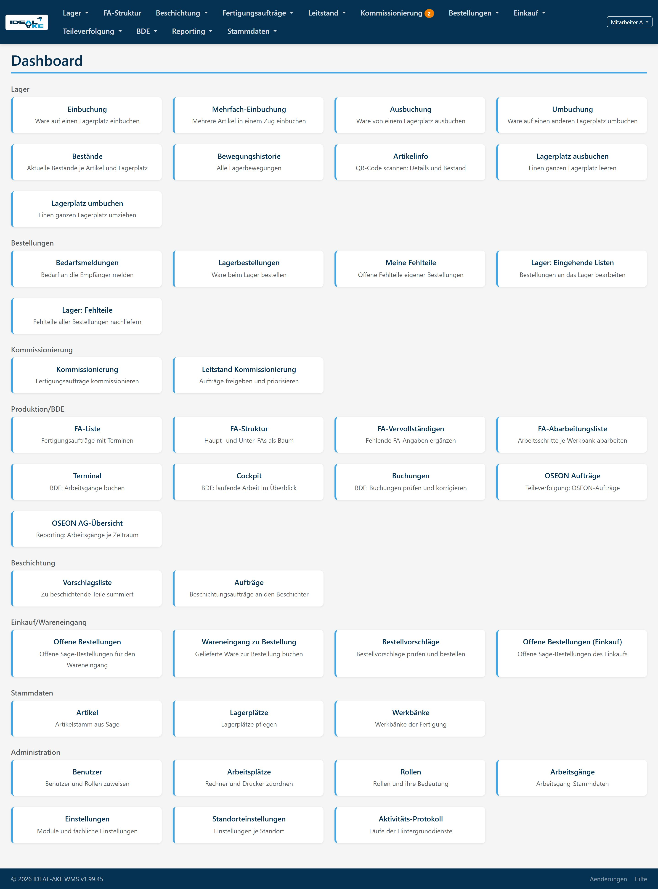
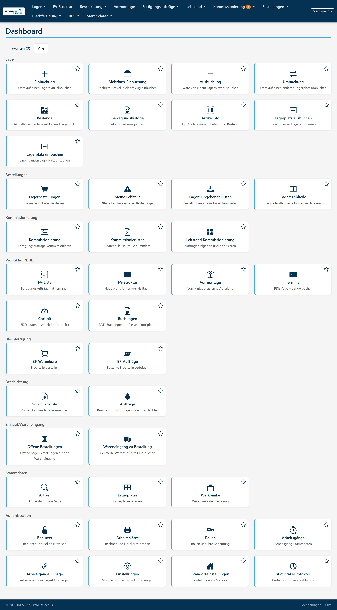
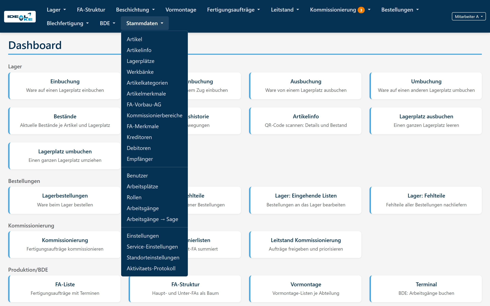
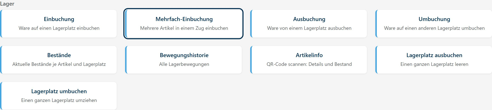
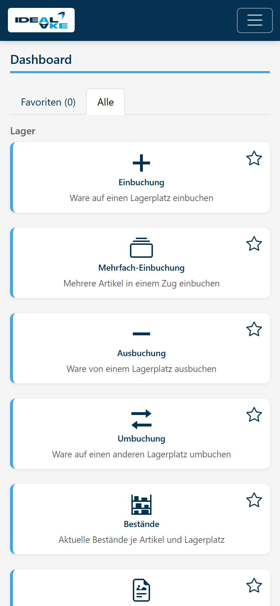

# 18 Startseite und Menü

Stand: Version **1.99.50** (23.11.2026), Bilder noch 1.99.46 (Neuaufnahme 18-01/18-02/18-05 ausstehend). Bilder: 18-01 (AKE), 18-02 und 18-05 (IDEAL) aus den DEV-Systemen mit 1.99.46; 18-03 und 18-04 Testsysteme mit 1.99.45 (ohne Symbole, Inhalt sonst gleich).

## Zweck

Die Startseite (Klick auf das Logo oben links) zeigt als **Kacheln** alle Funktionen, die man benutzen darf – geordnet nach Bereichen.
Kacheln und Menü kommen aus **derselben Liste**: Was im Menü steht, steht auch als Kachel da, und eine Kachel führt nie auf
„Zugriff verweigert“.

## Wer darf

Jeder angemeldete Benutzer sieht die Startseite. **Welche** Kacheln erscheinen, hängt ab von

- den eigenen **Rollen** (*Stammdaten → Rollen*), z. B. Einbuchung nur mit Lager-Rolle, Artikelinfo nur mit **Stammdaten lesen**;
- den **eingeschalteten Modulen** in *Einstellungen* (z. B. Blechfertigung, Beschichtung, Lagerbestellung, BDE, Leitstand).

Ein Bereich ohne sichtbare Kachel erscheint nicht. Hat man gar keine Funktion, steht dort:
„Für Ihren Benutzer sind keine Funktionen freigeschaltet. Bitte wenden Sie sich an den Administrator.“

## Schritt für Schritt

1. Auf das **Logo** oben links klicken – die Startseite öffnet sich.

   

2. Die Bereiche stehen immer in derselben Reihenfolge: **Lager, Bestellungen, Kommissionierung, Produktion/BDE, Blechfertigung,
   Beschichtung, Einkauf/Wareneingang, Stammdaten, Administration**. Bei IDEAL kommt z. B. **Blechfertigung** dazu.

   

3. Kachel anklicken – die Funktion öffnet sich. Über dem Namen steht ein Symbol, unter dem Namen in einem Satz, wofür sie da ist.
4. Dieselben Funktionen findet man im **Menü**. Neu im Menü: *Stammdaten → Artikelinfo* (QR-Code scannen, Details und Bestand).

   

5. **Ohne Maus:** mit der Tabulator-Taste von Kachel zu Kachel springen; die gewählte Kachel bekommt einen dunklen Rahmen,
   **Enter** öffnet sie.

   

6. Auf dem **Handy** stehen die Kacheln untereinander.

   

## Hinweise und Stolperfallen

- Jede Kachel hat wieder ein **Symbol** (seit 1.99.46). Die bekannten Symbole sind wie früher, Einbuchung zeigt ein Plus, Ausbuchung ein
  Minus, Umbuchung einen Doppelpfeil. Ein hohler Rahmen steht für einen ganzen Lagerplatz (mit Minus = Lagerplatz
  ausbuchen, Pfeil = umbuchen, „!“ = Lager: Fehlteile). Ein Blatt mit Inhalt ist eine Liste, ein Tropfen steht für
  Beschichtung. Jedes Symbol gibt es nur einmal (seit 1.99.50). Das Symbol ist nur Erkennungshilfe – maßgeblich ist der Name der Kachel.
- Manche Seiten gibt es **nur im Menü**, nicht als Kachel (z. B. Kreditoren, Debitoren, Empfänger, Service-Einstellungen,
  Sage-Lagerbuchungen). Sie sind seltener gebraucht.
- **OSEON AG-Übersicht** erscheint nur, wenn das OSEON-Modul (Teileverfolgung) eingeschaltet ist.
- Ein Menü ohne sichtbaren Eintrag (z. B. „Bestellungen“ ohne passende Rolle) erscheint nicht mehr leer.

## Häufige Fragen

**Mir fehlt eine Kachel, die ein Kollege hat.**
Dann fehlt eine Rolle oder das Modul ist an diesem Standort aus. Die Administration sieht unter *Stammdaten → Rollen*, welche Rolle wofür
nötig ist.

**Früher hatte ich die Kachel „Artikelinfo“ und jetzt nicht mehr.**
Die Artikelinfo braucht die Rolle **Stammdaten lesen**. Ohne sie führte die Kachel früher auf „Zugriff verweigert“; jetzt wird sie gar
nicht erst angezeigt.
