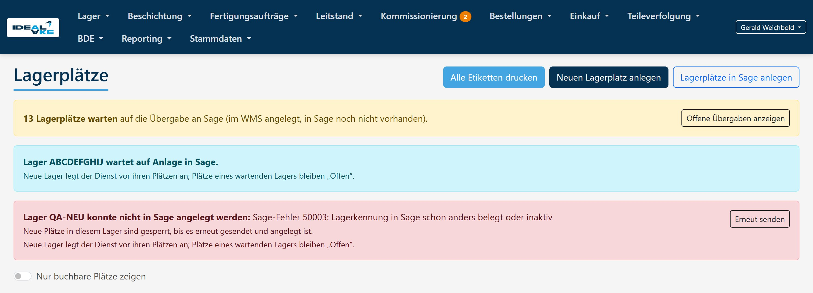
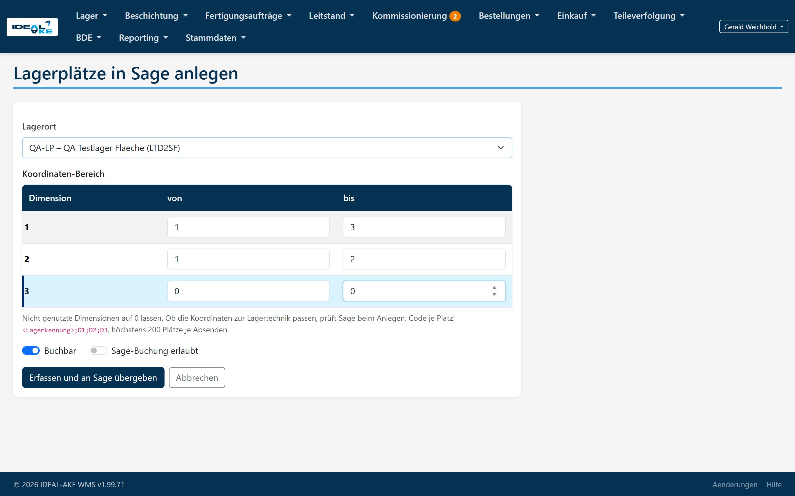
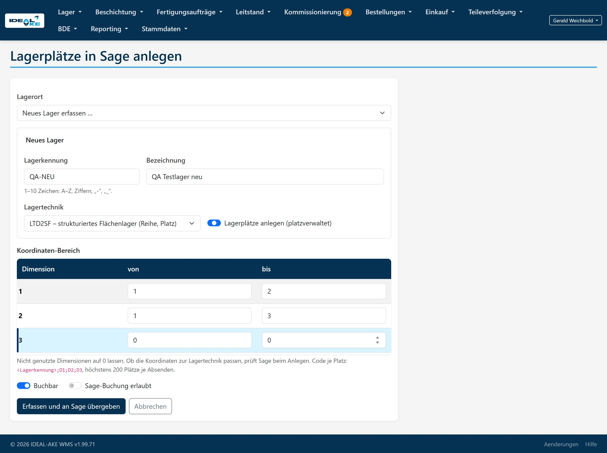
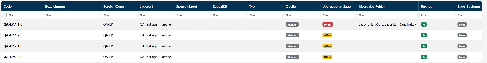
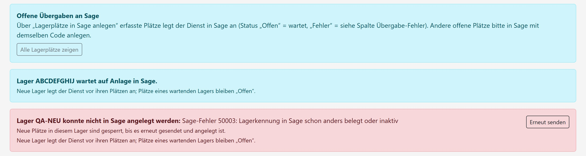

# 19 – Lagerplätze in Sage anlegen

**Stand:** Version 1.99.71 (25.11.2026). Standorte: AKE und IDEAL.

## 1. Zweck

Neue Lagerplätze werden im WMS erfasst statt in Sage. Man wählt das Lager und den Bereich der Koordinaten, das WMS legt die Plätze an, und
der WMS-Dienst legt sie danach in Sage an. Fehlt das Lager selbst in Sage, kann es im selben Formular mit erfasst werden.

## 2. Wer darf

- Rolle **Stammdaten** (oder Admin).
- Die Service-Einstellung **„Lagerplätze in Sage anlegen (Direkt-SQL)“** (`SageLagerplatzAnlageAktiv`) muss an sein. Sie wird ausgeschaltet
  ausgeliefert und je Standort von der WMS-Betreuung eingeschaltet.
- Ein neues Lager erfassen geht nur, wenn die Einstellung **„Lager-Anlage in Sage: freigegebene Lagertechniken“** nicht auf `Aus` steht. Sie
  legt fest, welche Lagertechniken angeboten werden.

Ist die Einstellung aus, fehlt der Knopf; ein direkter Aufruf meldet „Lagerplatz-Anlage in Sage ist ausgeschaltet …“.

## 3. Schritt für Schritt

### 3.1 Plätze in einem vorhandenen Lager

1. *Stammdaten → Lagerplätze*, Knopf **„Lagerplätze in Sage anlegen“**.
2. **Lagerort** wählen. Angeboten werden die Lager aus dem Lagerplatz-Abgleich. Ein Lager mit Zusatz „(neu, wartet auf Sage)“ wird gerade
   angelegt; „(Fehler – erst ‚Erneut senden‘)“ ist gesperrt, bis es übergeben ist (siehe 4.).
3. **Koordinatenbereich** je Dimension eingeben (von – bis). Genutzte Dimensionen beginnen bei 1, nicht genutzte bleiben 0. Beispiel Hochregal
   mit Regal 1, Ebene 1 bis 3, Platz 1 bis 4 = 12 Plätze `HR;1;1;1` bis `HR;1;3;4`. Höchstens **200 Plätze** auf einmal, Koordinaten bis 9999.
4. **Buchbar** und **Sage-Buchung erlaubt** einstellen (gelten für alle neuen Plätze, später einzeln änderbar).
5. **„Erfassen und an Sage übergeben“**. Die Rückmeldung nennt, wie viele Plätze angelegt wurden und welche Codes schon vorhanden waren (diese werden übersprungen).
   Die Liste zeigt danach die offenen Übergaben.

### 3.2 Neues Lager mit Plätzen

1. Im Feld Lagerort **„Neues Lager erfassen …“** wählen.
2. **Kennung** (bis 10 Zeichen, Buchstaben, Ziffern, `-`, `_`), **Bezeichnung** (bis 40 Zeichen) und **Lagertechnik** eingeben.
   Beim Bodenlager ohne Plätze (LTD0ST) gibt es keine Koordinaten; das Lager hat dann nur seinen Basisplatz.
3. Koordinatenbereich wie oben, **„Erfassen und an Sage übergeben“**.

Der Dienst legt zuerst das Lager in Sage an, danach seine Plätze. Bis dahin steht über der Liste der Hinweis „Lager … wartet auf Anlage in Sage.“

### 3.3 Nach dem Anlegen

- Spalte **„Übergabe an Sage“**: *Offen* = wartet auf den Dienst (in der Regel unter einer Minute), *Übergeben* = in Sage angelegt; der Platz ist
  ab jetzt ein Sage-Platz (Quelle „Sage“).
- Code, Bezeichnung und Zone dieser Plätze sind im WMS gesperrt. Buchbar, Sage-Buchung, Kapazität und Aktiv bleiben änderbar.

## 4. Hinweise und Stolperfallen

- **Übergabe-Fehler:** Lehnt Sage einen Platz ab (z. B. Code in Sage schon anders belegt, Koordinaten passen nicht zur Lagertechnik), steht der
  Grund in der Spalte **„Übergabe-Fehler“**. Ursache beheben, dann in der Zeile **„Erneut senden“**. Das WMS wiederholt einen solchen Fehler nicht
  von selbst.

- **„Letzter Versuch fehlgeschlagen: …“** bei Status *Offen* heißt: Sage war gerade nicht erreichbar. Nichts tun, der Dienst versucht es selbst
  wieder. Hält es an, die WMS-Betreuung informieren.
- **Lager im Fehler:** Kann ein neues Lager nicht in Sage angelegt werden, zeigt der rote Hinweis über der Liste den Grund und den Knopf
  **„Erneut senden“**. Solange ist das Lager für neue Plätze gesperrt, und seine Plätze warten.

- **Platz während der Übergabe deaktiviert:** Legt Sage ihn trotzdem an, holt der nächste Lagerplatz-Abgleich ihn zurück und aktiviert ihn
  wieder. Dann erneut deaktivieren.
- **Neues Lager in den Kommissionierbereichs-Regeln:** Ein neu erfasstes Lager erscheint dort schon, bevor es in Sage angelegt ist.
- Ein Platz wird nie gelöscht; falsch angelegte Plätze deaktivieren (im WMS) bzw. in Sage bearbeiten.

## 5. Häufige Fragen

**Der Knopf fehlt.** Die Einstellung ist aus oder die Rolle Stammdaten fehlt.

**Im Feld Lagerort steht nichts.** Der Lagerplatz-Abgleich hat noch keine Lager geliefert (Quelle Lagerplätze muss „SData“ sein). An die
WMS-Betreuung melden.

**„Neues Lager erfassen …“ fehlt.** Die Lager-Anlage ist am Standort nicht freigegeben (Einstellung steht auf `Aus`).

**Warum `Lager;1;0;0`?** Das ist die Schreibweise von Sage: Lager, dann die drei Koordinaten. Nicht genutzte Dimensionen sind 0.

## Bilder

Aufgenommen auf DEV AKE (v1.99.71, 25.11.2026) mit QA-Testdaten; die Fehlerzustände in 19-04/19-05 sind in der DEV-Datenbank gesetzt,
nicht von Sage gemeldet (kein Live-Lauf gegen Sage).
