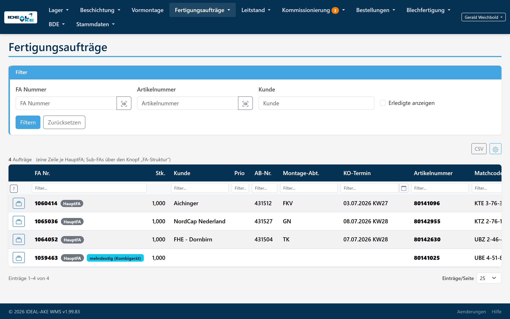
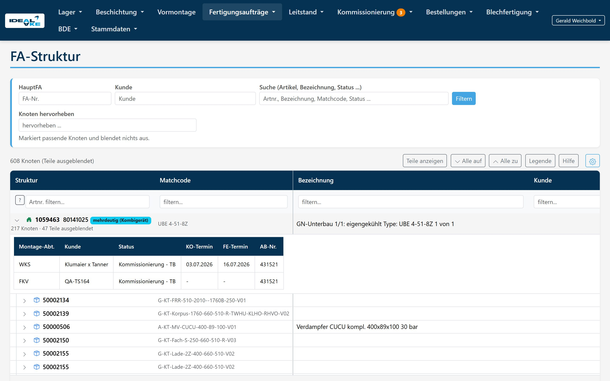
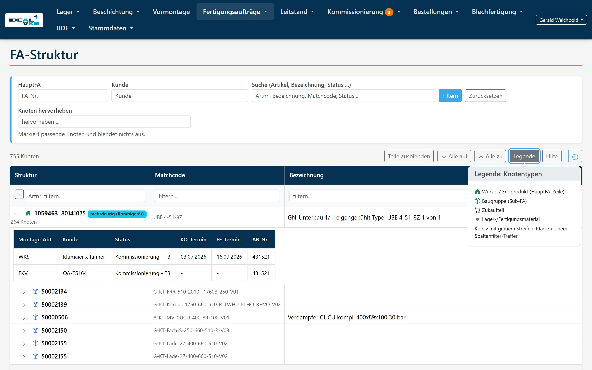

# 20 – FA-Liste und FA-Struktur (IDEAL)

Gilt für **IDEAL** (hierarchische Fertigungsaufträge). An AKE bleibt die FA-Liste unverändert.
Stand: Version **1.99.83** (26.11.2026).

## FA-Liste: eine Zeile je Auftrag (ab 1.99.82)

*Fertigungsaufträge › FA-Liste* (Seitentitel „Fertigungsaufträge“) zeigt je Auftrag genau **eine Zeile**, die des HauptFA. Sub-FAs stehen nicht mehr in der
Liste; sie sehen Sie über den Knopf **FA-Struktur** in der Zeile (öffnet die FA-Struktur dieses HauptFA im selben Fenster).

- **Suchen über eine Sub-FA-Nummer:** Tragen Sie in der Filterkarte oder im Spaltenfilter *FA Nr.* eine Sub-FA-Nummer ein,
  erscheint der zugehörige HauptFA.
- **Weitere Spalten:** Über das Zahnrad blenden Sie 17 Felder aus der FA-Struktur ein, z. B. *PPS-Status*, *RAL*, *Beschichter*,
  *Beschicht. retour*, *Neuer PT (PPS)*, *Montage-Std.*, *Material*, *Fert.-Menge*, *Arbeitsbereich*. Sie sind anfangs ausgeblendet;
  Ihre bisherige Spaltenauswahl bleibt. Alle Spalten lassen sich wie gewohnt filtern ([Kapitel 10](10-bestaende-spaltenfilter.md)).
- **Matchcode:** kommt bevorzugt aus der FA-Struktur, sonst aus dem Artikelstamm – derselbe Wert wie in der Stückliste.
- **Kombigerät:** Hat ein HauptFA mehrere Auftragsköpfe, steht das Zeichen **mehrdeutig (Kombigerät)** an der Nummer und die
  Kopfspalten bleiben leer. Die Kopfdaten aller Köpfe zeigt die FA-Struktur.
- **Hinweis „Auftrag ohne HauptFA-Zeile“:** Gibt es offene Aufträge, zu denen das WMS keine HauptFA-Zeile kennt, nennt ein Hinweis
  über der Liste ihre Zahl. Diese Aufträge sehen Sie unter *FA-Struktur*.

## FA-Struktur: je HauptFA eine Zeile (ab 1.99.83)

*Fertigungsaufträge › FA-Struktur* zeigt je HauptFA **eine Zeile** – die oberste Zeile der Struktur. Daneben stehen die Auftragsdaten als
Spalten: Kunde, PPS-Status, KO-Termin, Fert.-Termin, Montage-Abt., AB-Nr., Prio, Liefertermin, AB-Pos., Beschichter, RAL,
Beschicht. retour, Neuer PT (PPS), Montage-Std., Bemerkung/Uhrzeit. Alle sind sichtbar; über das Zahnrad blenden Sie aus, was Sie
nicht brauchen. **Struktur** und **Matchcode** bleiben beim Querscrollen links stehen.

1. **Aufklappen:** Pfeil vor der HauptFA-Nummer zeigt die Baugruppen darunter; nochmals klicken klappt den ganzen Zweig zu.
   *Alle auf* / *Alle zu* wirken auf alle Strukturen der Seite. Am Terminal ist der Pfeil groß genug für den Finger; mit der Tastatur
   Tab auf den Pfeil, dann Enter oder Leertaste.
2. **Teile:** Kaufteile und Material sind anfangs ausgeblendet. Die HauptFA-Zeile nennt „n Knoten · m Teile ausgeblendet“.
   **Teile anzeigen** blendet sie für die ganze Seite ein, **Teile ausblenden** wieder aus. Teile mit Arbeitsschritten bleiben immer sichtbar.
3. **Zeichen an der Nummer:** *mehrdeutig (Kombigerät)* bzw. *n Auftragsköpfe* – die Kopfspalten bleiben leer, die Kopfdaten aller Köpfe
   stehen in der Zeile darunter. *ohne Kopfdaten* – zu diesem HauptFA gibt es keinen Auftragskopf. *Verwaist* – die Struktur hängt an
   einem Vater, den das WMS nicht kennt. *Fehlerhaft* – die Struktur wurde nur teilweise aufgebaut (rote Zeile darunter).
4. **Arbeitsgänge:** Knopf in der Spalte *Arbeitsgänge* der HauptFA-Zeile; das Fenster zeigt immer alle Knoten.
5. **Legende** (Knopf): grünes Haus = HauptFA-Zeile, blaue Box = Baugruppe, Einkaufswagen = Zukaufteil, grauer Punkt = Material.
   **Hilfe** öffnet den Abschnitt auf der Hilfeseite.

**Drei Suchwege:**

| Weg | Wirkung |
|---|---|
| Filterkarte (HauptFA, Kunde, Suche) | wählt Strukturen aus – findet auch über ausgeblendete Teile; dann erscheint der Hinweis „Die Suche kann in ausgeblendeten Teilen getroffen haben“ |
| Spaltenfilter in der Kopfzeile | blendet nicht passende Zweige aus; der Weg zu den Treffern bleibt kursiv als Kontext. Filter auf eine Auftragsspalte (z. B. Kunde) zeigt die passenden Strukturen zugeklappt; Termine filtern als Text, z. B. `.12.2026` |
| Knoten hervorheben | markiert nur, blendet nichts aus. Findet es nichts, weil Teile ausgeblendet sind, sagt die Seite das |

## Häufige Fragen

- **Wo sind die Sub-FAs der FA-Liste?** Knopf *FA-Struktur* in der Zeile.
- **Ein Kaufteil fehlt in der FA-Struktur.** Knopf *Teile anzeigen*.
- **Die Kopfspalten sind leer.** Kombigerät, ohne Kopfdaten oder verwaist – das Zeichen an der Nummer sagt, welcher Fall.
