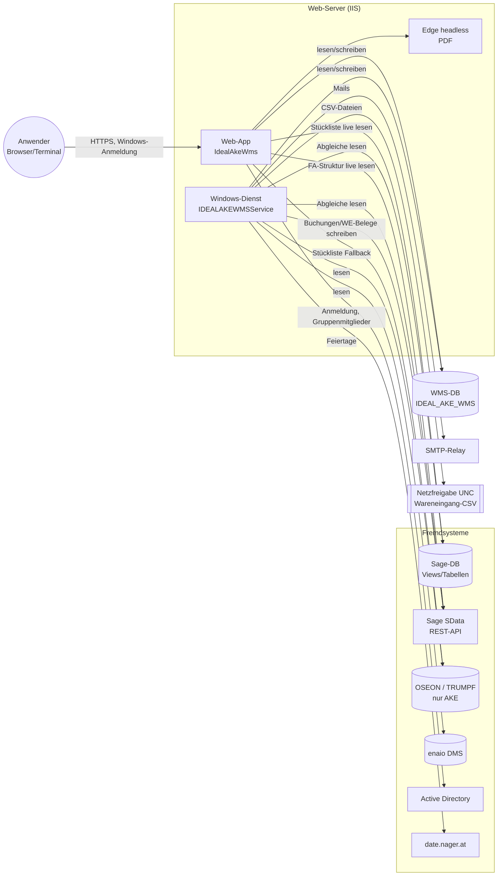
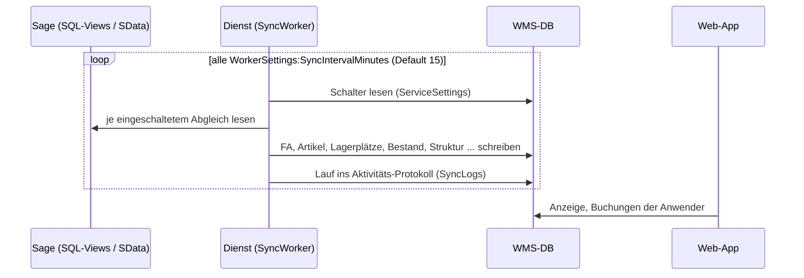
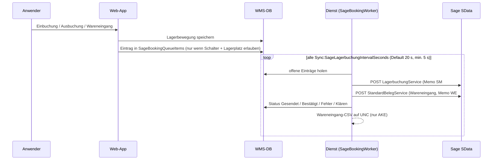
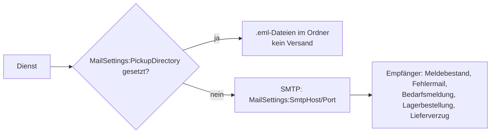
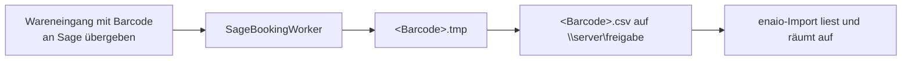

# 01 – Architektur und Technologie

**Stand:** v1.99.23, 2026-11-14 · **Zielgruppe:** IT-Administratoren (ohne Entwicklerwissen) · **Zweck:** Welche Teile das System hat,
womit es gebaut ist und welche Daten wohin fließen – als Landkarte für Installation, Überwachung und Fehlersuche.

Übersicht aller Kapitel: [00-index.md](00-index.md). Konkrete Server und Pfade: [02-systeme-umgebungen.md](02-systeme-umgebungen.md).

---

## 1. Komponenten im Überblick

| Komponente | Was sie ist | Läuft wo | Beleg |
|---|---|---|---|
| **Web-App** `IdealAkeWms` | ASP.NET-Core-MVC-Anwendung, Oberfläche für Lager, Kommissionierung, FA, BDE, Stammdaten, Einstellungen | IIS, „in-process“ im App-Pool (`w3wp.exe`), gestartet über `dotnet .\IdealAkeWms.dll` | (Quelle: `IdealAkeWms/web.config:11-16`) |
| **Windows-Dienst** `IDEALAKEWMSService` | Hintergrundprozess: Abgleiche aus Sage/OSEON/enaio, Mails, Bereinigung, Buchungen an Sage | Windows-Dienst auf demselben Server wie die Web-App | (Quelle: `IDEALAKEWMSService/Program.cs:21-24`, `scripts/deploy/ziele.psd1:5`) |
| **WMS-Datenbank** | SQL Server, eigene DB je System (Prod/Test) | SQL Server (z. B. `AKESQL20.ake.at`, DB `IDEAL_AKE_WMS`) | (Quelle: `README.md:17`, `IdealAkeWms/appsettings.json:3`) |
| **Sage (ERP)** | Führendes System für Aufträge, Artikel, Bestand. Gelesen per SQL (Views/Tabellen) und SData-REST; geschrieben nur per SData | Sage-SQL-Datenbank und Sage-SData-Server | (Quelle: [[integrationen]] Abschnitt „Sage“, `IDEALAKEWMSService/appsettings.json:4`) |
| **OSEON / TRUMPF** | Fertigungssteuerung (nur AKE): Teileverfolgung, Stücklisten-Fallback | `aketrumpf01.ake.at\TRUMPFSQL2`, DB `T1000_V01_V001` | (Quelle: `IdealAkeWms/appsettings.json:4`, [[integrationen]] Abschnitt „OSEON“) |
| **enaio (DMS)** | Werkstattaufträge/Zeichnungen (Verknüpfung an FA) | DB `enaio` auf `AKESQL20.ake.at` | (Quelle: `IdealAkeWms/appsettings.json:5`, [[integrationen]] Abschnitt „enaio“) |
| **Active Directory** | Windows-Anmeldung (SSO) und Benutzer-Anlage aus einer AD-Gruppe; keine Rechtevergabe über AD | Domäne | (Quelle: [[integrationen]] Abschnitt „Active Directory“, `IdealAkeWms/Program.cs:49`) |
| **SMTP-Server** | Ausgangsmails des Dienstes | `MailSettings:SmtpHost` in der Dienst-`appsettings.json` | (Quelle: `IDEALAKEWMSService/appsettings.json:8-16`) |
| **date.nager.at** | Feiertage (Internet, HTTPS) | extern | (Quelle: `IDEALAKEWMSService/Program.cs:111-115`) |
| **Microsoft Edge** | PDF-Erzeugung der Druckdokumente (headless) auf dem Web-Server | lokal installiert | (Quelle: `README.md:29`, `README.md:542-547`) |
| **Netzfreigabe (UNC)** | Wareneingang-CSV für den enaio-Import (nur AKE) | `WareneingangCsvPfad` (Service-Einstellung) | (Quelle: [[integrationen]] Abschnitt „Wareneingang-CSV“) |

Wichtig für den Betrieb:
- Die Web-App spielt beim Start fehlende Datenbank-Migrationen **selbst** ein (`db.Database.Migrate()`). Deshalb laufen Updates über das
  Update-Skript, das vorher alle Schema-Skripte einspielt (Kapitel [03-installation-update-rollback.md](03-installation-update-rollback.md)).
  (Quelle: `IdealAkeWms/Program.cs:206`, `scripts/deploy/Update-IdealAkeWms.ps1:805`)
- Der Dienst referenziert das Web-Projekt (gemeinsame Datenzugriffs-Klassen); beide sind ein Paket mit einer Version.
  (Quelle: [[fallstricke]] §5 „Service referenziert das Web-Projekt“, `IdealAkeWms/AppVersion.cs:5`, `IDEALAKEWMSService/AppVersion.cs:5`)
- Fachliche Schalter liegen in der DB: `AppSettings` (Maske `/Settings`) und `ServiceSettings` (Maske `/ServiceSettings`). In den
  `appsettings*.json` stehen nur Verbindungen, Mail und wenige technische Werte. (Quelle: `README.md:928-933`) Details:
  [04-konfiguration.md](04-konfiguration.md).

---

## 2. Tech-Stack mit Versionen

| Bereich | Technik | Version | Beleg |
|---|---|---|---|
| Laufzeit | .NET (Zielplattform `net10.0`) | 10.0 | (Quelle: `IdealAkeWms/IdealAkeWms.csproj:4`, `IDEALAKEWMSService/IDEALAKEWMSService.csproj:4`) |
| Web-Framework | ASP.NET Core MVC (Razor-Views) | 10.0 | (Quelle: `README.md:16`) |
| Datenzugriff | Entity Framework Core SqlServer | 10.0.2 | (Quelle: `IdealAkeWms/IdealAkeWms.csproj:11`, `IDEALAKEWMSService/IDEALAKEWMSService.csproj:13`) |
| SQL-Client (Dienst) | Microsoft.Data.SqlClient | 6.1.1 | (Quelle: `IDEALAKEWMSService/IDEALAKEWMSService.csproj:14`) |
| Dienst-Hosting | Microsoft.Extensions.Hosting.WindowsServices | 10.0.0 | (Quelle: `IDEALAKEWMSService/IDEALAKEWMSService.csproj:12`) |
| Logging | Serilog (AspNetCore 10.0.0, Sinks.File 7.0.0, Expressions 5.0.0; Dienst zusätzlich Settings.Configuration 10.0.0, Sinks.Console 6.1.1) | s. links | (Quelle: `IdealAkeWms/IdealAkeWms.csproj:16-18`, `IDEALAKEWMSService/IDEALAKEWMSService.csproj:15-19`) |
| Mail | MailKit | 4.12.0 | (Quelle: `IDEALAKEWMSService/IDEALAKEWMSService.csproj:20`) |
| AD-Zugriff | System.DirectoryServices.AccountManagement | 10.0.9 | (Quelle: `IdealAkeWms/IdealAkeWms.csproj:20`) |
| Barcode/Grafik | BarcodeLib 3.1.5, SkiaSharp 3.119.2 | s. links | (Quelle: `IdealAkeWms/IdealAkeWms.csproj:10`, `:19`) |
| Oberfläche | Bootstrap 5, jQuery, Select2, html5-qrcode | **zu prüfen:** genaue Versionen (liegen in `wwwroot/lib`, nicht im csproj) | (Quelle: `README.md:19`) |
| Datenbank | Microsoft SQL Server; Update-Skript braucht für die Backup-Ordner-Prüfung **SQL Server 2017+** | IDEAL-Test-Instanz = 2019; AKESQL20 **zu prüfen** | (Quelle: [[0023-daten-und-einmal-skripte-fuehrt-das-update-skript-mit-bestaetigung-aus]] Konsequenzen, [[2026-11-12-deploy-fahrplan-buendel-v1-99]] „Einmal je Server“) |
| Webserver | IIS mit ASP.NET Core Module V2 (Hosting Bundle 10.x), Windows-Authentifizierung, Application Initialization | Hosting Bundle 10.x | (Quelle: `scripts/deploy/Install-IdealAkeWms.ps1:182-199`) |
| Deploy-Werkzeuge | Windows PowerShell 5.1 (Administrator), `sqlcmd` (ODBC-Variante), `robocopy`, `icacls` | – | (Quelle: `scripts/deploy/Update-IdealAkeWms.ps1:1-14`, `:124-134`) |

**Laufzeitmodell:** Beide veröffentlichten Komponenten im Paket sind **framework-abhängig** (keine eigene .NET-Laufzeit im Ordner; sie
verlangen die gemeinsamen Frameworks `Microsoft.NETCore.App` **und** `Microsoft.AspNetCore.App` 10.0). Auf dem Server muss daher das
**ASP.NET Core Hosting Bundle 10.x** installiert sein – auch für den Dienst. (Quelle: `publish/IDEALAKEWMSWeb/IdealAkeWms.runtimeconfig.json`
und `publish/IDEALAKEWMSWebService/IDEALAKEWMSService.runtimeconfig.json`, jeweils Abschnitt `frameworks`; `scripts/deploy/Install-IdealAkeWms.ps1:193-199`)
> Widerspruch: `README.md:651-657` empfiehlt für den Dienst „Self-Contained“. Das aktuelle Paket ist es nicht. Maßgeblich ist das Paket.

**Feste Kultur:** Die Web-App rechnet und zeigt seit v1.99.23 immer in `de-DE`, unabhängig von der Server-Sprache.
(Quelle: `IdealAkeWms/Program.cs:11-16`)

---

## 3. Datenflüsse

### 3.1 Gesamtbild

Belege: Web liest Stückliste aus Sage-View bzw. OSEON-Fallback ([[integrationen]] Tabelle „Was gelesen wird“,
[[0007-bom-quelle-sage-view-mit-oseon-fallback]]); Web liest FA-Struktur live per SData ([[integrationen]] „SData lesend: FA-Struktur live“);
Dienst-Abgleiche (`IDEALAKEWMSService/Workers/SyncWorker.cs:43-580`); Sage-Schreibwege (`IDEALAKEWMSService/Workers/SageBookingWorker.cs:67-93`);
Feiertage (`IDEALAKEWMSService/Program.cs:111-115`); PDF (`IdealAkeWms/Program.cs:411-413`).

> Hinweis Stückliste: Die Live-Stückliste liest Sage über einen Drei-Teil-Namen (`[ake].[dbo].[vw_AKE_Kommissionierung_StuecklistenDB]`)
> auf **dem SQL-Server der WMS-DB**, nicht über eine eigene Verbindung. (Quelle: [[2026-10-29-dev-umgebung-lokal]] „Belege aus dem Code“)
> **zu prüfen:** wie das an IDEAL gelöst ist (anderer Sage-Mandant/Server).

### 3.2 Sage → Dienst → WMS-DB → Web (Abgleiche, lesend)

- Takt: `WorkerSettings:SyncIntervalMinutes`, Default 15 Minuten, aus der DB gelesen. (Quelle: `IDEALAKEWMSService/Workers/SyncWorker.cs:31`,
  `:551-552`)
- Quelle je Abgleich umschaltbar `View` / `SData` / `Vergleich` (`Sync:Quelle:*`). (Quelle: `README.md:764-768`,
  [[0019-quellen-weiche-view-sdata-je-abgleich]])
- Jeder Lauf erscheint im Aktivitäts-Protokoll (`/SyncLog`). (Quelle: `README.md:945`, [[0010-aktivitaets-protokoll-mit-isolierten-dbcontexts]])
  Überwachung: [06-logs-ueberwachung.md](06-logs-ueberwachung.md).

### 3.3 WMS → Sage (schreibend, über Warteschlange und Worker)

- Enqueue in der Web-App nur bei Einbuchung/Ausbuchung **und** `SageLagerbuchungAktiv` **und** Lagerplatz-Flag „Sage-Buchung erlaubt“;
  ein Fehler beim Einreihen bricht die WMS-Buchung nicht ab. (Quelle: [[integrationen]] „Sage-Lagerbuchung“)
- Der Worker sendet Lagerbuchungen nur bei `SageLagerbuchungAktiv`, Wareneingangsbelege nur bei `SageWareneingangBelegAktiv`, CSV nur
  bei eingeschaltetem Sage-Wareneingang. (Quelle: `IDEALAKEWMSService/Workers/SageBookingWorker.cs:60-105`)
- Doppelbuchungsschutz über die Kennung im Sage-Memo (`SM#<id>#`, `WE#<id>#`, auf Testsystemen mit System-Kürzel); vor erneutem Senden
  wird in Sage nachgesehen. (Quelle: `README.md:726-734`, [[integrationen]] „Idempotenz“)
- Idempotenz gilt nur bei **genau einer** laufenden Dienst-Instanz je DB. (Quelle: [[fallstricke]] §8 „Sage-Lagerbuchung: Idempotenz nur
  bei genau EINER Worker-Instanz“)
- Alle schreibenden Sage-Schalter sind nach einem Deploy aus und werden je System bewusst eingeschaltet. (Quelle: `README.md:121-131`)

Details zu Endpunkten und Zugangsdaten: [05-schnittstellen.md](05-schnittstellen.md).

### 3.4 Mail

- Nur der Dienst versendet Mails. Ist `MailSettings:PickupDirectory` gesetzt, gehen **alle** Dienst-Mails als `.eml` in den Ordner statt per
  SMTP (nur für DEV/QA gedacht). (Quelle: `README.md:971`, `scripts/deploy/nachlauf.psd1:158-161`)
- Mail-Arten und Schalter: Meldebestand (`Notifications:MeldebestandEnabled`, `IDEALAKEWMSService/Workers/NotificationWorker.cs:37`),
  Bedarfsmeldungen/Lagerbestellungen (`Sync:PartRequisitionEmailEnabled`, `Sync:WarehouseRequisitionEmailEnabled`,
  `IDEALAKEWMSService/Workers/SyncWorker.cs:154`, `:171`), Lieferverzug (`Lieferverzug:MailAktiv`, `SyncWorker.cs:490`), Fehlermails
  (`ErrorNotification:*`, `README.md:986`).
- Lieferverzug kann **externe** Mails an Lieferanten senden; `Lieferverzug:Testbetrieb` bleibt bis zur Freigabe an. (Quelle: `README.md:127-128`)

### 3.5 Datei-Ausgang CSV/UNC (nur AKE)

Wirkt nur mit `WareneingangCsvAktiv` **und** `SageWareneingangBelegAktiv` **und** gesetztem UNC-Pfad; nie überschreiben; das Dienstkonto
braucht „Ändern“ auf Freigabe und NTFS. (Quelle: `README.md:735-742`, [[integrationen]] „Wareneingang-CSV“) Rechte:
[09-sicherheit-konten-rechte.md](09-sicherheit-konten-rechte.md).

---

## 4. Hintergrundjobs des Dienstes (Überblick)

Der Dienst startet vier Hintergrund-Worker. (Quelle: `IDEALAKEWMSService/Program.cs:161-165`)

| Worker | Takt | Was er tut (Auszug) | Beleg |
|---|---|---|---|
| **SyncWorker** | `WorkerSettings:SyncIntervalMinutes` (Default 15 min) | Abgleiche, jeder Block einzeln schaltbar: FA (`Sync:ProductionOrdersEnabled`), FA-Zusatzinfos, Artikel, OSEON, enaio, Bedarfsmeldungs-/Lagerbestellungs-Mails, Stücklisten-Cache, Erkennungen, Lagerplätze, IDEAL-FA-Struktur (`Sync:HierarchicalFaEnabled`), Werkbänke, Arbeitsgänge, PPS-Mitarbeiter, Stillstandsgründe, Kreditoren, Debitoren, Artikel-Lieferanten, offene Bestellungen, Lieferverzug-Mail, Arbeitsgang-Erkennung, Feiertage (täglich), Lagerbestand (eigener Takt möglich), BDE-Auto-Pause (eigener Takt `Sync:BdeAutoPauseIntervalMinutes`, Default 60) | `IDEALAKEWMSService/Workers/SyncWorker.cs:31-580` |
| **NotificationWorker** | `WorkerSettings:NotificationCheckIntervalMinutes` (Default 60 min) | Meldebestand-Mail | `IDEALAKEWMSService/Workers/NotificationWorker.cs:25`, `:37` |
| **CleanupWorker** | 24 h | Bereinigung Aktivitäts-Protokoll (`Cleanup:AktivitaetsprotokollAufbewahrungTage`, Default 180) | `IDEALAKEWMSService/Workers/CleanupWorker.cs:13`, `README.md:950-951` |
| **SageBookingWorker** | `Sync:SageLagerbuchungIntervalSeconds` (Default 20 s, min. 5 s) | Lagerbuchungen und Wareneingangsbelege an Sage, Wareneingang-CSV | `IDEALAKEWMSService/Workers/SageBookingWorker.cs:60-105` |

- DryRun-Modus: `WorkerSettings:SyncDryRun = true` → nur protokollieren, nichts ändern. (Quelle: `README.md:944`,
  `IDEALAKEWMSService/Workers/CleanupWorker.cs:35`)
- Ein Fehler in einem Block stoppt die anderen nicht. (Quelle: `README.md:935`, [[fallstricke]] §5 „Sync-Bloecke sind einzeln gekapselt“)
- Auch ohne eingeschalteten Sync laufen einige Jobs immer (u. a. BDE-Auto-Pause, Bereinigung, IDEAL-FA-Materialisierung).
  (Quelle: [[2026-10-29-dev-umgebung-lokal]] „Abweichungen vom Plan“ Punkt 7)

> Widerspruch: `README.md:947` nennt einen eigenen „BdeAutoPauseWorker“. Registriert sind nur die vier Worker oben; die Auto-Pause läuft
> innerhalb des SyncWorkers. (Quelle: `IDEALAKEWMSService/Program.cs:161-165`, `IDEALAKEWMSService/Workers/SyncWorker.cs:268-276`)

Alle Schalter mit Defaults: [04-konfiguration.md](04-konfiguration.md) und `secondbrain/codebase/services.md`. Log-Dateien und
Überwachung der Läufe: [06-logs-ueberwachung.md](06-logs-ueberwachung.md). Fehlerbilder: [07-troubleshooting.md](07-troubleshooting.md).

---

## 5. Zwei Standorte, ein Code

- Derselbe Code läuft an **AKE** und **IDEAL**; Unterschiede entstehen über Einstellungen (z. B. IDEAL: hierarchische FA-Struktur, eigene
  Sage-Views; AKE: OSEON, enaio, Sage-Wareneingang). (Quelle: [[2026-10-20-ake-testsystem-bestandsaufnahme]] §2.1/§2.2, `README.md:999-1004`)
- Der Master-Schalter `ProduktionsauftragHierarchisch` (IDEAL) ist ein **Einwegtor**: nach dem ersten hierarchischen Import nicht mehr über
  die Anwendung umkehrbar. (Quelle: [[0012-fa-hierarchie-einweg-migrationstor]] Punkt 2, `README.md:443`)
