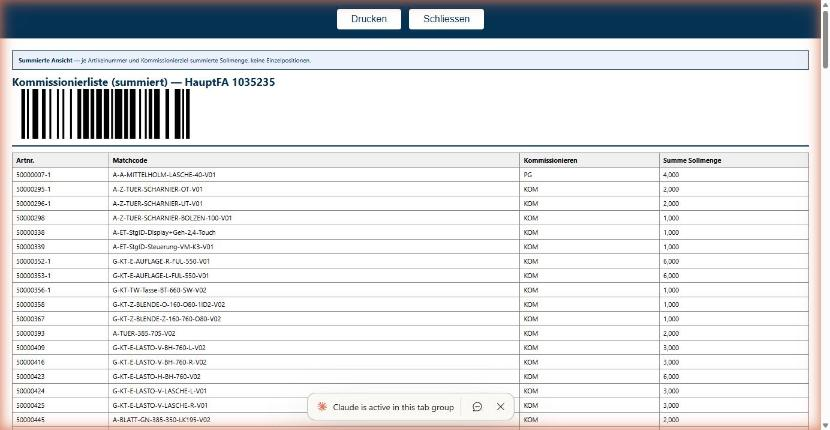

# Testbericht TS-80 Teil B — Kommissionierliste v1.47.0 (IDEAL-Testsystem)

Lauf: 2026-09-30, Claude in Chrome, http://idealweb01.ideal.ideal-ake.at:88/
Protokoll: tests/2026-09-29-ts-80-browser-testprotokoll.md
Testdaten (Fall A/B/C) wurden nicht geliefert → B2, B3, B4, B7 (Hauptteil), B10 nicht prüfbar.

Anzeige-Einstellungen zu Beginn (am Ende identisch wiederhergestellt und nach Neuladen geprüft):
- Summiert: HauptFA, Artnr., Matchcode, Kommissionieren, Hauptlagerplatz, Summe Sollmenge (alle sichtbar); Seitengröße 50
- Liste: HauptFA, Haupt-Artnr., Artnr., Matchcode, Sollmenge, Hauptlagerplatz, Kommissionieren, Arbeitsbereich sichtbar; Artikeltyp, Beschichtet, Material ausgeblendet; Seitengröße 50

Spalte „Screenshot“: ja = während des Laufs aufgenommen und angesehen. Als Datei gespeichert wurde nur der Screenshot zu B8: `bilder/B8-druck-ohne-hauptlagerplatz.jpg`.

| Schritt | Ergebnis | Beobachtung | Screenshot |
|---|---|---|---|
| B1 Einstieg | FEHLER (teilweise) | Dropdown Kommissionierung → Kommissionierlisten: /FaHierarchyKommissionierListen/Summiert ohne Parameter, summierte Ansicht erscheint. Einen zweiten, eigenen Navigationslink gibt es nicht: auf Startseite und FA-Struktur nur ein Link auf die Kommissionierlisten. | ja |
| B2 Summe richtig | NICHT PRÜFBAR | Testdaten Fall A fehlen. | nein |
| B3 Ziele getrennt | NICHT PRÜFBAR | Testdaten Fall B fehlen. | nein |
| B4 Gleicher Matchcode | NICHT PRÜFBAR | Testdaten Fall C fehlen. | nein |
| B5 Spalten + PDF-Knopf | OK | Summiert zeigt Matchcode und Hauptlagerplatz; Druckansicht (PrintSummiert) ebenfalls. PDF-Knopf je HauptFA vorhanden (/PdfSummiert/<HauptFA>). | ja |
| B6 KW optional | OK | Ohne KW: 4 HauptFA, 174 Summenzeilen, kein Hinweis „Bitte KW eingeben“. Mit KW 2026-W40 bis 2026-W40: 0 Zeilen („Keine Kommissionier-Positionen …“). | nein |
| B7 Umschalter nimmt Filter mit | NICHT PRÜFBAR (Hauptteil) / OK (Zusatz) | Hauptteil braucht ZIEL_A/ARTNR_A. Zusatz: KW in Summiert gesetzt → Liste-Adresse enthält kwVon/kwBis=2026-W40 → zurück zu Summiert: KW wieder in den Feldern und wirksam. Der Umschalter-Link „Summiert“ reagierte beim ersten Klick nicht, beim zweiten ja. | ja |
| B8 Druck sofort nach Ausblenden | OK | Hauptlagerplatz ausgeblendet, Panel über X geschlossen, ca. 0,8 s danach Drucken (insgesamt gut 1 s): URL visibleColumns=hauptfa,artnr,matchcode,kommissionieren,sollmenge; Spalte fehlt in Kopf und Zeilen (4 Zellen je Zeile). Spalte danach wieder eingeblendet. Zwei frühere Versuche mit Drucken ≤ 0,5 s nach Schließen des Panels öffneten keinen Tab (siehe Beobachtungen). | ja, [bilder/B8-druck-ohne-hauptlagerplatz.jpg](bilder/B8-druck-ohne-hauptlagerplatz.jpg) |
| B9 Gespeicherte Spaltenauswahl | NICHT PRÜFBAR wie beschrieben | Matchcode ist in Summiert Pflichtspalte (gesperrt, laut Spec gewollt) und lässt sich nicht ausblenden. Ersatzweise mit Hauptlagerplatz geprüft: nach 5 s + Neuladen weiter ausgeblendet; /PrintSummiert direkt im selben Tab: Hauptlagerplatz fehlt, Matchcode (gesperrt) vorhanden, HauptFA als Gruppenkopf. Danach wieder eingeblendet. | nein |
| B10 Filter im Druck (Liste) | NICHT PRÜFBAR | ZIEL_A fehlt. | nein |
| B11 Hinweis „Summierte Ansicht“ | OK | Ohne Filter: Banner „Summierte Ansicht“. Mit Spaltenfilter Kommissionieren=KOM (98 Zeilen): Druck zeigt beide Banner „Summierte Ansicht“ und „Gefilterte Ansicht“, 98 Zeilen, nur KOM. PDF nicht heruntergeladen (keine Freigabe). | nein |
| B12 Keine HauptFA reißt | NICHT PRÜFBAR | Testsystem hat nur 4 HauptFA mit relevanten Positionen; kleinste Seitengröße 25 → nur eine Seite. | nein |
| B13 Beschichtung/Vormontage | OK (Beschichtung) / NICHT PRÜFBAR (Vormontage-Druck) | Beschichtungsauftrag lädt, Druckansicht /FaHierarchyBeschichtung/Print lädt fehlerfrei (2 HauptFA, 18 Zeilen). Vormontage (Einzelne Teile und Summiert) lädt fehlerfrei, hat aber keinen Drucken-Link. | ja |
| B14 Skript-Sicherheit | OK | Filter Artikelnummer mit dem Testtext: kein Meldungsfenster, Seite normal, leere Liste. Druckansicht mit diesem Filter: kein Meldungsfenster, „Keine Kommissionier-Positionen … — nichts zu drucken“. Filter danach gelöscht. | ja |
| B15 Lagerbestellung-Druck | NICHT PRÜFBAR | Lagerbestellungen (Lager und Glas) des Testbenutzers: „Noch keine Listen erfasst.“ Keine Bestellung zum Öffnen; nichts angelegt. | nein |

## FEHLER
**B1:** Laut Spec gibt es zwei Einstiege, beide auf /Summiert: den Dropdown und einen eigenen Nav-Link in `_Layout.cshtml`. Auf der Seite gibt es nur den Dropdown-Eintrag unter „Kommissionierung“; einen zweiten Link auf die Kommissionierlisten gibt es nicht. Der vorhandene Einstieg führt korrekt auf /Summiert ohne Parameter. Möglicherweise hängt der zweite Link von der Rolle ab – das mit einem anderen Benutzer prüfen.

## Beobachtungen (keine FEHLER)
- „Drucken“ öffnete mehrfach erst beim zweiten Klick einen Tab: direkt nach dem Schließen des Spalten-Panels und direkt nach der Eingabe eines Spaltenfilters. Beim Umschalter „Summiert“ war es einmal genauso. Das kann an der Klick-Zeitfolge der Browser-Steuerung liegen. Bitte von Hand nachprüfen.
- Das Spalten-Panel schloss sich nicht mit Escape, nur über das X.
- Protokoll B9 widerspricht der Spec: Matchcode ist in Summiert gesperrt (Locked). Das Protokoll sollte eine nicht gesperrte Spalte nennen, z. B. Hauptlagerplatz.
- Protokoll B12 lässt sich mit den derzeitigen Daten auf dem Testsystem nicht durchführen (4 HauptFA, kleinste Seitengröße 25).

## Bilder

