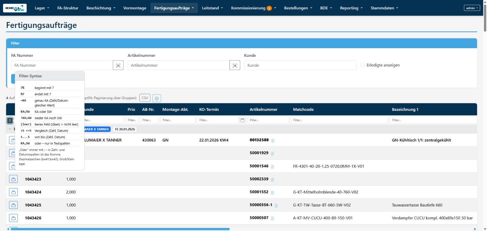
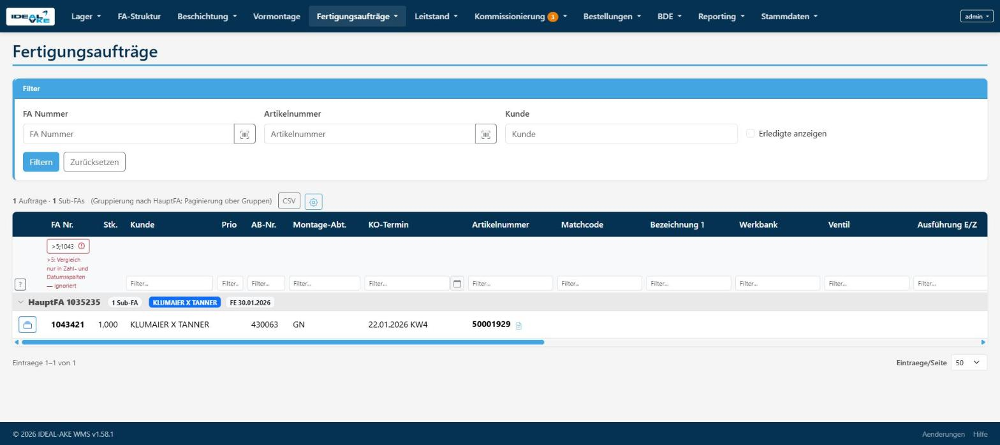
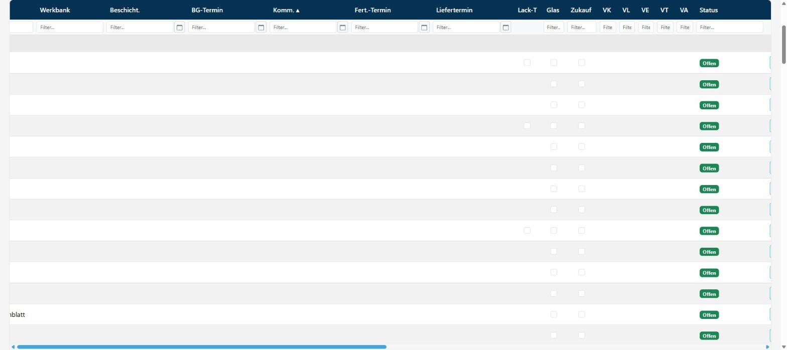
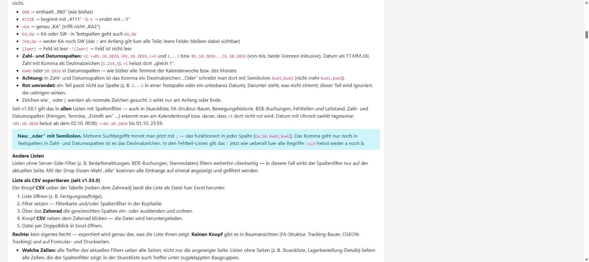

# Browser-Testbericht TS-91 Teil B — 2026-10-13 (Zwischenstand)

**Stand:** Geprüft sind nur die Schritte, die ohne Werte aus der Testdaten-SQL laufen. Geralds
Nachricht enthielt noch die Platzhalter der Vorlage. Es fehlen:

- BdeAktiv und LagerbestellungAktiv
- das Ergebnis A2
- die ganze Testdaten-Tabelle (ID_BOM, ID_BA, STICHTAG_*, BEW_*, BA_*, ARTNR_*, TEXT_PROZENT, HFA_BAUM,
  ANZ_*, ID_EINGEHEND, BDE_BUCHUNGEN)

Ersatzdaten habe ich nicht genommen. Die Verweiszeile in der Spec folgt erst nach dem vollständigen
Lauf.

**Bisher: 7 OK, 0 FEHLER, 3 teilweise nicht prüfbar (B7, B17, B18), 0 Protokoll passt nicht.** Offen:
B2, B8–B16, die Stückliste in B1 und B17 Teil 3. B20 ist nur für die bisher benutzten Ansichten
erledigt.

## Rahmen
- **Benutzer:** `admin`, von Gerald angemeldet. Fußzeile v1.58.1.
- **Anzeige-Einstellungen zu Beginn:**
  - FA-Liste: Bezeichnung 2, Kältemittel und Sage-Status ausgeblendet, Seitengröße 50.
  - Leitstand → Kommissionierung: Kältemittel, Ventil, Ausführung E/Z, Maschine, Sage-Status und
    Übergeordnete Sub-FA ausgeblendet, Seitengröße 50.
  - Lagerplätze: alles sichtbar, Seitengröße 50.
  - Die übrigen Ansichten aus VOR DEM START notiere ich, sobald ich sie für ihre Schritte öffne.
- **Abgelesene Werte (FA-Liste, 4 HauptFA, 130 Zeilen):**
  - FA1 = 1043421, FA2 = 1043386, P = 1043, E = 21
  - M = G-KT-Mittelholmblende-40-760-V02
  - D = 30.01.2026, K = 5
- **Datenlage im Testsystem:**
  - FA-Liste: Prio und Werkbank sind in allen Zeilen leer, und jede Zeile hat einen Kunden.
    Fert.-Termine gibt es nur drei: 29.01., 30.01. und 13.03.2026, also KW5 und KW11.
  - Seitengröße mindestens 25 bei nur 4 Gruppen: Es gibt nur eine Seite.

## Ergebnisse

| Schritt | Ergebnis | Beobachtung | Screenshot |
|---|---|---|---|
| B1 Hilfe-Knopf „?“ | OK (FA-Liste, FA-Struktur) / offen (Stückliste {ID_BOM}) | **FA-Liste:** „?“ steht in der ersten sichtbaren Zelle der Filterzeile. Er ist per Tab erreichbar, hat einen sichtbaren Fokusrahmen (blauer Rahmen, `:focus-visible`) und `aria-label` „Hilfe zur Filtersyntax“. Enter und Leertaste öffnen jeweils das Popover „Filter-Syntax“ mit allen 9 Zeilen in der Reihenfolge des Protokolls. Der Satz darunter stimmt Zeichen für Zeichen mit dem Protokoll überein. Escape schließt, der Fokus bleibt auf „?“. **FA-Struktur:** „?“ in der ersten sichtbaren Zelle vorhanden. **Stückliste:** ID_BOM fehlt. Zur Orientierung, nicht als Ersatz: In `/Picking/Bom/24` steht „?“ ebenfalls in der ersten Zelle. | ja, [[B1-popover-fa-liste.jpg]] |
| B3 FA-Liste Textspalten | OK (Seitenwechsel nicht prüfbar) | Ohne Filter 130 Zeilen. **a)** `1043%`: 127, alle beginnen mit 1043. **b)** `%21`: 1, nur 1043421. **c)** `=1043421`: 1. **d)** `1043421;1043386`: genau diese 2. **e)** `!1043421;1043386`: 128, beide fehlen. **Kunde:** `(leer)` 0 Zeilen (es gibt keine ohne Kunde), `!(leer)` 130. **Matchcode:** `=` in Groß- und in Kleinschreibung, je 1 Treffer (1043424). Mit Enter in der Filterzelle steht in der Adresse `?colf_order-number=1043%`. Kein Feld wird rot. Einen Seitenwechsel gibt es nicht: nur eine Seite (siehe Datenlage). | nein |
| B4 FA-Liste Datumsspalten | OK | `>=30.01.2026`: 109, nur 30.01. und 13.03. `<30.01.2026`: 21, nur 29.01. `30.01.2026...01.03.2026`: 39. `=30.01.2026` und `30.01.2026` je 39, nur 30.01. `kw5`: 60. `kw5;kw11`: 130, beide Wochen. Statt kw6 habe ich KW11 genommen, weil KW6 keine Termine hat. `kw5,kw11`: 0 Treffer, nicht rot. `01.2026`: 60. Der Kalenderknopf in Fert.-Termin, Tag 13.10. gewählt, setzt `colf_production-date=13.10.2026` und filtert (0 Treffer). **KO-Termin:** `(leer)` 0, `!(leer)` 130. Kein Feld wird rot. | nein |
| B5 Prio | OK (`>abc`) / NICHT PRÜFBAR (Werte-Teil) | Prio ist in allen Zeilen leer. `>abc`: Feld rot, darunter genau „>abc: Zahl nicht lesbar — ignoriert“, die Liste bleibt ungefiltert (130). `=1,0`: nicht rot. | nein |
| B6 ungültig bleibt rot | OK | **Teil 1:** Artikelnummer `1...5`: Feld rot, „1...5: Bereich nur in Zahl- und Datumsspalten — ignoriert“, die Liste bleibt ungefiltert (130). **Teil 2:** Nach F5 (Ladeart `reload`) ist das Feld weiter rot, mit demselben Text. **Teil 3:** FA Nr. `>5;1043421`: rot, „>5: Vergleich nur in Zahl- und Datumsspalten — ignoriert“; gefiltert ist trotzdem nur 1043421 (1 Zeile). | ja, [[B6-rot-vergleich-in-textspalte.jpg]] |
| B7 Leitstand | OK (Teil 1 „nicht rot“, Teil 2, Teil 4) / NICHT PRÜFBAR (Termin-Treffer in Teil 1, Teil 3) | **Teil 1:** Im Leitstand sind Fert.-Termin, Komm., BG-Termin und alle übrigen Terminspalten bei allen 130 Zeilen leer. `(leer)` ergibt 130, `!(leer)` 0. `>=30.01.2026`, `30.01.2026...01.03.2026` und `kw5`: kein Feld rot, aber 0 Treffer. **Teil 2:** Matchcode `%V02`: 44 Zeilen, alle enden mit V02. **Teil 3:** VK ist überall leer: `!(leer)` 0, `=fertig` 0. **Teil 4:** Die Spalte Kunde ist in allen Zeilen leer angezeigt. Der Filter `KLUMAIER X TANNER;NORDCAP` liefert die Gruppen 1035235, 1039413 und 1043153; das passt zu den Kunden in der FA-Liste. `(leer)` ergibt 0, `!(leer)` 130. Nichts freigegeben, keine Häkchen gesetzt. | ja, [[B7-leitstand-terminspalten-leer.jpg]] |
| B17 Komma-Regel | NICHT PRÜFBAR (Teil 1) / OK (Teil 2) / offen (Teil 3) | Teil 1: Werkbank ist überall leer. Teil 2: Artikelnummer `!5000`: 4 Zeilen (80132588, 80133096, 80134572, 31001354), keine mit 5000. Teil 3 braucht ID_BA. | nein |
| B18 Stichprobe | a) OK / b) NICHT PRÜFBAR / c), d) NICHT PRÜFBAR | **a) Lagerplätze (178):** Kapazität ist überall leer, alle Einträge wurden am 11.08.2026 erstellt. `<01.01.2026` und `>0`: 0 Treffer, nicht rot. Gegenprobe: `>=11.08.2026` 178, `<11.08.2026` 0. **b)** Keine Lagerbestellungen: „meine Listen“: „Noch keine Listen erfasst.“, „Lager: Eingehende Listen“: keine. **c), d)** FA-Abarbeitungsliste und FA-Vervollständigen stehen für `admin` nicht im Menü. | nein |
| B19 Hilfeseite | OK | Karte „Listen-Pagination & Filter (seit v1.14.0)“ mit dem Eintrag „Filter-Syntax (seit v1.58.0)“ und der Syntax-Liste. Der Satz „Seit v1.58.1 gilt das in allen Listen mit Spaltenfilter“ ist vorhanden. Blauer Kasten „Neu: „oder“ mit Semikolon.“ mit dem Satz zu den Fehlteil-Listen („!a;b heisst weder a noch b“). | ja, [[B19-hilfe-info-kasten.jpg]] |
| B20 Wiederherstellen | OK (bisherige Ansichten) | An keiner Ansicht habe ich Spaltenauswahl oder Seitengröße geändert. FA-Liste danach unverändert: 3 Spalten ausgeblendet, 50. FA-Liste, Leitstand und Lagerplätze laden ohne Filter. | nein |

## Beobachtungen (keine FEHLER)
- **Leitstand:** Kunde und alle Terminspalten sind in jeder Zeile leer, die FA-Liste zeigt für
  dieselben Aufträge aber Kunde und Termine. Der Kundenfilter wirkt trotzdem; die Terminfilter finden
  nichts. Ob das so gewollt ist, kann ich nicht beurteilen. Für B7 heißt es: Ob Termin-Treffer
  erscheinen, lässt sich hier nicht zeigen.
- **Daten für Teil B fehlen:** Für Prio, Werkbank, VK und Kapazität gibt es im Testsystem keine
  Werte. Die Werte-Teile von B5, B7, B17 und B18 brauchen dafür Testdaten.
- **Hilfeseite:** Der Satz „Seit v1.58.1 … auch in … BDE-Buchungen“ und der Absatz „Andere Listen“
  darunter („Listen ohne Server-Side-Filter (z. B. Bedarfsmeldungen, BDE-Buchungen, Stammdaten)
  filtern weiterhin clientseitig“) nennen beide die BDE-Buchungen. Das ist nicht zwingend ein
  Widerspruch, sollte aber gegengelesen werden.

## Hinweise zur Durchführung
- **Hintergrund-Tab:** Der Chrome-Tab lief im Hintergrund (`visibilityState = hidden`).
  - Den ersten Tab-Tastendruck in B1 musste ich wiederholen; der zweite kam an.
  - Den Fokus habe ich vorher per Skript auf das Element vor „?“ gesetzt (Zahnrad „Spalten
    konfigurieren“).
  - Enter, Leertaste, Escape und F5 waren echte Tastendrücke.
- **Filter:** Das erste Filtern (B3 a) lief per Enter-Ereignis in der Filterzelle. Danach habe ich
  die Filter in derselben Form direkt über die Adresse gesetzt (`colf_<spalte>=…`).
- **Trefferlisten:** Für B3, B4, B7, B17 und B18 habe ich die gefilterten Seiten zusätzlich per
  Skript abgerufen und Zeile für Zeile ausgewertet.
- **Rote Markierung:** Rotmarkierung und Hinweistexte habe ich jeweils auf der echten Seite im Tab
  geprüft.
- **Hinweistexte:** Sie wurden als Zeichencodes ausgelesen, weil die Browser-Steuerung Text mit `;`
  teilweise ausblendet. Gedankenstrich = U+2014.

## Bilder

